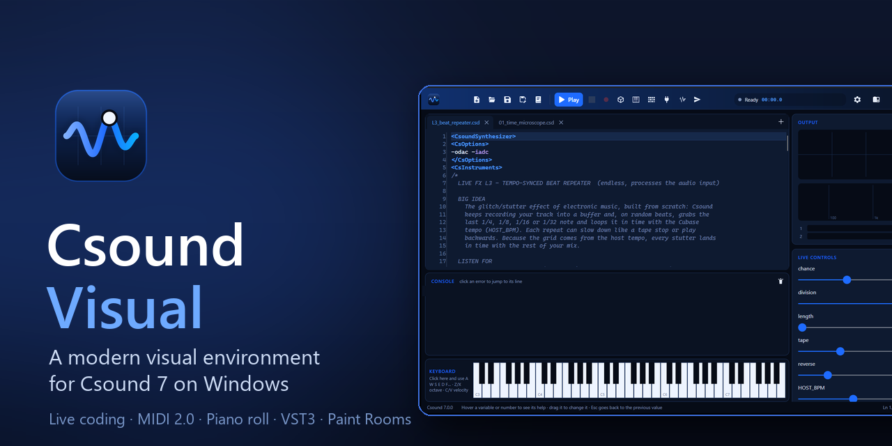
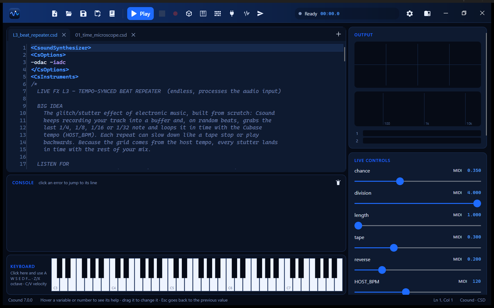
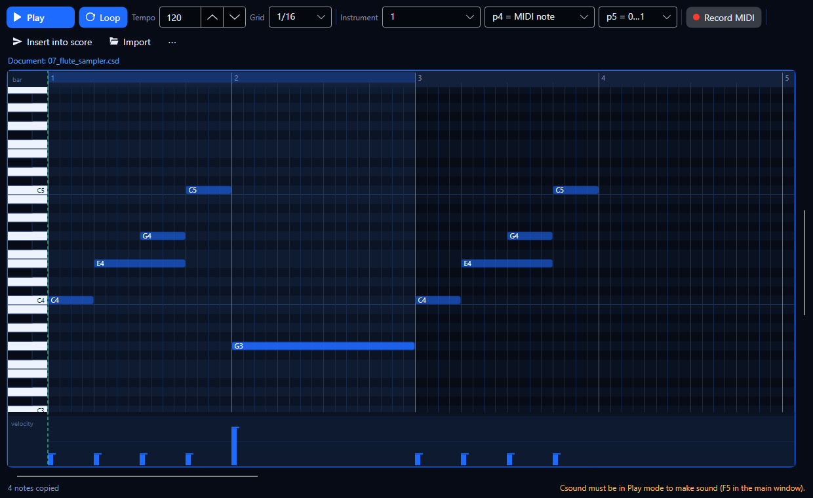
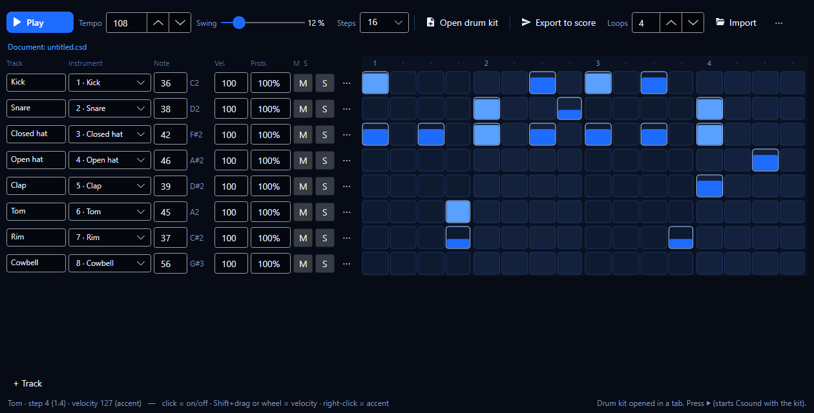
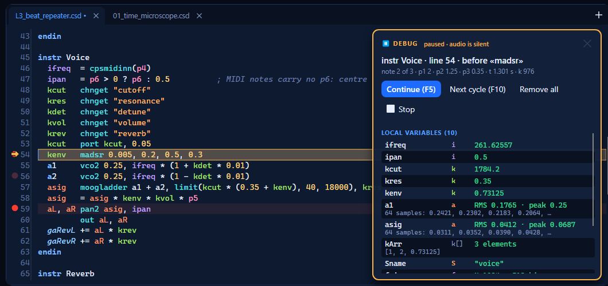
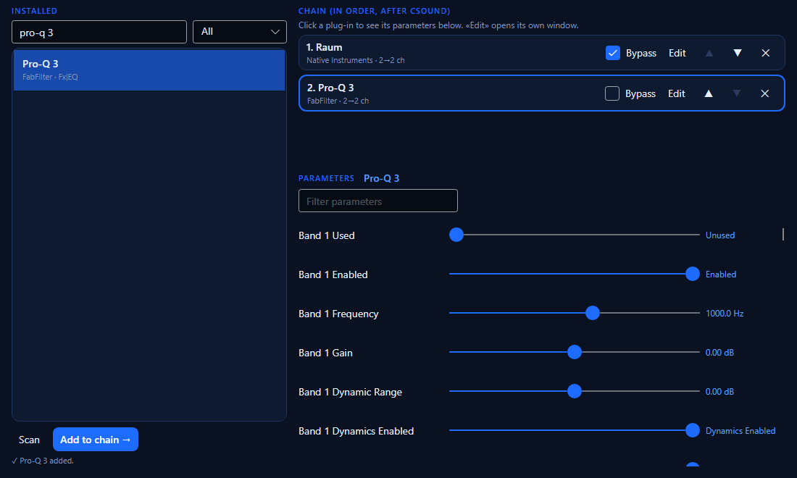
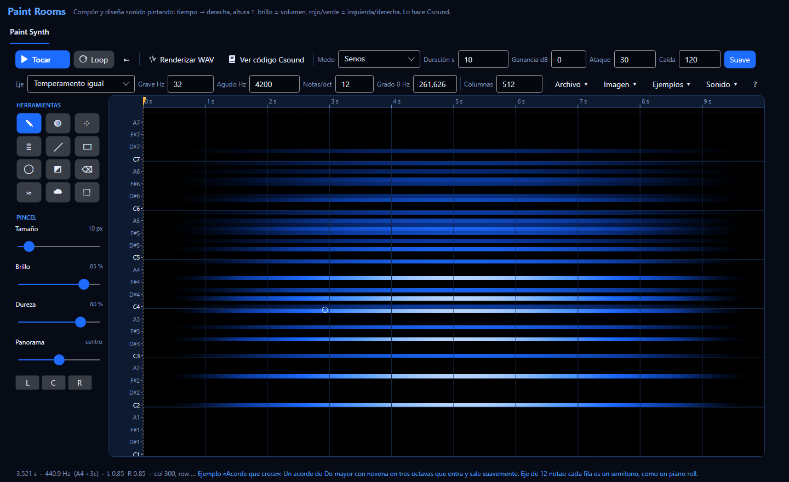
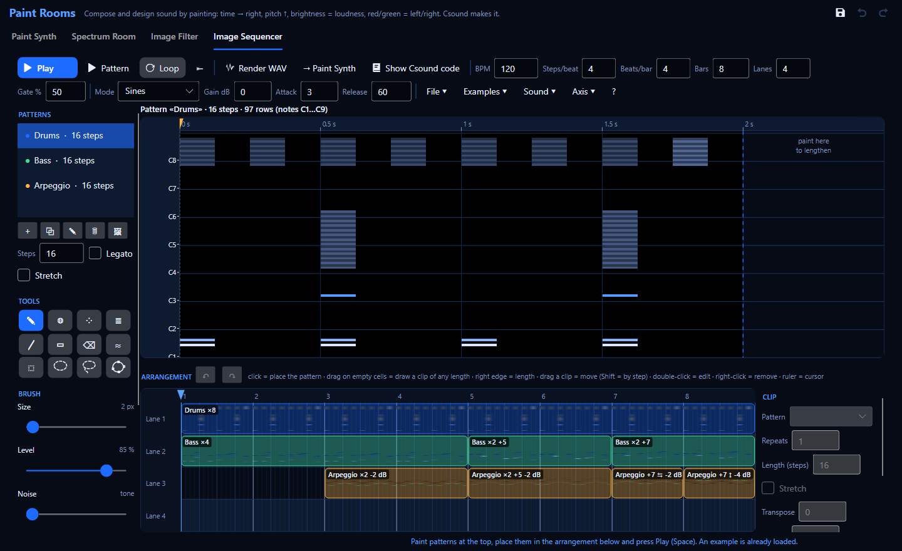
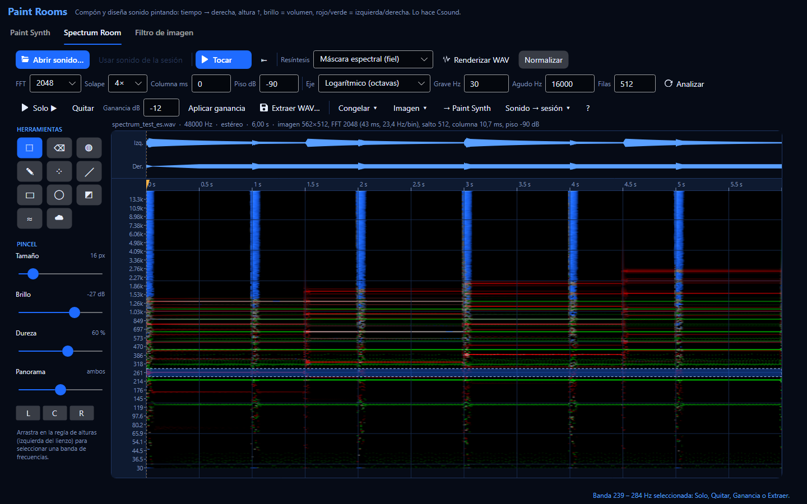
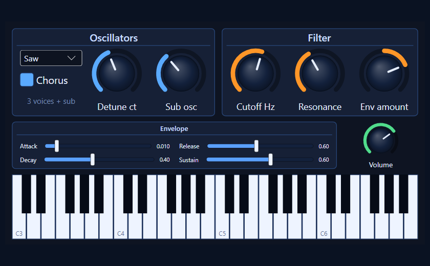

# Csound Visual

**Un entorno visual moderno para [Csound 7](https://csound.com) en Windows**: escribe orquestas con
un editor inteligente, escúchalas y míralas en tiempo real, tócalas con MIDI, secuéncialas con un
piano roll y un secuenciador por pasos, pasa el sonido por tus plugins VST3 y manda el mismo código
a Cubase como plugin VST3.

> **Hecho 100% con vibe coding.** Cada línea de código, cada prueba y cada página de documentación
> de Csound Visual la escribió una IA ([Claude Code](https://claude.com/claude-code), de
> Anthropic) a partir de conversaciones en lenguaje natural. Su autor dirigió el proyecto, lo
> probó y decidió qué construir, pero no escribió el código a mano.

*[Read in English](README.md)*

## Lo principal

* **Un editor que entiende Csound**: colores de sintaxis, autocompletado de los más de 1400 opcodes,
  ayuda al pasar el mouse (F1), todas las apariciones de la palabra elegida resaltadas y los errores
  marcados en su línea.
* **Live coding**: Ctrl+Enter recompila el instrumento bajo el cursor mientras suena; aparecen
  sliders solos para cada `chnget`/`chnk`; arrastrar un número en el código lo cambia.
* **Valores en vivo y breakpoints**: mira las variables mientras suena, obsérvalas en un panel, o
  detente en una línea (F9) y avanza ciclo a ciclo (F10) con todas las variables a la vista.
* **Motor de audio propio de baja latencia**: WASAPI compartido o exclusivo (≈3 ms medidos),
  entrada de audio en vivo con corrección de deriva de reloj, medidores de carga DSP y RAM,
  grabación a WAV.
* **MIDI 1.0 y MIDI 2.0** (Windows MIDI Services), MIDI learn en cualquier slider, teclado en pantalla.
* **Herramientas musicales**: piano roll (dibujar, grabar MIDI, insertar en la partitura) y
  secuenciador por pasos con swing, probabilidad, relleno euclidiano y un kit de batería
  sintetizado; ambos programados sobre el reloj de Csound.
* **Paint Rooms**: compón y diseña sonido pintando: lienzo tiempo × altura, pincel armónico,
  afinaciones Scala e imágenes importadas, tocado en vivo por Csound o renderizado a WAV
  (Ctrl+Shift+I). Un **Image Sequencer** convierte patrones pintados en frases y loops; las
  imágenes de 16 bits y RGBA pintan ruido por píxel (azul) y máscaras (alfa).
* **Host VST3**: tus efectos e instrumentos VST3 después de Csound, con sus propias ventanas y la
  cadena guardada; un administrador desactiva los plugins que se caen, como en Cubase.
* **Csound dentro de tu DAW**: un plugin VST3 (instrumento y efecto) que corre cualquier orquesta;
  *Enviar al DAW* manda el código del editor a Cubase y deja los sliders de la app vinculados.
* **Compatible con Cabbage**: las secciones `<Cabbage>` se dibujan como perillas, sliders, pads XY,
  botones y teclados.
* **Ableton Link**: comparte tempo y fase con Live, Bitwig y apps del celular.
* **Vistas 3D por GPU**: espectrograma en cascada, pad XYZ, panorámica espacial binaural.
* **Más de 1500 ejemplos**: todo el manual de Csound más galerías de piezas de muestra,
  procesamiento de audio (estirar el tiempo, congelamiento espectral, vocoder, convolución,
  granular…) e instrumentos Cabbage.
* Interfaz y documentación **en español e inglés**, cinco temas de color.

| | |
|---|---|
|  |  |
|  |  |

| | |
|---|---|
|  |  |

## Descargar y usar

1. Descarga `CsoundVisual-<versión>-win-x64.zip` desde la página de [Releases](../../releases).
2. Descomprímelo donde quieras y abre `CsoundVisual.exe`. No hay que instalar nada más: el paquete
   trae el runtime de .NET y Csound 7.
3. Aprieta **Play** (F5). Abre **Examples** (Ctrl+E) para explorar.

El programa no está firmado digitalmente, así que la primera vez Windows SmartScreen puede decir
*«Windows protegió su PC»*: haz clic en **Más información › Ejecutar de todas formas**.

**Requisitos:** Windows 11 x64, versión 24H2 o posterior; una tarjeta de video con Direct3D 11 para
las vistas 3D. Los dispositivos MIDI 2.0 necesitan [Windows MIDI Services](https://aka.ms/midi)
(MIDI 1.0 funciona sin eso).

Para usar Csound dentro de Cubase, copia la carpeta `VST3 plug-in\CsoundVisual.vst3` del paquete a
`%LOCALAPPDATA%\Programs\Common\VST3` y vuelve a examinar los plugins.

## Documentación

Toda la documentación está en español en [docs/es](docs/es/index.md) (y en inglés en
[docs/en](docs/en/index.md)); también en HTML en [docs/html](docs/html/index.html) y en la carpeta
`Docs` del paquete. Empieza por la [guía de usuario](docs/es/guia-de-usuario.md); para pintar
sonido, la guía paso a paso de [Paint Rooms](docs/es/salas-de-pintura.md).

## Compilar desde el código

Ver **[BUILDING.md](BUILDING.md)** (en inglés): SDK de .NET 10, una instalación de Csound 7 y, para
las partes nativas opcionales (host VST3, plugin VST3, Ableton Link), Visual Studio 2022 con C++ y CMake.

## Estado

Csound Visual es un proyecto joven (versión 0.1). Se desarrolló y probó en un PC con Windows 11,
una Steinberg UR22mkII, un teclado Impact LX61+ y Cubase 15. Los reportes de errores y las ideas
son bienvenidos en [Issues](../../issues).

## Licencia

Csound Visual es software libre: puedes redistribuirlo y modificarlo bajo los términos de la
**Licencia Pública General de GNU versión 3** o (a tu elección) cualquier versión posterior: ver
[LICENSE](LICENSE).

Se apoya en Csound (LGPL-2.1), Avalonia, el VST 3 SDK de Steinberg (MIT), Ableton Link (GPL-2.0+) y
otros componentes de código abierto; los ejemplos del manual de Csound están bajo GFDL-1.2+.
Detalles y marcas: **[THIRD-PARTY-NOTICES.md](THIRD-PARTY-NOTICES.md)**.

VST es una marca registrada de Steinberg Media Technologies GmbH. Csound Visual es un proyecto
independiente, sin relación con los desarrolladores de Csound, Steinberg, Ableton ni Cabbage.
