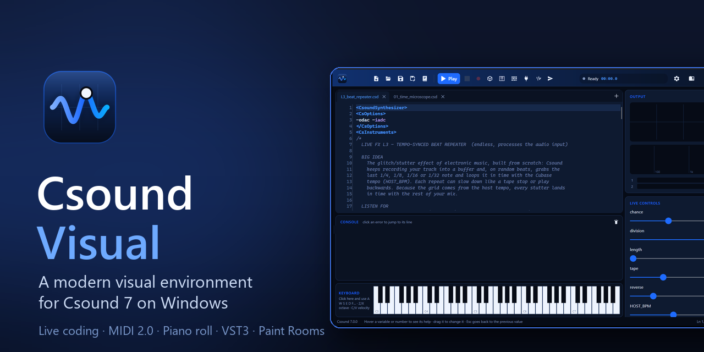
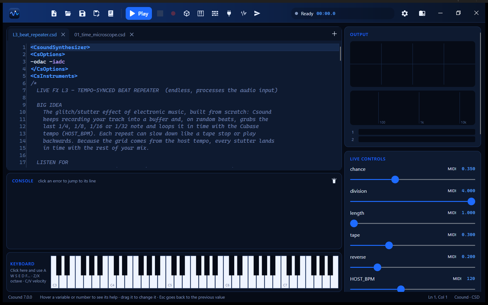
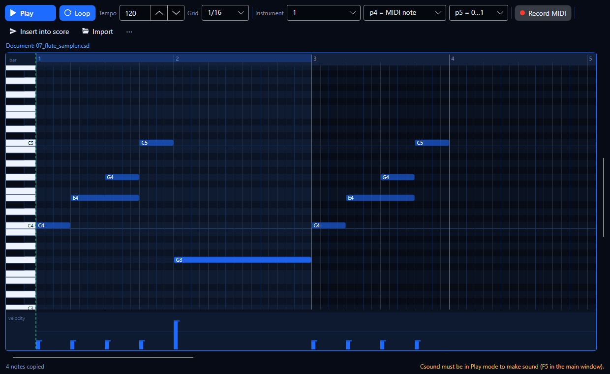
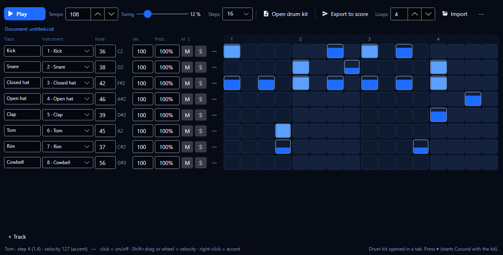
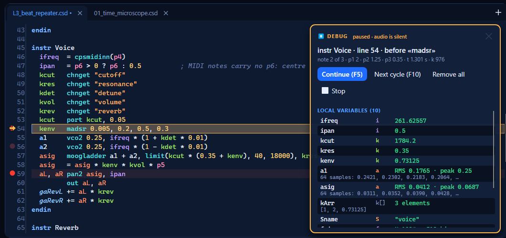
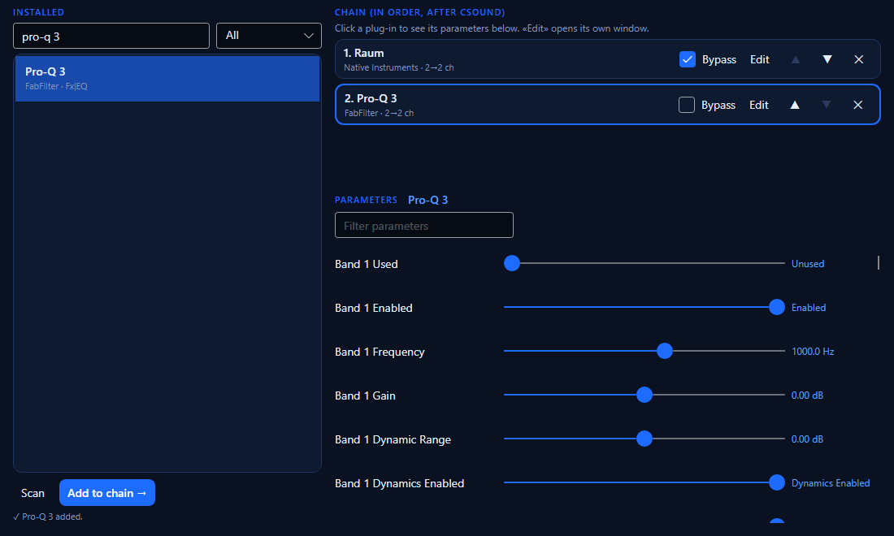
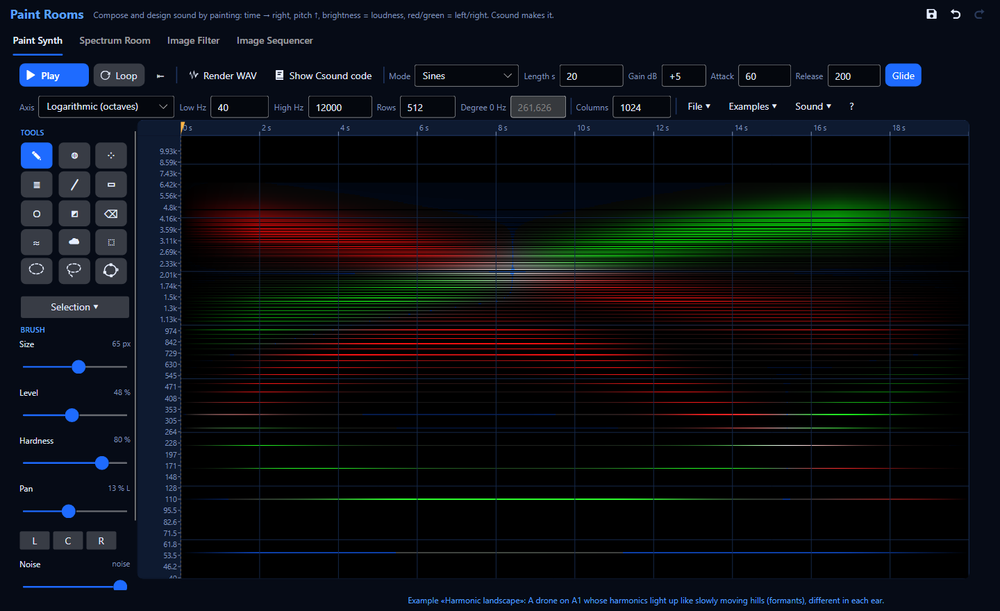
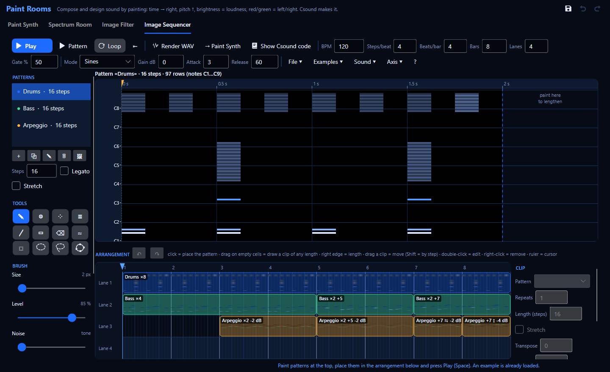
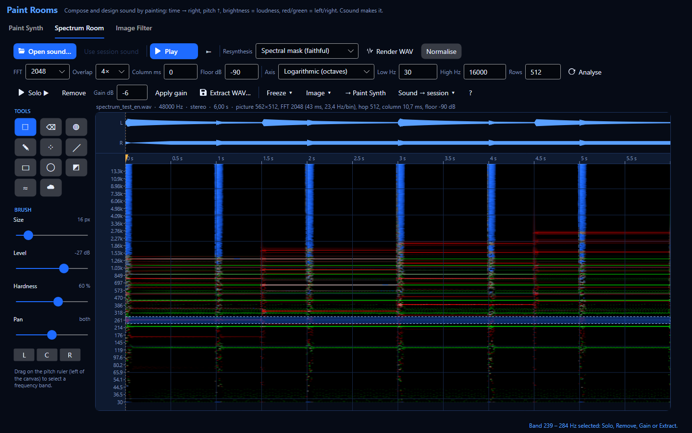
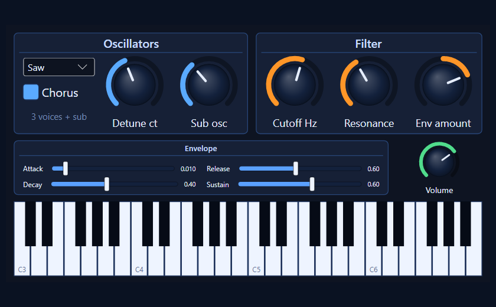

# Csound Visual

**A modern visual environment for [Csound 7](https://csound.com) on Windows** — write orchestras
with a smart editor, hear and see them in real time, play them with MIDI, sequence them with a
piano roll and a step sequencer, run your VST3 plug-ins after Csound, and send the same code into
Cubase as a VST3 plug-in.

*[Leer en español](README.es.md)*

## Highlights

* **Editor that understands Csound** — syntax colours, autocompletion of the 1,400+ opcodes, help on
  hover (F1), every occurrence of the selected word highlighted, errors marked on their line.
* **Live coding** — Ctrl+Enter recompiles the instrument under the cursor while it plays; channel
  sliders appear automatically for every `chnget`/`chnk`; drag a number in the code to change it.
* **Live values and breakpoints** — see variables while the sound plays, watch them in a panel, or
  stop on a line (F9) and step through k-cycles (F10) with all local variables shown.
* **Own low-latency audio engine** — WASAPI shared or exclusive (≈3 ms measured), live audio input
  with clock-drift correction, DSP-load and RAM meters, recording to WAV.
* **MIDI 1.0 and MIDI 2.0** (Windows MIDI Services), MIDI learn on any slider, on-screen keyboard.
* **Music tools** — piano roll (draw, record MIDI, insert into the score) and a step sequencer with
  swing, probability, Euclidean fills and a synthesised drum kit; both scheduled on Csound's own clock.
* **Paint Rooms** — compose and design sound by painting: time × pitch canvas, harmonics brush,
  Scala tunings and imported pictures, played live by Csound or rendered to WAV (Ctrl+Shift+I).
  An **Image Sequencer** turns painted patterns into phrases and loops; 16-bit and RGBA pictures
  paint noise per pixel (blue) and masks (alpha).
* **VST3 host** — put your VST3 effects and instruments after Csound, open their own windows, save
  the chain; a plug-in manager switches off plug-ins that crash, like Cubase does.
* **Csound inside your DAW** — a VST3 instrument/effect plug-in that runs any orchestra; *Send to DAW*
  sends the code from the editor to Cubase and keeps the app's sliders linked to it.
* **Cabbage compatibility** — `<Cabbage>` sections are drawn as knobs, sliders, XY pads, buttons and
  keyboards.
* **Ableton Link** — share tempo and phase with Live, Bitwig and phone apps.
* **3D views on the GPU** — waterfall spectrogram, XYZ pad, binaural spatial panner.
* **1,500+ examples** — the whole Csound manual plus galleries of showcase pieces, audio processing
  (time-stretch, spectral freeze, vocoder, convolution, granular…) and Cabbage instruments.
* **English and Spanish** interface and documentation, five colour themes.

| | |
|---|---|
|  |  |
|  |  |

| | |
|---|---|
|  |  |

## Download and run

1. Download `CsoundVisual-<version>-win-x64.zip` from the [Releases](../../releases) page.
2. Unzip it anywhere and run `CsoundVisual.exe`. Nothing else to install: the package carries the
   .NET runtime and Csound 7.
3. Press **Play** (F5). Open **Examples** (Ctrl+E) to explore.

The program is not code-signed, so Windows SmartScreen may show *"Windows protected your PC"* the
first time: click **More info › Run anyway**.

**Requirements:** Windows 11 x64, version 24H2 or later; a GPU with Direct3D 11 for the 3D views.
MIDI 2.0 devices need [Windows MIDI Services](https://aka.ms/midi) (MIDI 1.0 works without it).

To use Csound inside Cubase, copy the `VST3 plug-in\CsoundVisual.vst3` folder from the package to
`%LOCALAPPDATA%\Programs\Common\VST3` and rescan plug-ins.

## Documentation

| | English | Español |
|---|---|---|
| User guide | [user-guide](docs/en/user-guide.md) | [guía de usuario](docs/es/guia-de-usuario.md) |
| Editor, live values, breakpoints | [editor-intelligence](docs/en/editor-intelligence.md) | [inteligencia-del-editor](docs/es/inteligencia-del-editor.md) |
| Audio engine | [audio-engine](docs/en/audio-engine.md) | [motor-de-audio](docs/es/motor-de-audio.md) |
| MIDI | [midi](docs/en/midi.md) | [midi](docs/es/midi.md) |
| Piano roll and step sequencer | [music-tools](docs/en/music-tools.md) | [herramientas-musicales](docs/es/herramientas-musicales.md) |
| Paint Rooms (painting sound, spectral editing, image filter) | [paint-rooms](docs/en/paint-rooms.md) | [salas-de-pintura](docs/es/salas-de-pintura.md) |
| VST3 host | [vst3-host](docs/en/vst3-host.md) | [host-vst3](docs/es/host-vst3.md) |
| Csound inside Cubase | [vst3-cubase](docs/en/vst3-cubase.md) | [vst3-cubase](docs/es/vst3-cubase.md) |
| Cabbage | [cabbage](docs/en/cabbage.md) | [cabbage](docs/es/cabbage.md) |
| Ableton Link | [ableton-link](docs/en/ableton-link.md) | [ableton-link](docs/es/ableton-link.md) |
| 3D views | [visual-3d](docs/en/visual-3d.md) | [visual-3d](docs/es/visual-3d.md) |
| Architecture | [architecture](docs/en/architecture.md) | [arquitectura](docs/es/arquitectura.md) |
| Roadmap | [roadmap](docs/en/roadmap.md) | [hoja de ruta](docs/es/hoja-de-ruta.md) |

The same pages are in HTML in [docs/html](docs/html/index.html) (and in the `Docs` folder of the release).

## Building from source

See **[BUILDING.md](BUILDING.md)**: .NET 10 SDK, a Csound 7 installation, and — for the optional
native parts (VST3 host, VST3 plug-in, Ableton Link) — Visual Studio 2022 with C++ and CMake.

## Status

Csound Visual is a young project (version 0.1). It has been developed and tested on one Windows 11
PC with a Steinberg UR22mkII, an Impact LX61+ keyboard and Cubase 15. Bug reports and ideas are
welcome in the [Issues](../../issues).

## Licence

Csound Visual is free software: you can redistribute it and/or modify it under the terms of the
**GNU General Public License version 3** or (at your option) any later version — see [LICENSE](LICENSE).

It builds on Csound (LGPL-2.1), Avalonia, the Steinberg VST 3 SDK (MIT), Ableton Link (GPL-2.0+) and
other open-source components; the examples from the Csound manual are under the GFDL-1.2+. Details
and trademarks: **[THIRD-PARTY-NOTICES.md](THIRD-PARTY-NOTICES.md)**.

VST is a registered trademark of Steinberg Media Technologies GmbH. Csound Visual is an independent
project, not affiliated with the Csound developers, Steinberg, Ableton or Cabbage.
