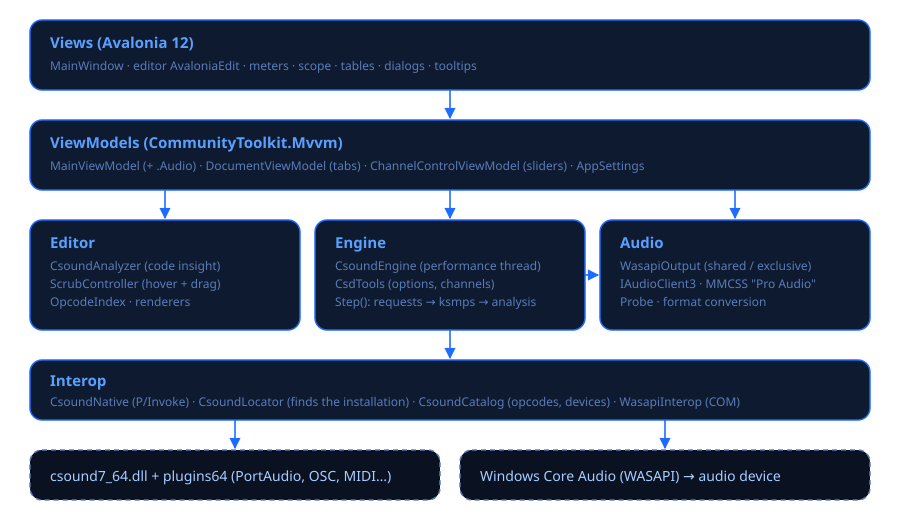
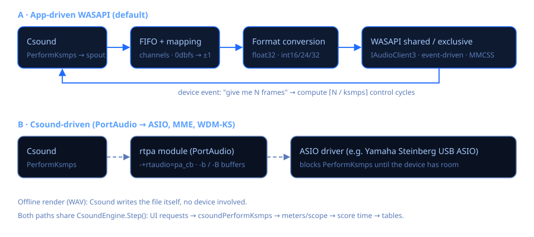
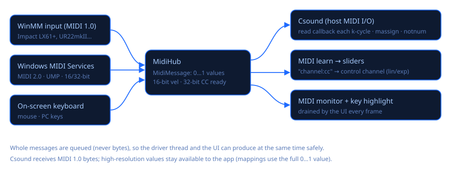
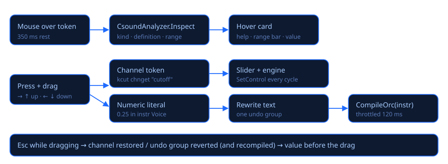

# Architecture

Csound Visual is a C# (.NET 10) desktop application built with Avalonia 12, AvaloniaEdit and
CommunityToolkit.Mvvm. It hosts the native Csound 7 library (`csound7_64.dll`, 64-bit doubles)
through P/Invoke. Windows only.



## Repository layout

```
CSound Visual.code-workspace   VS Code workspace (two folders + Csound tasks)
.vscode/                       Folder settings (dark yellow theme), build/run tasks
@Source/Csound7/               Binary Csound 7.0 installation (DLL, headers, plugins, examples) — not modified
src/CsoundVisual.slnx          Solution
src/CsoundVisual/
  Program.cs, App.axaml(.cs)   Entry point (+ --audio-probe / --audio-test), theme, main window
  Audio/                       Own WASAPI output: WasapiOutput (shared/exclusive), WasapiInterop (COM)
  Interop/                     CsoundNative (P/Invoke), CsoundLocator, CsoundCatalog (opcodes, devices)
  Engine/                      CsoundEngine (performance thread), LiveValueMonitor, WavRecorder, CsdTools
  Midi/                        MidiMessage (high-res), WinMmMidiInput, MidiHub
  Music/                       Stage 4 tools: TransportScheduler (look-ahead, score clock), PianoRollModel, StepPattern, ScoreBlocks, PFields
  Editor/                      CsoundAnalyzer, ScrubController, CompletionProvider, OpcodeIndex, renderers, Csound.xshd
  Controls/                    LevelMeter, Oscilloscope, SpectrumView, TableView, Sparkline, RangeIndicator, PianoKeyboard
  ViewModels/                  MainViewModel (+ .Audio, .Live, .Midi, .LiveCoding), DocumentViewModel, ChannelControlViewModel, AppSettings
  Views/                       MainWindow, ConfirmSaveDialog, InfoDialog
  Styles/Theme.axaml           Theme, icons, style classes, tooltips
  Assets/                      Demo.csd, app.ico, app.png
docs/                          en/, es/, diagrams/, html/ (generated)
tools/                         build_docs.py (HTML docs), make_icon.py (app icon)
```

## Layers and responsibilities

* **Interop** binds the native library. `CsoundLocator` finds the installation
  (`CSOUND_VISUAL_HOME`, an `@Source\Csound7` folder above the executable, or
  `%ProgramFiles%\Csound7`). `CsoundNative` declares the API subset in use: core,
  host audio/MIDI I/O and the debugger. `CsoundCatalog` uses short-lived instances to list opcodes
  and Csound's audio modules/devices.
* **Audio** is the app's own low-latency output. See [Audio engine & latency](audio-engine.md).
* **Engine** owns a performance: one `CSOUND*` per run on a dedicated thread. It also holds the
  live-value monitor (debugger callback), the live recorder and the MIDI bridge.
* **Midi** collects MIDI from ports and the on-screen keyboard in a protocol-neutral,
  high-resolution message type, and feeds Csound, the UI and MIDI learn.
* **Editor** is the code-intelligence layer (analysis, hover/drag, completion, highlighting).
* **ViewModels** hold the state and commands and never reference Avalonia controls; the window
  provides pickers, dialogs and caret movement through delegates and events.

## The performance thread

1. Optionally open the WASAPI device (its rate becomes `--sample-rate`) and register the thread
   with MMCSS *Pro Audio*.
2. `csoundCreate` → message callback → `csoundSetHostAudioIO` / `csoundSetHostMIDIIO` with the
   MIDI read callback → `csoundSetOption` → `csoundCompileCSD` (text) → debugger + live callback
   → `csoundStart`.
3. Loop. Each control cycle runs `Step()`: apply UI requests (channels, events, timed tool events whose p2 is computed here from their absolute score time, live recompiles),
   `csoundPerformKsmps`, meters and scope, recorder, score time, tables. With the app's output
   the loop is driven by the device event and measures DSP load and dropouts.
4. Fade out, detach the debugger, `csoundDestroy`, raise `Finished`.

The UI never calls Csound. It enqueues requests into concurrent collections and reads
snapshots every frame: meters, scope, messages, immutable live-value dictionaries and the MIDI
queue.



## Music tools

The piano roll and the step sequencer (`Music/`, `Views/PianoRollWindow.cs`, `Views/StepSequencerWindow.cs`) share a `TransportScheduler` thread that reads Csound's score time and queues notes 120 ms ahead through `CsoundEngine.SendEventAt`; the performance thread converts each absolute time into the `i` statement's p2 just before the control cycle. Patterns reach the scheduler as immutable snapshots. See [Music tools](music-tools.md).

## Paint Rooms

`Paint/` holds the foundation shared by the Paint Rooms tabs (`Views/PaintRoomsWindow.cs`; one
class per room implementing `IPaintRoom`): `SpectralImage` (time columns × pitch rows, two float
layers L/R, column-major), `PitchAxis`/`ScalaScale`, `PaintSession` (image, bounded undo history,
synthesis settings, clipboards; kept in `MainViewModel.PaintSession`), `BrushEngine`, `ImageOps`
(operation registry), `ImageCodec` (SkiaSharp), `Stft`, `WavIO`. Sound: `PaintTables` converts the
image into Csound table data and `PaintCsoundCode` writes the instrument (`instr 9301`: per
control period it slices the current columns out of the image tables with `ftslice`, smooths them
with array arithmetic and drives `adsynt2` oscillator banks). `PaintLivePlayer` plays through the
app's engine with `CsoundEngine.InvokeOnCsoundThread` — a pipeline of short actions, one per
control cycle, that compiles the code, creates a fresh table set, copies the data straight into
table memory (`csoundGetTable`) and starts a held note with a fractional instrument number; edits
are re-uploaded column by column. When Csound is stopped `MainViewModel` (as `IPaintEngineHost`)
starts a small host orchestra that already contains the instrument. `PaintRenderer` writes a
standalone `.csd` with its tables as data files (GEN01/GEN23) and renders it on a private engine
instance. See [Paint Rooms](paint-rooms.md).

**Selections** (`Paint/SelectionMask.cs`): `PaintSession.Selection` is an immutable `SelectionMask` —
a bounding `CellRect` plus a per-cell coverage 0…1 (null array = plain rectangle). Ellipse, lasso
(polygon, non-zero winding) and spline (centripetal Catmull-Rom sampled into a polygon) are
rasterised with exact horizontal and 4× vertical coverage; masks combine (add = max, subtract =
a·(1−b)), feather (3-pass box blur) and trace their 0.5 contour for the marching ants. Everything
that uses the selection works on `Region` (= the bounds) and blends the result by the coverage
(`PaintSession.Apply`, copy/paste/move, `BrushEngine.Gradient`, `SpectralMask.BuildGains` solo,
the Spectrum Room's additive solo and freeze), so `ImageOps` implementations stay shape-agnostic.
The canvas (`PaintCanvas`) owns the four selection tools; `PaintSelectionUi` builds their shared
palette entries and options. Players cancel a stopped play by number (`stoppedGeneration`), so a
Play→Stop during the staged upload never leaves a held note.

**Image Filter** (`Views/ImageFilterRoom.cs`, `Paint/ImageFilter*.cs`): the room keeps its own
`PaintSession` (own canvas/undo/axis) per shared session. `ImageFilterTables` maps the picture's rows
onto FFT bins (max over covered rows / interpolation between rows) and stores one gain per bin and
column; `instr 9351` (tables 33500…) slices the current column per control period, blends and
smooths it with array arithmetic and applies it with `pvsanal` → `pvsmaska` → `pvsynth` per channel
(source: `diskin2` on a stereo temp copy of the WAV, or `inch 1/2`). Latency N + 2·hop is
compensated in renders and on the dry path. `ImageFilterPlayer` reuses the staged-upload pattern of
`PaintLivePlayer` on the same «Paint Rooms host».

**Spectrum Room** (`Views/SpectrumRoom.cs`): also a private `PaintSession`; each analysed picture is
linked to its `SpectrumAnalysis` (sound, settings, untouched original) through a
`ConditionalWeakTable`, so undo across re-analyses stays consistent. `SpectralAnalysis` runs a
streaming STFT (no frame storage) in parallel blocks of columns, places each bin's power on the rows
around its phase-vocoder true frequency (edge rows collect what lies beyond the axis) and stores dB
levels. `SpectralMask` turns edited ÷ original into per-cell gains and applies them by STFT → gain →
ISTFT (WOLA, exact identity when unedited; all-unity frames skip the FFT). Preview: the mask result
is rendered in C# to a temporary stereo WAV and played by `SoundPreviewPlayer` (`instr 9311`,
`diskin2`, compiled into the running performance; same host-orchestra pattern as `PaintLivePlayer`).
The additive path converts levels to Paint Synth levels and uses `PaintLivePlayer`/`PaintRenderer`.
Non-WAV files are decoded by `SoundFileLoader` with two `csound.exe` runs (info, then `diskin2` at the
file's own rate).

**Noise layer and 16-bit pictures**: `SpectralImage.Noise` is an optional third float layer (per-cell
noisiness 0 = tone … 1 = noise band, `null` until used) carried by `ImageHistory` region entries, the
`PaintSession` snapshot / mask blend / clipboard / move, `ImageOps` geometry operations, the brushes
(`BrushSettings.Noise` / `NoiseOnly`) and `Retuned`. In the Sines mode a noisy picture sets
`PaintTables.Mixed`: instr 9301 gets p14 = 1 and table 13 of its set (noisiness, `(W+1)·H`); each row's
amplitude a is split equal-power into a·√(1−n) (tone) and a·√n (noise band) and the tone rides on the
noise bands' sine bank, so the mix costs what Noise bands costs. `ImageCodec` decodes 16-bit PNG/TIFF
through WIC as straight `Rgba16` without colour management and maps it with a float separable
resampler (`FromPixels`, also used for the RGB / RGBA mappings: blue = noise, alpha = level mask);
`WritePng16` is a minimal 16-bit RGBA PNG writer used by the export.

**Image Sequencer** (`Views/ImageSequencerRoom.cs`, `Paint/ImageSequencer.cs`,
`Controls/SequencerTimeline.cs`): patterns are small `SpectralImage`s (one column per step), each in its
own `PaintSession` (own undo); clips (`SeqClip` records: pattern, lane, start step, repeats, transpose,
reverse, invert, gain) are arranged on lanes × bars. `SequencerComposer.Compose` stamps the clips into
one canvas of steps × 8 columns (gate written as lit columns per step) whose duration is the
arrangement's length, played by the room's own `PaintLivePlayer` (slot 1: its own table ring
31640… and instance range 9301.5001…, so it can sound with Paint Synth's player in the same
performance; `HostInUseByOthers` keeps either from stopping the shared host). Edits while playing
are diffed column by column (`CopyChanged`) and uploaded like brush strokes. The document persists
in `PaintRoomSettings.Sequencer` (levels as base64 16-bit).

## MIDI



`WinMmMidiInput` (MIDI 1.0) feeds `MidiHub`. A Windows MIDI Services (MIDI 2.0 / UMP) backend can
feed it too: `MidiMessage.FromUmp` already decodes MIDI 2.0 channel-voice packets with 16-bit
velocity and 32-bit controllers. Csound receives MIDI 1.0 bytes pulled by its read callback each
control cycle; MIDI learn mappings use the full-resolution value.

## Live values

`LiveValueMonitor` registers `csoundSetDebugCallback`. About 30 times per second it walks the
active instances (`csoundDebugGetInstrInstances`), reads numeric and audio variables
(`csoundDebugGetVariables`, `csoundDebugGetGlobalVariables`) and publishes an immutable
dictionary keyed by (instrument number, variable name) with value, min/max, polyphony and a
history ring. Named instruments are resolved with `csoundGetInstrNumber`.

## Live coding



| Gesture | Effect | Implementation |
|---|---|---|
| Move a slider | Channel value changes | `ChannelControlViewModel` → `CsoundEngine.SetControl` |
| Drag a channel variable / channel name | Same channel; slider follows | `ScrubController` → `IScrubHost.SetChannelValue` |
| Drag a literal inside an `instr` | Literal rewritten, instrument recompiled | `LiteralScrubbed` → throttled `CompileOrc(block)` |
| Ctrl+Enter | Selection or instrument recompiled | `MainViewModel.EvaluateCode` → `CompileOrc` |
| Ctrl+Shift+Enter | Score lines sent as events | `SendScoreLines` → `SendEvent` |

## Code analysis

`CsoundAnalyzer` is heuristic and line-oriented. It splits sections and blocks, parses
statements (classic syntax, assignments, opcode-only lines) and classifies the token under the
mouse: variable, number, p-field, header constant, channel name or opcode. It uses the real
opcode list (`OpcodeIndex`) to tell variables from opcodes, and infers ranges from definitions
(channel reads, literals, `random`, `limit`, breakpoint generators, envelopes, oscillator
amplitude, triggers, smoothing chains). Known limits: macros, `#include` and multi-line
statements are only partially understood.

## Build

```
dotnet build src/CsoundVisual.slnx
dotnet run --project src/CsoundVisual/CsoundVisual.csproj
python tools/build_docs.py        # regenerates docs/html
```
