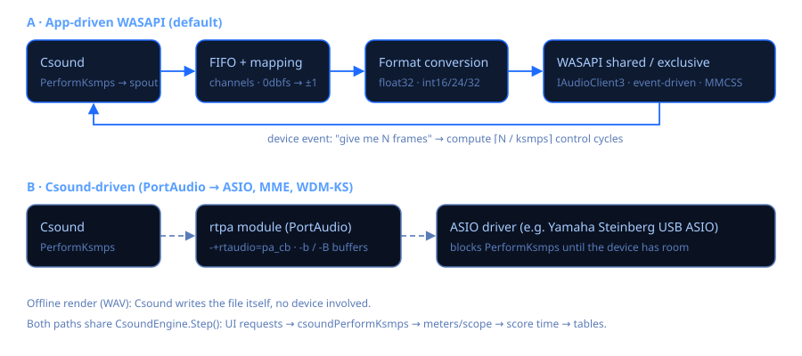

# Audio engine & latency

Csound Visual can drive the audio device in two ways. You choose in the **Audio** card
(*Motor*). The choice, the device, the latency preset and the ksmps override are remembered.



## Backends

| Backend (as shown in the app) | Who talks to the device | Typical latency | When to use it |
|---|---|---|---|
| **Windows · WASAPI compartido (recomendado)** | the app (`WasapiOutput`, shared mode) | 3–10 ms (driver dependent) | Everyday use. Standard Windows 11 output: other apps keep playing. |
| **Windows · WASAPI exclusivo (latencia mínima)** | the app (exclusive mode) | ≈3 ms period | Playing live without ASIO. Other apps are muted while it plays. |
| **Csound · PortAudio (ASIO, MME, WDM-KS)** | Csound's `rtpa` module | depends on `-b`/`-B` and the driver | ASIO drivers such as *Yamaha Steinberg USB ASIO*. |
| Csound · PortAudio bloqueante | Csound (`pa_bl`) | as above | Compatibility. |
| Csound · WASAPI interno | Csound's `rtwasapi` | ≈22 ms, fixed | Compatibility only (see below). |

### Why the app has its own WASAPI output

Measurements on the development machine with Csound 7.0's built-in `rtwasapi` module:

* it **always opened a 1056-frame shared buffer (≈22 ms)**, whatever `-b`/`-B` said;
* exclusive mode **failed on every device** (`0x88890008`, unsupported format) because the
  module only tries 32-bit float formats, while most hardware wants 16/24-bit integers in
  exclusive mode.

The app's `WasapiOutput` fixes both:

* **Shared mode** uses `IAudioClient3::InitializeSharedAudioStream` with the shortest engine
  period the driver offers (for example 336 frames = 7 ms on a Realtek USB device instead of
  480 = 10 ms). When the driver offers no low-latency periods it falls back to a classic
  event-driven shared stream.
* **Exclusive mode** negotiates a format the hardware accepts, in this order: float32, int32,
  int24-in-32, packed int24, int16. It tries the mix rate first, then 48 and 44.1 kHz, and uses
  the device's minimum period. If the driver reports `AUDCLNT_E_BUFFER_SIZE_NOT_ALIGNED`, the
  buffer is re-aligned to the size it asks for.
* The audio thread registers with **MMCSS** as *Pro Audio*, so Windows schedules it like
  professional audio software.

### Measured results (silent self-test, 0 dropouts in all cases)

| Device | Mode / preset | Period | Estimated latency | DSP load |
|---|---|---|---|---|
| Steinberg UR22mkII | exclusive / Minimum | 132 frames @ 44.1 kHz (2.99 ms), int24 | ≈6 ms | 1.6 % |
| Steinberg UR22mkII | exclusive / Low | 265 frames (6 ms) | ≈12 ms | 1.3 % |
| Realtek USB SPDIF | shared low-latency / Minimum | 336 frames @ 48 kHz (7 ms) | ≈7 ms | 1.7 % |
| LG ULTRAGEAR (NVIDIA HDMI) | exclusive / Minimum | 144 frames (3 ms), int24-in-32 | ≈6 ms | 2.6 % |

Bluetooth headphones always add their own latency (often 100 ms or more), which no
application can remove.

### 44.1 kHz devices and exclusive mode

USB audio drivers work in 1 ms packets. At 44.1 kHz a 3 ms period is 132.3 frames and a 6 ms one
264.6: the driver drifts by a fraction of a sample every period and the sound crackles. The
exclusive mode therefore tries **48 kHz first** and only uses periods that are a whole number of
milliseconds *and* frames. A device that only accepts 44.1 kHz in exclusive mode (the UR22mkII
when Windows has it at 44.1 kHz) gets an exact 10 ms period, and the console suggests switching
the device to 48 kHz (*Settings › Sound › device › Properties › Advanced*) to reach ≈3 ms.

The engine also counts a dropout when the audio thread wakes up much later than one period, and
keeps the .NET garbage collector in *SustainedLowLatency* mode while playing.

### Using the *WASAPI Driver for ASIO*

The driver ([0.9.15](https://github.com/irregbex/WASAPI-Driver-for-ASIO/releases)) shows up in
the **Csound · PortAudio** backend as **ASIO · WASAPI Driver for ASIO**. Its own guidance applies:
Shared mode with *Low latency in Shared* and a buffer of 128 or 256 for USB/built-in audio
(Exclusive 64–128 for the lowest latency; 512 or more for Bluetooth). Its panel sets the real
buffer; Csound's `-b/-B` presets only need to be at least as large (*Baja* = 256/512 is a good match).
Its KNOWN-ISSUES KI-12 agrees with what was measured here: the UR22mkII in Exclusive mode needs the
Yamaha Steinberg USB driver at the project rate.

## Latency presets

| Preset | App WASAPI | Csound/PortAudio |
|---|---|---|
| **Mínima** | the device's minimum period | `-b128 -B256` |
| **Baja** | about twice the minimum | `-b256 -B512` |
| **Normal (estable)** | the device's default period (≈10 ms) | `-b512 -B2048` |

If you hear clicks or dropouts, move one level up. The status bar shows **DSP %** (time spent
computing audio ÷ time available; above 100 % audio breaks up) and **cortes** (dropouts).

### ksmps override

*ksmps* is the number of samples per control cycle. Smaller values give finer control and
MIDI timing but cost more CPU. *Del archivo* keeps the value written in the `.csd`; any other
choice passes `--ksmps=N`.

### Sample rate

With the app's own output, the orchestra's `sr` is set to the device rate (`--sample-rate`),
because shared mode must run at the rate chosen in *Windows Settings › Sound*. The console
prints the stream that was really opened, for example:

```
🔊 WASAPI exclusivo · Line (Steinberg UR22mkII ) · 44100 Hz · 2 ch · int24 · periodo 132 frames (2,99 ms) · latencia ≈ 6 ms
🔊 device 44100 Hz · Csound sr 44100 Hz
```

The second line (also appended to the stream line under *Settings › Audio*) states both the
device's real rate in Windows and Csound's `sr`, so a `.csd` that says `sr = 48000` on a
44.1 kHz device is not confusing: with the app's engine they always match, because the file's
`sr` is replaced. In exclusive mode the stream may run at another rate than the one set in
Windows; then the line shows both (`48000 Hz (Windows: 44100 Hz)`). When Csound drives the
device itself (PortAudio, Csound's WASAPI) the line reads e.g.
`WASAPI · Speakers (X) · device 44100 Hz · Csound sr 48000 Hz (Windows converts)`; ASIO drivers
switch to Csound's rate, so for them only `sr` is shown.

## Live audio input

Orchestras that read `ain1, ain2 in` (or `inch`) can process a microphone or an audio-interface
input inside the app, without a DAW. Choose it in *Settings › Audio › Input*:

* **None** (default): nothing changes; `in` reads silence, as before.
* **Windows default**: the default recording device of *Settings › Sound › Input*.
* A specific endpoint, e.g. *Line (Steinberg UR22mkII)*. The choice is saved by endpoint id.

It works with the app's own engines (*Windows · WASAPI shared/exclusive*). With PortAudio/ASIO,
Csound opens the input itself: add `-iadc` (or `-iadcN`) to `<CsOptions>`.

**Input channels.** An interface such as the UR22mkII delivers its two inputs as **one stereo
device** (input 1 = left, input 2 = right). *Settings › Audio › Input channels* decides how they
reach Csound; it applies instantly, also while playing:

| Choice | Csound sees | Use it when |
|---|---|---|
| **Stereo** (default) | `inch 1` = input 1, `inch 2` = input 2 — two independent mono channels | two sources (e.g. mic + guitar) or a real stereo source; the orchestra decides what to do with each (`a1 inch 1`, `a2 inch 2`) |
| **Mono: input 1 only** | input 1 on every channel | one microphone on input 1 and a stereo effect (`ain1, ain2 in`): it hears it on both sides |
| **Mono: input 2 only** | input 2 on every channel | one source on input 2 |
| **Mono: inputs 1 + 2 summed** | the sum on every channel | two sources mixed into one |

Example that treats the two inputs as separate instruments in *Stereo* mode:

```csound
instr 1
  aVoice  inch 1                 ; microphone on input 1
  aGuitar inch 2                 ; guitar on input 2
  aVerb   reverb aVoice, 2.5     ; reverb only on the voice
  aDist   distort1 aGuitar, 4, 0.5, 0, 0   ; drive only on the guitar
  outs aVerb * 0.4 + aDist * 0.3, aVerb * 0.4 + aDist * 0.3
endin
```

**Shared mode only.** The capture stream (`Audio/WasapiInput.cs`) is always shared, so Cubase,
the browser or a voice chat can use the same input at the same time. With the *Minimum* or
*Low* latency preset it asks for the short IAudioClient3 period (≈3 ms) when the driver offers
it; otherwise the default ≈10 ms. The mix format is converted to float (float32, int16, packed
int24, int32/24-in-32, any channel count). Its own MMCSS "Pro Audio" thread only copies samples
into a preallocated lock-free ring (single producer, single consumer: `Audio/InputRingBuffer.cs`).

**Into Csound.** Before every `csoundPerformKsmps` the engine writes one control block into
Csound's input buffer (`csoundGetSpin`); with host audio I/O Csound 7 reads it through `in`
and `inch` and never clears it (verified), and no `-i` option is needed. `nchnls_i` is *not*
forced (Csound defaults it to `nchnls`; forcing 2 would break mono orchestras that use
`ain in`): input channel *c* goes to Csound channel *c*, a mono input goes to every channel,
and Csound channels beyond the input's get silence. Values are scaled by `0dbfs`.

**Different clocks and rates.** Input and output may be different devices (UR22 input,
Bluetooth headphones output). Even at the same nominal rate their crystals differ by tens of
ppm, so a plain FIFO would slowly run dry or grow. `AdaptiveInputReader` reads the ring with a
fractional step `inRate / sr × (1 + c)` and 4-point cubic (Catmull-Rom) interpolation:

* `c` is a proportional correction `(fill − target) / (inRate × 4 s)`, clamped to ±0.5 %. A
  drift of *d* ppm is cancelled with a fill offset of only ≈ *d* × 0.2 frames at 48 kHz, and
  100 ppm is a pitch change of 0.17 cent: inaudible.
* The fill is estimated *continuously*: `count + (now − time of the last packet) × inRate`
  (samples already recorded but not yet delivered), smoothed over ≈0.5 s. Sampling the raw
  count would depend on the drifting phase between the two devices' periods and make the
  controller wander.
* Target fill (the latency the input adds) = one capture period + one output period + one
  ksmps block + 3 ms; e.g. ≈24 ms with 10 ms periods, ≈10 ms with 3 ms periods.
* If the ring runs dry (input stalled or unplugged) the input becomes silence until it
  refills to the target, then fades in over one block. If it overflows far beyond the target
  (output stalled), the oldest samples are dropped. The output never stops.
* Different nominal rates (input 44.1 kHz, output 48 kHz) use the same resampler. Upsampling
  is clean; downsampling (96 → 48 kHz) has no anti-alias filter, so content above 24 kHz could
  fold back (microphones and instruments rarely carry much there).

Measured in an offline simulation with 1.5 ms of random capture-thread jitter: the correction
locks to the simulated drift (+200 ppm → +190, −150 → −146, +80 → +83, +50 → +46 ppm), no
dropouts, a 150 ms input stall recovers in one block, and the residual against an ideal sine
stays 53–64 dB down.

**Errors.** If the device is unplugged or disabled, the console says so once
(`⚠ The audio input was disconnected…`) and the output keeps playing with a silent input.
If Windows blocks microphone access (*Settings › Privacy & security › Microphone*, which also
covers line inputs of interfaces) the input cannot open: the console explains where to enable
it and the performance continues without input.

**Meter.** While an input feeds Csound, an **IN** meter appears under the output meters in the
side panel (peaks per input channel before Csound). The status bar adds the input dropouts.

Test orchestra: *Examples › AudioFX › Live › L0 Input check* (auto-wah, ping-pong delay,
reverb; prints the input level every second). Use headphones to avoid feedback.

## When the chosen device fails

* **Not available** (unplugged, disabled, busy): the app opens the **Windows default output**
  instead and says so in the console. The saved choice is not changed.
* **Opens but never asks for samples** (its clock stopped — seen with a USB interface whose driver
  hung): after 2 s the run ends with a console message, the device is released, and playback
  **restarts once on the Windows default output**. Later runs of the session keep using the
  default output until you pick an output again in *Settings › Audio*. Stop always works, even
  with a stalled device. Fix the device by unplugging and reconnecting it.
* **Input not available** (unplugged, or microphone access blocked in Windows privacy): the
  performance continues without input (`in` reads silence) and the console says why.

## Diagnostics

* **Diagnóstico de audio** (button in the Audio card) lists every output with its shared
  format, its shared-mode periods (with or without a low-latency mode) and its exclusive
  support (format and minimum period). It plays nothing.
* From a terminal:

```
CsoundVisual.exe --audio-probe
CsoundVisual.exe --audio-test exclusive minimum UR22
```

`--audio-test [shared|exclusive] [minimum|low|normal] ["part of device name"]` runs a silent
3-second performance through the full engine and prints the stream, DSP load and dropouts.

For the input:

```
CsoundVisual.exe --input-probe              (list capture endpoints, record 2 s from the default one)
CsoundVisual.exe --input-probe UR22 3       (record 3 s from the UR22 input, print levels)
CsoundVisual.exe --input-probe loopback     (record what Windows is playing: tests the capture path
                                             even when microphone access is blocked)
CsoundVisual.exe --input-test UR22 5        (full engine: silent output + input into Csound's `in`;
                                             prints the RMS Csound measures and the drift control)
```

Nothing audible is played by any of them. (As a WinExe, pipe the output to see it: `| more`.)

## How the host loop works

1. The device signals its event: "I have room for N frames".
2. The engine runs as many Csound control cycles as needed (`⌈N / ksmps⌉`). In each cycle it
   applies UI requests (sliders, events, live recompiles), calls `csoundPerformKsmps`, and
   updates the meters, scope, score time and tables.
3. The samples are mapped to the device channels (mono is duplicated, extra channels dropped)
   and scaled by `1 / 0dbfs`.
4. They are converted to the device format and written. The DSP time of the period is
   measured; if it exceeds the period, or the shared buffer ran dry, a dropout is counted.
5. On *Detener* a short linear fade-out is written to avoid a click.

With a live input, step 2 also writes one block of captured audio into `spin` before each
`csoundPerformKsmps` (see *Live audio input*).

Source: `src/CsoundVisual/Audio/WasapiOutput.cs`, `WasapiInput.cs`, `InputRingBuffer.cs`,
`WasapiInterop.cs`, `Engine/CsoundEngine.cs` (`PerformHost`, `StartInput`, `Step`).
