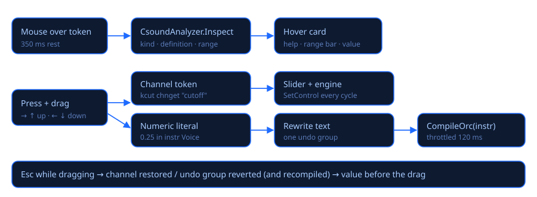

# Hover help & live values

## The help card

Rest the mouse ≈⅓ s on something in the code:

| Over… | The card shows |
|---|---|
| a **variable** (`kcut`, `aL`, `gaRevL`) | rate (audio/control/init/string, global or local), where it is defined and reassigned, usage count, what it holds (reads a channel, an ADSR envelope 0–1, an oscillator ±amp, a random value between a and b…) and its **possible range** |
| a **number** | which argument of which opcode it is, the type the opcode expects, a suggested range (cutoff, resonance, pan, ADSR times…), `chnk` fields, header constants and score p-fields |
| a **p-field** (`p4`) | its meaning, the values it takes in the score and the expressions passed by `schedule`/`schedulek`/`event` |
| a **channel name** (`"cutoff"`) | its range and current value |
| an **opcode** | readable signatures (inputs and outputs) |

### Live values

While playing, a variable's card also shows **its value right now**, the minimum and maximum
seen, how many notes of the instrument are active and a **sparkline** of the last ≈3 seconds.
Audio variables show the block peak.

It uses the Csound 7 debugger (`csoundSetDebugCallback`): after each control cycle, about 30
times per second, the app reads the variables of every active instance. With several notes of
the same instrument, the most recent one is shown. It can be switched off with **Valores en
vivo** in the *Observar* card.

### Watch panel

Right-click a variable › **Observar «name»** pins it in the *Observar* panel with its live value,
range and sparkline. The same menu offers **Go to definition**, **Opcode help (F1)**,
undo/redo and cut/copy/paste.

## Drag to change values

Press on a variable that reads a channel, a channel name or a number, and move the mouse:

* **right or up** increases, **left or down** decreases, clamped to the range;
* **Shift** = 10× finer, **Ctrl** = 10× coarser;
* **Esc** (before releasing) restores the previous value;
* a click without moving behaves like a normal click.

| What you drag | What changes |
|---|---|
| A variable that reads a channel (`kcut chnget "cutoff"`) or the channel name | The channel, in real time, and its slider. The code is not modified. |
| A number inside an `instr` | The number in the code; **while playing the instrument is recompiled** (at most every 120 ms) and new notes use the new value. |
| A `chnk` default value | The number in the code and the channel live. |
| A header or score number | The number in the code; applied on the next run. |

A whole drag is a single undo step (Ctrl+Z).

## Completion and manual

* After two letters the list appears: variables of the file, keywords and opcodes with their
  signature. Enter or Tab accepts, Esc closes. **Ctrl+Space** opens it manually.
* **F1** on an opcode opens its page in the Csound manual.

## Live coding

* **Ctrl+Enter** evaluates the selection or the `instr … endin` under the caret without
  stopping the audio (`csoundCompileOrc`). Evaluated lines flash green.
* **Ctrl+Shift+Enter** sends the score line under the caret (or the selected ones) as live events.

## Breakpoints

Stop the performance on a line of an instrument and look at every variable of that note.

| Action | How |
|---|---|
| Set / remove a breakpoint | Click the narrow strip left of the line numbers (a red dot appears), **F9** on the caret line, or right-click › *Set breakpoint* |
| Remove all | **Shift+F9**, right-click › *Remove all breakpoints*, or *Remove all* in the Debug panel |
| Continue | **F5** while paused (F5 is Play otherwise) or *Continue* |
| Next control cycle | **F10** while paused or *Next cycle* |
| Stop | *Stop* in the Debug panel, or Shift+F5 |

When a note reaches the line, Csound stops **before** that line runs: the device keeps running
but plays **silence** (no dropouts are counted), the line turns yellow with an arrow in the gutter,
the editor scrolls to it, the status bar says «⏸ Paused at line 42 · instr Voice · F5 continue»
and the **Debug** panel opens over the right side of the editor with:

* the instrument, the line and the opcode about to run, which note it is («note 2 of 3»), p1, p2,
  p3, the score time and Csound's control-cycle counter;
* every local variable (name, rate, value): `i`/`k` as numbers, `a` as RMS and peak of the block
  plus its first samples, arrays with their first elements, `S` strings, f-signals with the FFT
  size and the strongest bin; then the globals (`gk…`, `ga…`, `gi…`).

**Continue vs. next cycle.** A line runs once per control cycle (hundreds of times per second), so
*Continue* only stops where a note has **not** stopped yet: another breakpoint line, another note
playing at the same time, or the next new note. *Next cycle* stops at the next breakpoint reached,
at the latest the same line one control cycle (ksmps samples) later, so you can watch an envelope
move step by step.

Where it works:

* only lines inside `instr … endin` that run at k- or a-rate. Lines that only run when the note
  starts (`ifreq = p4`), the `instr`/`endin` lines, blank lines, comments, header code and UDO
  bodies cannot stop: clicking them explains why in the status bar. Breakpoints in an instrument
  that calls a UDO go on the calling line;
* only while **playing** with the app's own audio engine (Settings › Audio › Windows · WASAPI).
  Rendering to WAV, or a Csound module (PortAudio/ASIO), ignores them and says so once in the console;
* breakpoints belong to the open file, follow their lines while you edit and last for the
  session (they are not saved in the .csd).

Breakpoints set while playing take effect immediately when *Live values* is on (the default),
because both features share Csound's debugger. With *Live values* off, set at least one breakpoint
before pressing Play.

**Editing while paused or playing.** Csound's line numbers are those of the code that is
running. If you insert lines above an instrument, the app still knows where each running line is
now (a stop is shown on the right line). **Ctrl+Enter** (or dragging a number) recompiles the
instrument numbered like the editor shows it now, and the breakpoints of that instrument are moved
to the new code. A recompile requested while paused is applied when you continue.

Limits of the Csound 7.0 debugger (verified, worked around where possible):

* it can only stop *before* a line, not between the opcodes of one line, and there is no «step
  into a UDO» or «step to the next line»: *Next cycle* is the finest step;
* expression helpers are sometimes tagged with the next line (a breakpoint on
  `kcut = 500 + kenv * 2000` may stop at `=` while the `*` belongs to the next line);
* resuming in the middle of a line with several opcodes would stop again forever at the same
  opcode, and Csound reports the wrong note for later stops in the same cycle; the app removes the
  line for the rest of that cycle and reinstalls it before the next one;
* when two notes of the same instrument stop in the same cycle, the panel shows the first one.

Self-test (no sound, uses the real WASAPI engine muted):
`CsoundVisual.exe --breakpoint-test file.csd LINE [SHIFT]` prints the variables at each stop and
checks pause, time frozen without dropouts, next cycle, continue to another note, a recompile
shifted by SHIFT lines, remove all and stop while paused.

Source: `src/CsoundVisual/Editor/` (`CsoundAnalyzer`, `ScrubController`, `CompletionProvider`)
and `Engine/LiveValueMonitor.cs`; breakpoints: `Editor/Breakpoints.cs`, `Engine/BreakpointSession.cs`,
`Engine/CsoundEngine.Debugger.cs`, `ViewModels/MainViewModel.Debug.cs`, `Views/DebugPanel.cs`.
