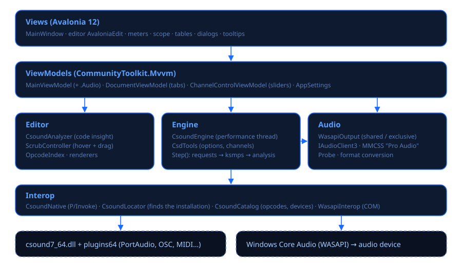

# Csound Visual

**Csound Visual** is a graphical environment for making music with [Csound 7](https://csound.com)
on Windows. You write code, and you play, see and control it live: every variable, number or
channel in the code can be inspected and dragged while it sounds.

> **Made 100% with vibe coding.** Every line of code, every test and every page of documentation
> of Csound Visual was written by an AI ([Claude Code](https://claude.com/claude-code), by
> Anthropic) through natural-language conversation. Its author directed the project, tried it and
> decided what to build, but did not write the code by hand.

## What you can do

| Area | Features |
|---|---|
| **Editor** | Tabs, syntax highlighting of the ≈2500 real opcodes, completion with signatures, F1 opens the manual, error lines marked, unsaved-changes prompt. |
| **Live help** | Hover a variable or number: what it is, where it is defined, its range and **its live value** with a sparkline. Drag it to change it; Esc restores the previous value. |
| **Audio** | Own WASAPI engine: shared (coexists with other apps) or exclusive (≈3 ms). PortAudio/ASIO also available. Per-device diagnostics. |
| **Play live** | Automatic sliders for every channel, MIDI learn, on-screen and PC keyboard, MIDI input (WinMM; MIDI 2.0 on the way). |
| **Live coding** | Ctrl+Enter recompiles the instrument under the caret without stopping the audio; Ctrl+Shift+Enter sends score lines. |
| **See** | Oscilloscope, spectrum, peak meters, tables, *Observar* (watch) panel with pinned variables. |
| **Keep the result** | Record what you hear (including live changes) or render the file to WAV. |

## Start in one minute

1. Run `CsoundVisual.exe` (or in VS Code: *Tasks: Run Task › Csound Visual: ejecutar*).
2. Press **Tocar** (F5). The demo plays.
3. Move the **Controles en vivo** sliders, play the **keyboard** at the bottom or your MIDI controller.
4. Hover `kcut` in the code and drag it to the left.

Continue with the [user guide](user-guide.md).
