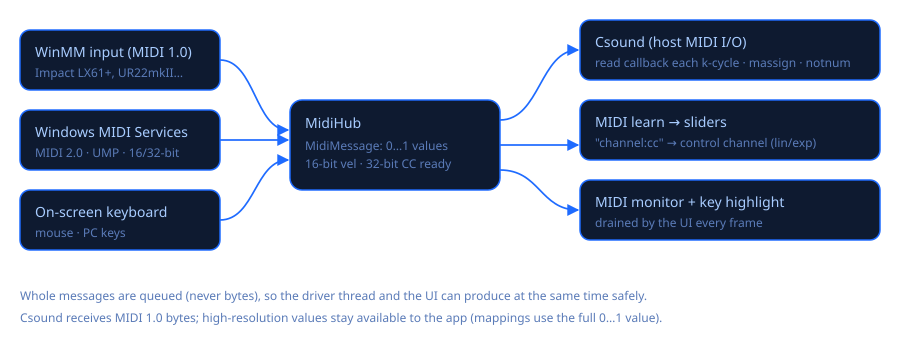

# MIDI (MIDI 2.0 and legacy)

Csound Visual has two MIDI input backends behind one router (`MidiHub`):

| Backend (as shown) | API | Resolution | Notes |
|---|---|---|---|
| **MIDI 2.0** | Windows MIDI Services, `Windows.Devices.Midi2` (WinRT) | 16-bit velocity, 32-bit controllers / pressure / pitch bend | Recommended. Every device appears here, MIDI 1.0 devices included (wrapped in UMP by the service). |
| **WinMM** | classic `midiIn*` | 7-bit (14-bit pitch bend) | Legacy fallback; works on every Windows version. |

The same keyboard is usually listed by both backends. **Enable only one of the two**, otherwise
every note arrives twice.

## Message model

`MidiMessage` stores values normalised to 0…1 as doubles, so nothing is lost from MIDI 2.0
sources. For Csound it is converted to MIDI 1.0 bytes, which is what Csound's MIDI opcodes
(`massign`, `notnum`, `veloc`, `ctrl7`…) read through the host MIDI callbacks. MIDI learn
mappings use the full-resolution value, so a 32-bit controller moves a slider smoothly.

Decoded Universal MIDI Packets:

* **type 0x2**: MIDI 1.0 channel voice, one word: `group | status | data1 | data2`;
* **type 0x4**: MIDI 2.0 channel voice, two words. Note on/off carry 16-bit velocity in the top
  half of word 1. CC, channel and poly pressure and pitch bend carry 32-bit values in word 1.

Other packet types (system, SysEx, stream, utility, flex data) are ignored for now.

## Windows MIDI Services integration

* Package: `Windows.Devices.Midi2` **0.99.92-preview.11**. The API surface is locked and the
  package carries a "go-live" licence. Microsoft publishes it on GitHub
  ([release inbox-preview-11](https://github.com/microsoft/MIDI/releases/tag/inbox-preview-11)),
  not on nuget.org, so it lives in `src/packages-local/` and is referenced through `src/nuget.config`.
* The package ships no .NET projection. **C#/WinRT** (`Microsoft.Windows.CsWinRT` 2.2.0) generates
  it from the `.winmd` at build time (`CsWinRTInputs`/`CsWinRTIncludes` = `Windows.Devices.Midi2`).
  This requires a Windows target framework: the project targets
  `net10.0-windows10.0.26100.0`, but keeps `bin\<Configuration>\net10.0\` as its output folder.
* The app-local `Windows.Devices.Midi2.dll` + `.pri` are copied next to the executable. When
  Windows ships the API in System32, Windows uses its own copy instead. The MIDI card shows
  which one is active (`MidiApi.IsSystemProvided()`).
* At start-up `MidiApi.EnsureServiceAvailable()` demand-starts the `midisrv` service. Endpoints
  come from `MidiEndpointDeviceInformation.FindAll(…, AllStandardEndpoints)` (diagnostic
  loopbacks excluded). One `MidiSession` ("Csound Visual") holds all connections. Messages are
  read with `MidiMessageReceivedEventArgs.FillWords`, which allocates nothing per message.

## Known issues and caveats (Preview 11 – 13)

Collected from Microsoft's release notes and from integrating it here:

1. **Windows 11 25H2 or later is required.** Microsoft does not support 24H2 and Windows 10. On
   unsupported systems the backend reports itself unavailable and WinMM keeps working.
2. **Activation failures become exceptions.** If the service or the API cannot be activated,
   WinRT throws. The app catches this once (`Midi2Input.IsAvailable`) and shows the reason in
   the MIDI card.
3. **Installer bug in the optional Tools/Transports packages** ([#1323](https://github.com/microsoft/MIDI/issues/1323)):
   previous preview versions must be uninstalled before installing new ones. Csound Visual does
   not need those installers; the in-box service is enough.
4. **Tearing down virtual devices could hang** in releases before November 2026. Csound Visual
   creates no virtual devices yet.
5. **Two copies of the API**: if Windows has the API in System32, that copy wins over the one
   shipped with the app. Behaviour may differ slightly from the preview until the 1.0 release.
6. **Go-live conditions** for shipping the preview DLL: update the app when the API ships in
   Windows, tell users that a preview API is used (the MIDI card does), and do not ship to
   Windows versions below 25H2.
7. **C#/WinRT and .NET**: the generated projection needs a `-windows10.0.x` target framework,
   and the package must not flow to dependent projects. It is referenced with
   `PrivateAssets="all"`, because a dependent `net10.0` project would otherwise fail with
   `NETSDK1130`.
8. **Duplicate devices** (see above): the same device appears as a MIDI 2.0 endpoint and as WinMM
   ports. Enable only one.

## Verified

* `EnsureServiceAvailable` → true; API origin: app-local preview.
* Endpoints found on the development PC: Impact LX61+, Steinberg UR22mkII, Vienna Instruments MIDI.
* Round trip through the diagnostic loopback A→B: a MIDI 2.0 note on with velocity `0xC000`
  arrived as 0.750011; a 32-bit CC as 0.5; a MIDI 1.0 note in UMP as note 60, velocity 0.787.
* WinMM to Csound: notes 60/67 reach the instrument with their velocities (`notnum`/`veloc`).

Source: `src/CsoundVisual/Midi/` (`MidiMessage`, `Midi2Input`, `WinMmMidiInput`, `MidiHub`).
