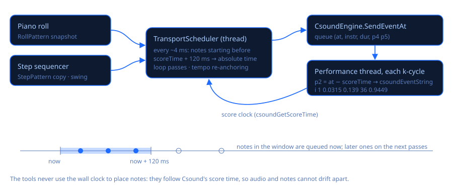

# Music tools: piano roll and step sequencer

Stage 4 adds two tools that **play the document's instruments live through Csound** and can
**write what you made into the score**. Open them from **Tools** in the toolbar (the button with
the little piano-roll icon) or with the shortcuts:

| Tool | Shortcut | For |
|---|---|---|
| **Piano roll** | Ctrl+P | Drawing melodies, chords and bass lines on a pitch × time grid |
| **Step sequencer** | Ctrl+Shift+P | Beats: tracks × sixteenth steps, with a synthesised drum kit |
| **Open drum kit** (Tools menu or sequencer) | — | The `DrumKit.csd` template (instruments 1–8) in a new tab |

Both windows can stay open next to the editor (or on a second screen). Closing them keeps
what you made for the session; closing the main window closes them.

## Csound must be playing

The tools do not make sound themselves: they send notes (`i` statements) to the running
Csound performance. If Csound is **not** in Play mode when you press the tool's **▶ Play**, the
tool starts it with the target document (as if you pressed F5) and begins as soon as the
performance runs. If Csound is rendering, or the document fails to compile, the tool says so in
its status line (bottom right) and the main window's «press Play» bubble appears.

**Target document**: the document being played; when Csound is stopped, the one shown in the
editor. Its name is shown under the tool bar. The instrument lists come from its `instr` lines
(numbers or names; the comment after `instr 1 ; Kick` becomes the label «1 · Kick») and refresh
when the document changes. An instrument that is not in the document is listed as «not in the
document» and the tool warns before playing.

If the document's score ends (e.g. a test score of 4 seconds), Csound stops and the transport
stops with it: give the score a long event such as `i "Reverb" 0 3600` or `f 0 3600`. The demo
and the drum kit already have one.

## Piano roll

| Area | What you do |
|---|---|
| **Grid** | Click empty space = new note (hold the button and drag: **right = length, up/down = velocity**). **Right-drag on empty space = box selection**, then **Delete** removes the selected notes (Shift/Ctrl adds to the selection; Ctrl+left-drag also draws a box). Drag a note = move it (all selected notes move together); **Alt+drag** copies. Drag the **right edge** = length. **Right-click** or double-click = delete (the whole selection if the note is selected). **Ctrl+click** adds/removes a note from the selection. Middle button = pan. |
| **Keys** (left) | Click (and drag) to audition notes while Csound plays. Labels on every C: C4 = MIDI 60 = middle C (Cubase calls it C3; the status line always shows the MIDI number). |
| **Ruler** (top) | Click = start position (the dashed green line; playback and paste start there). Drag = loop range (also switches Loop on). |
| **Velocity lane** (bottom) | Drag across the bars to draw velocities like a line; with a selection only the selected notes change. Note colour intensity also shows velocity. |
| **Wheel** | Wheel = pitch, Shift+wheel = time, **Ctrl+wheel = zoom time** around the mouse, Ctrl+Shift+wheel (or Alt+wheel) = zoom pitch. |
| **Keyboard** (grid focused) | Delete, Ctrl+A, Ctrl+C / Ctrl+V (paste at the green line), Ctrl+D (duplicate after the selection), **Ctrl+Z / Ctrl+Y** (undo/redo, 200 steps), arrows (move by grid step / semitone; Shift+↑↓ = octave), Q (quantize starts), Esc (deselect), **Space** = play/stop. |

Tool bar: **Play/Stop**, **Loop**, **Tempo** (BPM, can change while playing), **Grid** (1/1 … 1/32,
triplets 1/4 T, 1/8 T, 1/16 T, «—» = free), **Instrument**, the **p4** and **p5** mapping,
**Record MIDI**, **Insert into score**, **Import**, and «⋯» (undo/redo, select all, quantize,
duplicate, delete, loop to the notes, zoom to fit, back to start, remove the block).

### p-field mapping

Every note becomes `i <instr> <start> <duration> <p4> <p5>`:

| p4 option | Value for middle C | Use in the instrument |
|---|---|---|
| MIDI note (default) | `60` | `cpsmidinn(p4)` (the demo's `Voice`), `mtof:i(p4)` |
| Hz | `261.6256` | `p4` directly |
| cpspch | `8.00` (A4 = `8.09`) | `cpspch(p4)` |
| oct | `8` (A4 = `8.75`) | `cpsoct(p4)` |

p5 is the velocity as **0…1** (velocity / 127, ready to multiply an amplitude, as `Voice` does
with `asig * p5`) or **0…127**.

### Record MIDI

Turn **Record MIDI** on and press Play: notes played on your MIDI keyboard (or the on-screen one)
while the transport runs are added to the roll, snapped to the grid (start rounded to the nearest
grid line, length to whole grid steps). With Loop on you can record in layers. The whole take is
one undo step (Ctrl+Z).

## Step sequencer

Each **row** is a track: name, **instrument** (p1), **note** (p4; for the drum kit it tunes the
drum, the tom uses it as its pitch), **velocity** for new steps, **probability** (0–100 %: each
active step plays with that chance on each pass), **M**ute and **S**olo (when any track is
soloed only soloed tracks play) and «⋯» (Euclidean fill with 1…16 hits, random fill, rotate
left/right, clear, audition, remove the track). **+ Track** adds rows (up to 16).

**Steps**: click = on/off; keep the button down and sweep sideways to paint several; **keep it down and move up/down** on the cell (or **Shift+drag up/down**)
or the **wheel** over a step = that step's velocity (bar height); **right-click** = accent (127)
on/off. The step being heard is highlighted while playing. Ctrl+Z / Ctrl+Y undo and redo.

Global: **Tempo**, **Swing** 0–75 % (delays every second sixteenth by that fraction of a step:
33 % ≈ triplet feel, 50 % = dotted), **Steps** 8 / 16 / 32 (half bar, one bar, two bars; steps
beyond the count are kept), **Open drum kit**, **Export to score** with **Loops**, **Import**, and
«⋯» (example groove, random fill on every track, clear, clear mute/solo, p4/p5 mapping, remove the
block).

### The drum kit (`Assets/DrumKit.csd`)

Eight synthesised drums, no samples: **1 Kick, 2 Snare, 3 Closed hat, 4 Open hat, 5 Clap, 6 Tom,
7 Rim, 8 Cowbell**, plus **instr 100 Master** (reverb send, soft saturation, volume). 48 kHz,
stereo, `0dbfs = 1`. Every drum takes **p4 = MIDI note** (tuning relative to its General MIDI
note: kick 36, snare 38, closed hat 42, open hat 46, clap 39, tom 45, rim 37, cowbell 56; 0 =
default) and **p5 = velocity 0…1** (0 = 0.8), so the piano roll can play it too. The closed hat
chokes a ringing open hat. Sliders: **volume**, **reverb**, **drive**. Try it by hand:
`i 1 0 1 36 0.9` in the live event box.

The default tracks point at the kit (track *n* → instrument *n*) and come with a funk/pop
groove at 108 BPM with a little swing: **Open drum kit**, then **▶ Play** — Csound starts with
the kit and the groove plays.

## Timing: how notes are scheduled



* Both tools share one **look-ahead scheduler** (`Music/TransportScheduler.cs`) running on its
  own above-normal-priority thread, woken every ~4 ms by a `Stopwatch`-paced loop.
* The clock is **Csound's own score time** (`csoundGetScoreTime`, published after every control
  cycle), not the wall clock: there is no drift between the tools and the audio, whatever the
  device's real rate.
* On every pass the scheduler asks the pattern for the notes that start before
  **score time + 120 ms** and queues each with its **absolute score time**
  (`CsoundEngine.SendEventAt`). The performance thread turns that into the p2 offset **right
  before the control cycle** that receives it: `i 1 0.0315 0.139 36 0.9449`. So a note starts on
  the exact control period it belongs to (1.3 ms at ksmps 64 / 48 kHz; use `--sample-accurate`
  for sample precision), regardless of thread jitter or the audio buffer size (the score clock
  moves one buffer at a time; the look-ahead covers buffers up to ~100 ms).
* Notes more than 250 ms late (after a stall) are dropped instead of played in a bunch; the tool
  reports how many.
* **Loop**: the transport counts linear beats; each loop pass is mapped to the loop region with an
  offset computed from the pass number, so a note right on the wrap point is sent exactly once.
  The piano roll plays the run-in before the loop start once, then repeats the region; a note
  that crosses the loop end is shortened to it.
* **Tempo changes** re-anchor the beat ↔ time mapping at the point already scheduled: nothing is
  sent twice or skipped.
* Edits while playing are heard on the next pass: the tools hand the scheduler an immutable
  snapshot after every edit.
* Stop ends the transport; notes already started finish their duration. If Csound stops, the
  transport stops too.

## Score format (export / import)

The tools write a **marked block** at the end of `<CsScore>`; exporting again replaces it,
nothing else in the score is touched (Ctrl+Z in the editor undoes it). A CSD without a score gets
one.

```
; --- piano roll begin ---
; Csound Visual · piano roll (Tools › Piano roll). Re-exporting replaces this block.
;@roll tempo=120 instr=Voice pitch=midi vel=unit snap=0.25 loop=0:16:1
; times in seconds at 120 BPM (1 beat = 0.5 s) · p4 = MIDI note · p5 = velocity 0-1
i "Voice" 0          0.5        60 0.7874
i "Voice" 0.5        0.5        64 0.7874
; --- piano roll end ---
```

* **Times are in seconds** (beats × 60 / BPM), not beats with a `t` statement: a `t` statement
  would also re-time everything else in the score (the demo's `i "Reverb" 0 3600` would become
  3600 beats) and only one is allowed per section, so converting is the only safe choice.
* The `;@roll` line keeps the tempo and settings, so **Import** converts back exactly (positions
  are rounded to 1/960 beat). Verified by a round-trip test: 60 random notes × 4 p4 mappings × 2 p5
  mappings × 3 tempos come back identical.
* The step sequencer writes `;@seq` (tempo, steps, swing, loops, mapping) and one `;@track` line
  per row (name, instrument, note, velocity, mute, solo, probability and every step's velocity)
  followed by the `i` lines of **Loops** passes (swing and mute/solo applied; probability rolled
  with a fixed seed, so the same pattern always exports the same).
* **Import (piano roll)**: from the block when there is one (settings restored too); otherwise
  every `i` statement of the chosen instrument in the score, at the current tempo and mapping
  (lines using carry `.`, `+`, ramps or expressions are skipped and counted). **Import
  (sequencer)**: from its block.
* When a tool window opens and the target document has its block (and the tool is still empty /
  untouched), it is loaded automatically: save the file, reopen it tomorrow, open the tool and the
  pattern is back.

## Source

`Music/` (`TransportScheduler`, `PianoRollModel`, `StepPattern`, `ScoreBlocks`, `PFields`,
`EngineScoreTarget`), `Controls/PianoRollView.cs`, `Controls/StepGridView.cs`,
`Views/PianoRollWindow.cs`, `Views/StepSequencerWindow.cs`, `Views/ToolTransport.cs`,
`ViewModels/MainViewModel.MusicTools.cs`, `Engine/CsoundEngine.cs` (`SendEventAt`),
`Assets/DrumKit.csd`.
