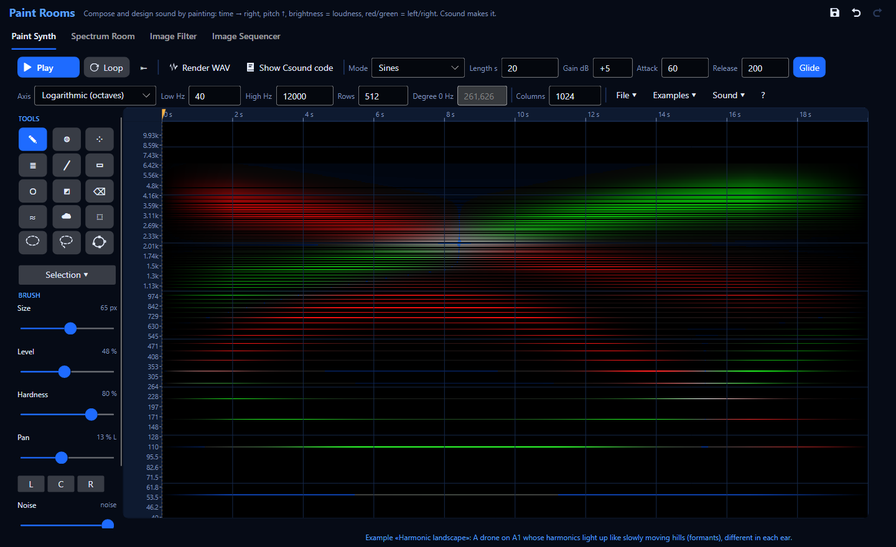
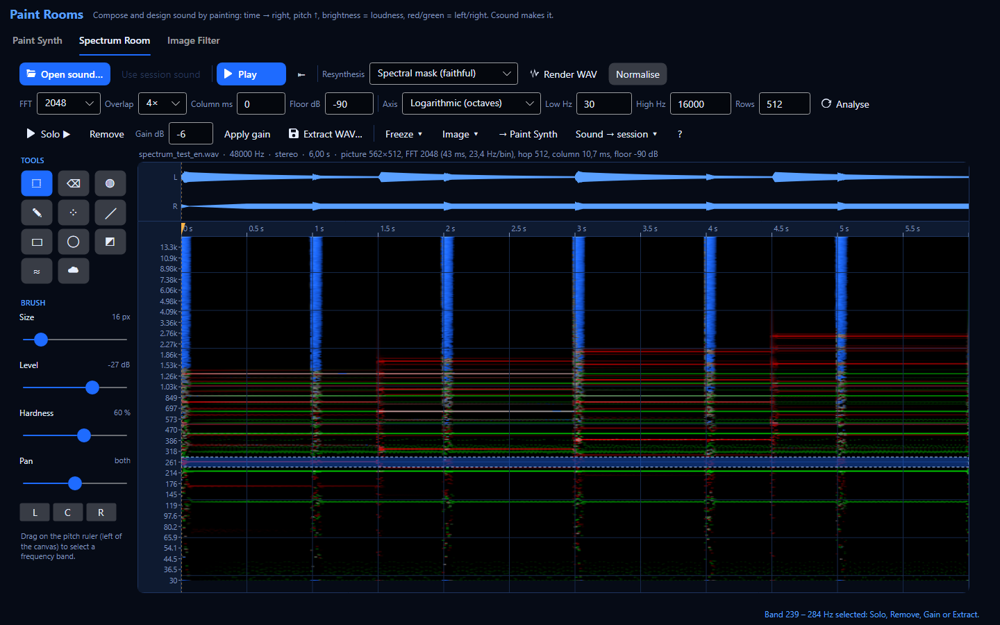
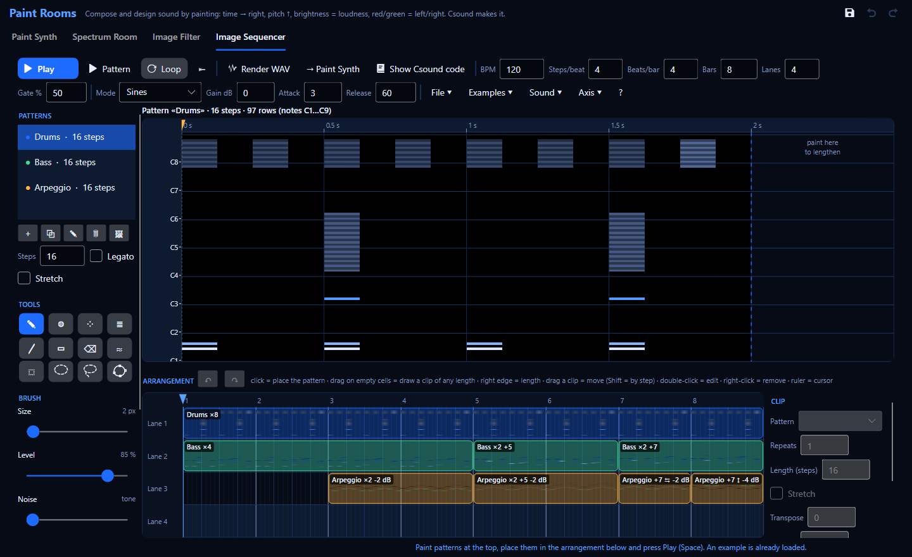

# Paint Rooms: compose and design sound by painting

**Paint Rooms** is a family of tools to make sound with pictures. Open it with **Ctrl+Shift+I**.
The first room, **Paint Synth**, is a canvas where:

* **left → right is time** (the ruler on top is in seconds),
* **bottom → top is pitch** (the ruler on the left says which frequency or note each row is),
* **brightness is loudness** (black = silence, bright = loud),
* **colour is position**: **red = left only, green = right only**, the theme colour (or yellow
  in an imported picture) = both sides.

Every row of the picture is one voice — a sine, a narrow band of noise or a looped sample — and
**Csound** makes the sound: when you press **Play**, the app writes the picture into Csound
tables and plays it with an additive-synthesis instrument; **Render WAV** runs the same
instrument offline; **Show Csound code** opens that instrument in the editor so you can study it.

Three more rooms share the same canvas and tools: the **Spectrum Room** turns a recording into a
picture you can edit and turn back into sound (see [Spectrum Room](#spectrum-room-turn-a-recording-into-a-picture-edit-it-hear-it-again)),
the **Image Filter** uses a picture as a time-varying stereo equaliser, and the **Image Sequencer**
builds phrases and loops out of small painted patterns arranged in time (see
[Image Sequencer](#image-sequencer-phrases-and-loops-made-of-pictures)).

## Your first painted sound in 5 minutes

1. **Open Paint Rooms**: Ctrl+Shift+I in the main window. You get an empty, black canvas.
2. **Choose a piano-like axis**: in **Axis** choose **Equal temperament** (12 notes per
   octave). Now every row is one semitone and the ruler shows note names (C4 = middle C).
3. **Draw a chord**: the **Pencil** (✎, key **P**) is selected. Drag three horizontal lines on the
   rows **C4**, **E4** and **G4**, from about 1 s to 6 s. Each line is a held note.
4. **Listen**: press **Play** (or **Space**). If Csound was stopped it starts by itself; the green
   line shows what you hear. Paint more while it plays — you hear it immediately.
5. **Give it a timbre**: choose the **Harmonics brush** (≣, key **H**) and paint another line on
   **C3**. It paints the note *and* its harmonics (2×, 3×, 4× the frequency…) each one softer:
   the sound becomes richer, like a string or a brass. Try **Roll-off** 2 (mellow) or 0.5
   (bright), and **Odd only** (hollow, clarinet-like).
6. **Change the tuning**: in **Axis** choose **Scala scale (.scl)** and pick a tuning file (there
   are thousands free in the Scala archive, huygens-fokker.org). What you painted moves to the
   nearest note of the new scale. Ctrl+Z goes back.
7. **Import a photo**: **File ▾ › Import picture…** (or drag the picture onto the canvas).
   **Any picture of any size works**: PNG, JPG, BMP, GIF, WebP, TIFF, HEIC/HEIF (iPhone photos),
   AVIF, ICO or JPEG XR; phone photos are turned upright automatically. The import dialog shows a
   **live preview** on the right (the canvas exactly as it will be, with its pitch and time
   rulers), updated as you change:
   * **Shape**: **Full detail** (recommended: one column per picture pixel, as sharp in time as the
     original; the duration only sets how fast they play), **Keep proportions with the rows**,
     **Stretch to the chosen columns** or **Fit inside the chosen columns** (black, silent borders);
   * **Resolution and pitch axis**: the picture is resampled to exactly *columns × rows* cells, so
     detail finer than that grid turns into **stair-steps**. Raise the **Rows** (vertical) and the
     **Columns** (horizontal) for smoother lines — **= picture** next to the rows gives one row per
     pixel of height; the **duration** adds no detail, it only stretches the same columns. Typed
     numbers count at once (Enter in a box never imports). The **Axis** decides how the rows are spread over the
     frequencies: the canvas's current one, **Logarithmic** (musical: every octave equally tall —
     the usual choice for drawings and photos) or **Linear** (even Hz: the lows get squeezed). A
     note axis (equal temperament, Scala) always rounds to notes, so vertical steps are part of it;
   * **What the colours mean**, with a plain explanation of the chosen option under the list (the
     same explanations are in Paint Synth's **?** help). «Don't ask again» makes dropped pictures
     import directly with the last choice.

   Bright parts sound. Photos have a lot of faint detail:
   **Selection ▾ › Threshold** (0.3) or **Contrast** (exponent 2–3) cleans it so only the strong
   shapes remain.
8. **Render and use it in Cubase**: **Render WAV**, choose a name. The file is 24-bit, normalised
   to −1 dBFS. Drag it from Explorer into a Cubase audio track (or open it in SpectraLayers —
   you will recognise your picture in its spectrogram).

## The window

**Row 1 — transport and sound**

| Control | What it does |
|---|---|
| **Play / Stop** (Space) | Plays from the yellow cursor through Csound. Click or drag in the time ruler to move the cursor; **⇤** (Home) puts it at the start. |
| **Loop** | Repeats the canvas forever. |
| **Render WAV** | Writes the canvas once (no loop) to a 24-bit WAV through Csound, as fast as the CPU allows. While rendering the button cancels. |
| **Show Csound code** | Writes the `.csd` that makes this sound into `Documents\Csound Visual\Paint Rooms\<name>_<date>\` (the instrument with comments, plus its tables as files next to it) and opens it in an editor tab. F5 plays it there. |
| **Mode** | **Sines**, **Noise bands** or **Sample loop** (see below). |
| **Length s** | Duration of the whole canvas. It does not change the picture: it stretches or squeezes time. |
| **Gain dB** | Volume on top of the automatic level. Changes live. |
| **Attack / Release** (ms) | How fast a row rises to a brighter pixel / falls to a darker one. Short attack = percussive; long release = a reverb-like tail. Change live. |
| **Glide** | On: neighbouring columns blend (smooth). Off: the sound jumps from column to column (rhythmic, «pixelated»). |

**Row 2 — pitch axis, size and menus**

| Control | What it does |
|---|---|
| **Axis** | **Logarithmic** (every octave the same height — the musical default), **Linear** (every row the same number of Hz — good for spectra), **Equal temperament** (one row per note, any number of notes per octave), **Scala scale** (one row per note of a `.scl` tuning). Changing it keeps what you painted at its pitch (Ctrl+Z undoes). |
| **Low Hz / High Hz** | Frequency range of the canvas. |
| **Rows** | Resolution of the logarithmic and linear axes (default 512). More rows = finer pitch and more CPU. |
| **Steps/oct** | Notes per octave of equal temperament: 12 = semitones, 24 = quarter tones, 19, 31, 53… |
| **Degree 0 Hz** | Frequency of the first note of the scale. 261.63 Hz = middle C with A4 = 440 Hz; use 256.87 for A = 432 Hz. |
| **Columns** | Time resolution (default 1024). Changing it resamples the picture. |
| **File ▾** | New canvas, import picture, export PNG, load Scala scale, and what colours mean when importing. |
| **Selection ▾** (under the tools) | Select all, deselect or invert the selection; then operations on the selection (or the whole canvas): see below. |
| **Examples ▾** | Four starter pictures to listen to and modify. |
| **Sound ▾** | Rarer settings: automatic level, brightness → loudness curve, silence floor, noise-band width, the sample and its root pitch, render normalisation and sample rate. |

**Left — tools and brush.** The status bar at the bottom shows what is under the mouse (time,
frequency, nearest note, left/right level), messages and Csound's DSP load while playing.

## Tools

| Tool | Key | Use it for |
|---|---|---|
| ✎ **Pencil** | P | Hard round brush. A horizontal stroke is a held note; a curve is a melody with glides. |
| ◍ **Airbrush** | A | Soft Gaussian brush: fades, clouds, swells. |
| ⁘ **Spray** | S | Random dots: grains, crackle, rain, insects. |
| ≣ **Harmonics** | H | Fundamental plus N harmonics (k·f) with amplitude 1/k^roll-off. One stroke = a note with a timbre. The ticks around the cursor show where the harmonics will land. |
| ╱ **Line** | L | Drag from start to end. Diagonal = glissando. |
| ▭ **Rectangle** | R | A block of many pitches: clusters, bands of noise. |
| ◯ **Ellipse** | O | A rounded block: it enters and leaves gradually. |
| ◩ **Gradient** | G | Drag: paints from the brush level at the start to nothing at the end, in the selection (or the whole canvas). Vertical = a spectral tilt; horizontal = a fade. |
| ⌫ **Eraser** | E | Silences what it touches. **The right mouse button erases with any brush.** |
| ≈ **Blur** | B | Softens under the brush: tones become bands, attacks soften. |
| ☁ **Smudge** | U | Drags the picture along: bend notes, smear attacks. |
| ⬚ **Selection** | M | Drag a rectangle. Drag inside it to move it. Ctrl+C / Ctrl+X / Ctrl+V (pastes at the yellow cursor), Del, Esc. Image operations apply to the selection. |
| ◌ **Ellipse selection** | Shift+M | Drag a box (Shift during the drag = circle). See [Selections](#selections). |
| ➰ **Lasso** | F | Draw any closed shape; it closes on release. |
| ✦ **Spline selection** | N | Click points; a smooth curve runs through them; double-click or Enter closes. |

**Brush settings**: **Size** (screen pixels; also `[` and `]`), **Level** (how loud the paint is),
**Hardness** (crisp or soft edge), **Pan** (−1 left only … +1 right only; buttons L, C, R).

Painting only ever brightens: going over a place twice in one stroke does not get louder than
the brush level, and painting the left side never darkens the right side.

## Selections

A selection limits what you change: **Selection ▾** operations, Delete, copy / cut / paste, moving,
the Gradient tool and, in the Spectrum Room, **Solo**, **Remove**, **Apply gain**, **Extract WAV…**
and **Freeze** all work only inside it. Four tools make one (they are in all three rooms):

| Tool | Key | How |
|---|---|---|
| ⬚ **Rectangle** | M | Drag a box. |
| ◌ **Ellipse** | Shift+M | Drag a box; the ellipse fits inside it. Press **Shift during the drag** for a perfect circle on screen. |
| ➰ **Lasso** | F | Hold the button and draw any shape around what you want; release and it closes by itself. |
| ✦ **Spline** | N | **Click** to place points: a smooth closed curve runs through all of them and you see it while you place them. **Double-click** or **Enter** closes it, **Esc** cancels, **Backspace** removes the last point. |

**Step by step — select one note's harmonics with the lasso**

1. Press **F** (lasso).
2. Hold the left button and draw a loop around the bright line you want, then release: the loop
   closes and the «marching ants» (a moving dashed line) show the real shape.
3. Hold **Shift** and draw another loop around the next harmonic: it is **added**. Hold **Alt**
   and draw over a part you do not want: it is **subtracted**.
4. Now press **Del**, use **Selection ▾**, or in the Spectrum Room **Solo ▶** / **Remove** / **Extract WAV…**.
   Ctrl+Z undoes it as usual.

**Good to know**

* **Edges are soft.** The ellipse, lasso and spline select partly the cells on their border
  (anti-aliasing), so an edit fades out over one cell instead of stopping abruptly. For a wider
  fade raise **Feather** (in the tool column, under **SELECTION**, in screen pixels): a feathered
  removal in the Spectrum Room has no hard edge in time or in pitch, so it does not click or ring.
* **Plain press inside the selection = move it** (rectangle, ellipse and lasso tools). The spline
  tool never moves: every click is a point. To start a new shape inside an old one, press Esc first.
* **Paste keeps the shape**: what you copy with an ellipse is pasted as an ellipse.
* The **pitch-ruler band** of the Spectrum Room is always a rectangle over the whole time.
* With a selection, **Freeze** holds only what the selection covers (if the yellow cursor is
  outside it, its middle is frozen).
* Image operations that move content (transpose, flip, reverse) work on the selection's bounding
  box and keep only what lands inside the shape.

## Undo and redo

Ctrl+Z undoes, **Ctrl+Y or Ctrl+Shift+Z** redoes. The **↶ ↷** buttons at the top right of the
window do the same for the room you are in (each room has its own history); they are grey when
there is nothing to undo or redo, and their tooltip says which step they would undo or redo.

The history holds **everything you change in the room**: painting and operations, selections
(new shape, select all, deselect, invert), the axis and the columns, and every **setting** of the
bars at the top — duration, mode, gain, attack, release, loop, the **Sound ▾** options (Paint
Synth), the filter settings (Image Filter), the analysis and resynthesis settings (Spectrum Room;
undoing an analysis setting also brings back the picture as it was, without analysing again) and
tempo, steps, bars, lanes, gate and sound (Image Sequencer). Several quick changes of the same
setting (spinner clicks, typing) are one step.

## Saving your work

Csound Visual never throws work away without asking. The **💾 Save** button at the top right (next
to ↶ ↷), or **Ctrl+S**, saves the work of the room you are in. When you close Paint Rooms (or the
app) with unsaved work, each room asks **Save**, **Don't save** or **Cancel**. **Don't save**
discards that work (it is not there when you reopen); **Cancel**, or cancelling the file dialog,
keeps the window open:

| Room | What is kept | When it asks | «Save» does |
|---|---|---|---|
| **Paint Synth** | The picture, until you close Paint Rooms or the app. | Closing **Paint Rooms** (or the app) after editing the picture. | Export PNG (16-bit, lossless: re-import it with the right colour mapping). |
| **Spectrum Room** | The edited picture lives only while Paint Rooms is open. | Closing **Paint Rooms** (or the app) after editing an analysed sound. | Render WAV of the edited sound. |
| **Image Filter** | The filter picture, until you close Paint Rooms or the app. | Closing **Paint Rooms** (or the app) after editing it. | Export PNG. |
| **Image Sequencer** | Patterns and arrangement are kept for the next session **only when saved**. | Closing **Paint Rooms** (or the app) with unsaved changes. | Keeps them for the next session (also File ▾ › Save for next session). |

Nothing is asked for untouched examples, new empty canvases, fresh analyses or work you already saved.

## Colour and stereo

The two layers of the picture are the **left** and **right** channels:

* painted with **Pan C** (both) a cell is drawn in the theme's colour map (dark → bright);
* painted with **Pan L** it is **red**, with **Pan R** it is **green**; in between you see the mix
  (red + green = yellow);
* **File ▾ › Export PNG** writes exactly that convention (red = left, green = right), so you can
  edit the picture in any image editor and import it back with **«Red → left, green → right»**.

When importing a picture you choose what its colours mean (**File ▾ › When importing…**):
**Brightness → both sides** (mono, best for photos), **Red → left, green → right** (the app's own
export, or pictures you drew for stereo) or **Brightness → level, hue → pan** (red and magenta
to the left, green and cyan to the right, yellow, blue and grey in the centre).

## 16-bit and RGBA pictures

**Noise per cell.** Besides its left and right levels, every cell can have a **noise amount**:
0 = a pure tone (the row's sine), 1 = a narrow band of noise around the row's pitch, anything in
between = a mix of both. It never changes the loudness (the mix is «equal power»), only what the
sound is made of — a held note can turn from a flute-like tone into breath, a vertical line from a
chord into a cymbal. You hear it in the **Sines** mode (Noise bands is all noise already; Sample
loop ignores it).

* **Paint it**: the brush's **Noise** slider (0 = tone … 1 = noise). Every painting tool then also
  paints the noise amount; **Noise only** changes only the noise of what is already painted, without
  touching the levels (make an existing note breathy, or a noisy one tonal again).
* **See it**: noisy cells are drawn grainy and less colourful (a checkerboard texture whose
  strength follows the amount); untick **Show noise layer** to hide the texture. The read-out at the
  bottom shows `N 0.60` for the cell under the mouse.
* **Set it for a selection**: **Selection ▾ › Noise amount (tone ↔ noise)…**. Transpose, flip, reverse,
  stretch, blur, copy / paste and move carry the noise along with the notes; Ctrl+Z undoes it like
  any other edit.

**RGB and RGBA pictures.** Two colour mappings (in the import dialog and **File ▾ › When
importing…**) read the noise from the picture:

| Mapping | Red | Green | Blue | Alpha |
|---|---|---|---|---|
| **RGB: R = left, G = right, B = noise** | left level | right level | noise amount (0 = tone, full = noise) | ignored |
| **RGBA: like RGB + alpha = mask** | left level | right level | noise amount | multiplies the levels: transparent = silence, half transparent = half as loud |

So a picture drawn in any editor can say, pixel by pixel, *where* it sounds (position), *how loud*
(brightness, alpha) and *how noisy* (blue). Paint it in layers: the red/green channels for the
notes, the blue channel for breath and hiss, a soft eraser on the alpha channel for fades.

**16 bits per channel.** PNG and TIFF files with 16 bits per channel are read with all their
65 536 levels (8-bit pictures have 256): the import dialog shows **«16-bit»** or **«8-bit»** (and
**«+ alpha»** when the picture has transparency). Smooth gradients and very quiet details survive,
and 16-bit files are read exactly as stored (no colour management), so data pictures round-trip.

**Export.** **File ▾ › Export PNG** offers **16-bit per channel (lossless)** — the default — or
**8-bit**. It writes red = left, green = right and blue = the noise amount when the picture has a
noise layer (re-import it with **«RGB: …»**), or blue = the smaller of left/right when it has none
(the classic grey look; re-import it with **«Red → left, green → right»**). A 16-bit export and
re-import changes no level by more than 0.00001.

## Scales and tunings

* **Logarithmic** is like a very fine piano roll: 512 rows over 40 Hz – 12 kHz is about 57 rows
  per octave (almost 5 per semitone). Good for free gestures, glides and textures.
* **Equal temperament** makes *one row per note*. With 12 steps, painting is exactly like a
  piano roll. With 24 you get quarter tones; 19 and 31 are classic microtonal tunings.
* **Scala** loads any `.scl` file: just intonation, historical temperaments, gamelan, Bohlen–Pierce
  (which repeats at the tritave 3:1, not the octave)… One row per note of the scale within the
  frequency range. The ruler labels these rows «octave·degree» (`4·7` = degree 7 of octave 4).
* **Degree 0 Hz** sets the pitch of the first note of the scale (it is labelled C in 12-tone
  scales). Retune everything to A = 432 Hz by entering 256.87.

## Synthesis modes

| Mode | Sound | How Csound does it |
|---|---|---|
| **Sines** | Clear, pure tones; harmonic brush strokes become instruments. | One sine oscillator per row (Csound's `adsynt2` oscillator bank), its amplitude read from the picture at every control period. |
| **Noise bands** | Air, wind, breath, sea, cymbals. A row becomes a narrow band of noise; a vertical block becomes a band of filtered noise. | Two oscillator banks (sine and cosine) per side whose amplitudes are slowly varying random numbers, one per row: that is a narrow band of noise around the row's frequency. **Sound ▾ › Noise band width** makes the bands narrower (more pitched) or wider (more hiss). **Sound ▾ › Smooth noise** off uses one oscillator per row instead of two: half the CPU, narrow bands sound slightly more like tremolo. |
| **Sample loop** | Any recording becomes a texture: each row loops the sound transposed to its pitch. | The sample is the waveform of the oscillator bank. Choose it in **Sound ▾ › Choose sample…** (or drop a WAV on the canvas) and set its **root pitch** (the Hz at which it plays untransposed). Short sounds with a steady pitch work best (a sung vowel, a bowed note). |

**Noise per cell**: in the Sines mode every cell can also be partly or fully noise — the brush's
**Noise** slider, **Selection ▾ › Noise amount** or the blue channel of an RGB picture (see
[16-bit and RGBA pictures](#16-bit-and-rgba-pictures)).

**Levels**: brightness becomes amplitude through a curve (**Sound ▾ › Brightness → loudness
curve**, default 2: a 50 % grey sounds 12 dB below white). Levels below the **silence floor**
(default 0.02) are silent, which removes the faint haze of photographs. The **automatic level**
sets the gain so that the loudest moment peaks around −6 dBFS; a soft safety limiter stops
anything from clipping; renders are normalised to −1 dBFS.

## Image operations (Selection ▾)

They apply to the **selection**, or to the whole canvas when nothing is selected. Ctrl+Z undoes
each one.

| Operation | Effect on the sound |
|---|---|
| Clear | Silence. |
| Invert | Bright ↔ dark: a chord becomes a hole in a wall of sound. |
| Normalize | The brightest point becomes the maximum. |
| Contrast (curve) | Exponent > 1 keeps only the strong parts (cleaner); < 1 lifts faint ones (denser). |
| Threshold | Silences everything below a level. |
| Blur | Softens in time and pitch: tones → bands, sharp attacks → swells. |
| Add noise | Random specks: air, grain, crackle. |
| Fade in / Fade out | A ramp across the selection. |
| Transpose (rows) | Moves up/down. On a 12-tone axis one row = one semitone (12 = an octave). |
| Flip vertically | Low ↔ high: melodies are inverted. |
| Reverse | Plays backwards. |
| Stretch in time | Longer (> 1) or shorter (< 1) without changing pitch: width and duration change. |
| Make mono / Swap left/right | Stereo helpers. |
| Pan… | Places the selection at one stereo position (−1 left … +1 right), keeping its loudness. |
| Pan sweep: right → left / left → right | The selection's sound travels smoothly across the stereo field from its start to its end. **A line that moves from right to left**: paint the line, select it (lasso or rectangle around it) and apply «Pan sweep: right → left». |

## Examples

| Example | Listen for |
|---|---|
| **Chord swell** | A C major 9 chord over three octaves on a 12-tone axis, swelling in and out. Each note was painted with 6 harmonics. |
| **Glissando sweep** | Two harmonic sounds gliding in opposite directions, one per ear. |
| **Rhythmic texture** | Two bars of noise bursts at 120 BPM (noise bands, glide off): low thumps, snare-like hits, hats left and right. |
| **Harmonic landscape** | A drone on A1 whose harmonics light up like moving hills (formants), different in each ear. |

## Sound-design tips

* **Rhythm**: switch **Glide** off and use a short attack/release; draw short vertical blocks.
  The Rectangle tool with noise bands makes drums.
* **Pads**: long Airbrush strokes, Glide on, attack 200 ms, release 1000 ms.
* **Vowel-like sounds**: a harmonic stroke, then a soft Airbrush with the eraser (right button)
  across some harmonics — you are carving formants.
* **Risers**: the Line tool diagonally upwards with the Harmonics brush, then **Selection ▾ ›
  Blur**.
* **Stereo movement**: paint with Pan L, then the same gesture slightly later with Pan R — a
  ping-pong. Or import a coloured picture with «hue → pan».
* **Photos**: high contrast pictures (silhouettes, text, architecture) sound clearer than soft
  ones. Threshold first, then Contrast.
* **Learn Csound from it**: **Show Csound code** and read the instrument: every section is
  commented. Change `iGlide` or the `linsegr` fade times and press F5.

## Shortcuts

| Keys | Action |
|---|---|
| Space | Play / stop |
| Shift+Space | Image Sequencer: play only the pattern being edited |
| Del (Image Sequencer) | Remove the selected clip (when no pattern selection is active, or right after clicking the arrangement) |
| P A S H L R O G E B U | Tools (see the table) |
| M · Shift+M · F · N | Selection: rectangle · ellipse · lasso · spline (Shift = add, Alt = subtract) |
| Enter / Esc / Backspace | While placing a spline: close / cancel / remove the last point |
| `[` `]` | Brush size |
| Ctrl+Z / Ctrl+Y (or Ctrl+Shift+Z) | Undo / redo (painting, operations, axis changes, imports); also the ↶ ↷ buttons |
| Ctrl+C / Ctrl+X / Ctrl+V | Copy / cut / paste the selection (paste at the yellow cursor) |
| Del / Esc / Ctrl+A | Clear selection / remove selection / select all |
| Home | Cursor to the start |
| Wheel / Shift+wheel | Scroll pitch / time |
| Ctrl+wheel / Alt+wheel | Zoom time / zoom pitch (Ctrl+0 shows everything) |
| Middle button drag | Move the view |
| Right button | Erase (with the selection tool: remove the selection) |

## How it works (and how it performs)

When you press Play, the picture becomes numbers in Csound function tables: one table per side
with all the columns one after the other (one column = the amplitude of every row at one
moment), one table with the frequency of every row. The instrument `instr 9301` reads, at every
control period, the two columns around the current time, blends and smooths them with whole-array
operations, and writes the result into the tables that `adsynt2` (an oscillator bank) reads.
While the picture plays, each brush stroke sends only the columns it changed.

If Csound is stopped, Play starts a small «Paint Rooms host» orchestra (the console says *Playing
Paint Rooms host.csd*); Stop also stops it. If you are already playing a document, the picture
plays on top of it through the same engine.

Measured with `CsoundVisual.exe --paint-test` (inaudible; 512 rows × 1024 columns, every cell lit
in both channels, 48 kHz, ksmps 32, the app's WASAPI engine at 10 ms): average DSP load about
12–20 % with sines, 20–35 % with smooth noise bands and 19–21 % with light noise. Smooth noise on
a big stereo picture can produce occasional dropouts when the computer is busy: the status line
then suggests switching it off, using fewer rows or a higher latency. Rendering a 21 s stereo
picture takes about 1–2 s.

## Spectrum Room: turn a recording into a picture, edit it, hear it again

The **Spectrum Room** (second tab) goes the other way round: you give it a **recording** and it
draws its **spectrogram** — the same kind of picture you paint in Paint Synth: time to the right,
pitch upwards, brightness = loudness. You edit that picture with the same brushes, selection and
image operations, and then turn it back into sound in one of two ways:

* **Spectral mask (faithful)** — the app keeps your *original recording* and only changes how loud
  each point of time × pitch is, following your edits. What you did not touch sounds **exactly**
  like the original (measured: no difference at all); what you erased **disappears**
  (measured: a removed note drops by more than 60 dB); what you darkened gets quieter by exactly
  the dB you took away. Use it to clean, remove, isolate and rebalance.
* **Additive (Paint Synth)** — Csound plays the picture with the Paint Synth engine: one sine (or
  narrow band of noise) per row. The pitches and the loudness of every row are kept, but the
  original phases and the «grain» of noises are not: you get a **painted copy** of the sound,
  smoother and more synthetic. Use it creatively, and to hear what you painted *on top* of a
  recording.

**Reading the picture.** Brightness is in **decibels**: white = 0 dB (a full-scale sine), black =
the **floor** (−90 dB by default), half brightness = half way (−45 dB). The hover read-out at the
bottom shows the exact dB of the left and right layer under the mouse. A stereo file fills both
layers: what is in both channels is drawn in the theme colour, what is only on the left is **red**
and only on the right **green** (the same rule as Paint Synth). The strip above the picture is the
**waveform**, aligned with it: a drum hit in the waveform sits exactly above its column.

### Your first edit in 3 minutes

1. **Open Paint Rooms** (Ctrl+Shift+I) and click the **Spectrum Room** tab.
2. **Open a sound**: **Open sound…** (or drag a file from Explorer onto the picture). WAV is read
   directly; **AIFF, FLAC, OGG and MP3** are decoded by Csound (the status line says so). Try
   `Examples\Manual\drumsMlp.wav` from the app folder. The analysis takes a fraction of a second.
3. **Listen**: press **Play** (or **Space**). With **Spectral mask** selected you hear the original
   recording, untouched.
4. **Erase something**: choose the **Eraser** (⌫, key **E**) and rub over a bright area — or simply
   hold the **right mouse button** and paint. Press **Play** again: that part is gone. While it
   plays you can keep editing: about half a second after you let go of the mouse the preview is
   recalculated and continues from where it was.
5. **Undo** with Ctrl+Z, **render** with **Render WAV** (24-bit; **Normalise** brings the peak to
   −1 dBFS, otherwise the level is kept).

### Tutorial 1 — remove a note from a recording

You have a recording with a wrong note (or a ringing resonance, or a whistle) and want it gone
without touching the rest.

1. Open the recording. For music, a pitch-friendly analysis helps: **Axis → Equal temperament**
   (one row per semitone; the ruler shows note names) and **FFT 4096** (finer pitch). The picture
   is recomputed automatically a moment after you change a setting (Ctrl+Z goes back to the
   previous picture with its edits).
2. Find the note: move the mouse over the bright line — the read-out says its note and level
   (e.g. `E4 · 329.6 Hz · L −18 dB R −20 dB`). A sung or played note is a stack of lines: the
   fundamental and its harmonics (2×, 3×… the frequency).
3. Choose **Selection** (⬚, key **M**) and drag a rectangle around the note's fundamental, only for
   the time it sounds. Press **Solo ▶**: you hear *only* what is inside the rectangle — this is how
   you check that you caught the right thing.
4. Press **Remove** (or **Del**). Play: the note is gone. If you still hear it faintly, it is the
   harmonics: select them too (each one a small rectangle at 2×, 3×… the frequency) and remove
   them, or use the **Eraser** with a small brush along each harmonic line.
5. To *soften* instead of remove: set **Gain dB** to −12 and press **Apply gain** on the selection.
6. **Render WAV** — or **Extract WAV…** before removing, to keep the note as its own file.

To remove a constant **hum** or **whine** (50/60 Hz mains, a monitor's 15 kHz whistle): **drag on
the pitch ruler** (the frequency labels at the left of the picture) from just below to just above
the hum line. That selects a **band over the whole duration**. Press **Remove**.

### Tutorial 2 — turn a voice into a frozen pad

1. Open a recording of a sung vowel or a sustained instrument note (`Examples\Manual\sing.wav`
   works well).
2. Click (or drag) in the **waveform strip** or the time ruler to put the **yellow cursor** on a
   moment where the vowel is steady.
3. **Freeze ▾ › Tone length…** — e.g. 12 s. Then **Freeze ▾ › ▶ Play the frozen moment**: the
   spectrum of that instant (averaged over a few columns so it is stable) becomes a sustained tone,
   played by the Paint Synth engine with soft fades in and out.
4. Move the cursor and freeze again: every moment of a word gives a different colour of pad.
5. **Freeze ▾ › Render the frozen moment to WAV…** to keep it, or **Freeze ▾ › Frozen moment →
   Paint Synth** to continue in Paint Synth: there you can switch the mode to **Noise bands** (a
   breathy choir), add a slow **Blur**, paint a swell with the Airbrush, or retune it to another
   scale.

### Tutorial 3 — paint over a drum loop

1. Open `Examples\Manual\drumsMlp.wav` (or your own loop). Kicks are the bright blobs at the
   bottom, snares the tall columns in the middle, hi-hats the thin columns at the top.
2. **Rebalance it** (Spectral mask): select the hi-hat region (a band across the top of the picture,
   dragged on the pitch ruler) and apply **Gain −9 dB**; select the kick area and apply **+4 dB**.
   Play: the same loop, mixed differently — with no filter ringing, because the edit follows the
   picture exactly.
3. **Make holes**: erase every second snare; the groove changes, the rest is untouched.
4. **Paint new sound**: switch **Resynthesis → Additive (Paint Synth)**, choose the **Pencil**, a
   level of about −20 dB and paint a few horizontal lines (a chord) across the loop. Play: the drums
   come back as a «painted» version and your lines sing on top. With **Voice → Noise bands** the
   drums keep more of their noisy character.
5. Want to keep painting with all of Paint Synth's tools? **→ Paint Synth** copies the picture to
   the Paint Synth canvas (with its levels converted so it plays at the measured loudness).
6. **Sound → session ▾ › Edited sound** leaves your edited loop in the session, so the **Image
   Filter** room can filter it further.

### The window

**Row 1 — sound and transport**

| Control | What it does |
|---|---|
| **Open sound…** | WAV, AIFF, FLAC, OGG, MP3 (also by drag and drop). Non-WAV formats are decoded by Csound. Ctrl+O. |
| **Use session sound** | Analyses the sound another room left in the session (e.g. the Image Filter's result). |
| **Play / Stop** (Space) | Plays the result from the yellow cursor with the chosen resynthesis. |
| **⇤** (Home) | Cursor to the start. |
| **Resynthesis** | **Spectral mask (faithful)** or **Additive (Paint Synth)**. |
| **Voice** | Additive only: **Sines** or **Noise bands**. Attack, release, curve and the other details come from Paint Synth's settings. |
| **Render WAV** | Writes the whole result (24-bit). |
| **Normalise** | Rendered and extracted files peak at −1 dBFS; off = original level (lowered only if it would clip). |

**Row 2 — analysis** (changing any of these re-analyses the sound; Ctrl+Z returns to the previous picture)

| Control | What it does |
|---|---|
| **FFT** | 512 … 16384. Bigger = sharper in pitch (low notes separate), blurrier in time. 2048 is a good start; 4096–8192 for slow tonal music; 512–1024 for drums. The information line shows the frame length (ms) and the bin spacing (Hz). |
| **Overlap** | 2×, 4× (normal) or 8×: more overlap = finer time steps and better frequency estimates. |
| **Column ms** | Time resolution of the picture. 0 = automatic (one column per analysis step). Long files are limited to 8192 columns. |
| **Floor dB** | The quietest level shown (black). −90 shows nearly everything; −60 hides the background noise. |
| **Axis, Low Hz, High Hz, Rows / Steps** | The pitch axis of the picture, as in Paint Synth: logarithmic, linear, equal temperament (one row per note, any number per octave) or the Scala scale loaded in Paint Synth. |
| **Analyse** | Re-analyses with the current settings. |

**Row 3 — sound tools**

| Control | What it does |
|---|---|
| **Solo ▶** | Plays only the selection (everything else silent), from its start. |
| **Remove** (Del) | Erases the selection. |
| **Gain dB** + **Apply gain** | Raises or lowers the selection (or everything) by that many dB. |
| **Extract WAV…** | Saves only the selection as a new file. |
| **Freeze ▾** | Tone length; play / render / send to Paint Synth the spectrum at the yellow cursor as a sustained tone. |
| **Selection ▾** (under the tools) | Select all, deselect or invert the selection; then the image operations of Paint Synth (blur, threshold, transpose, reverse…), on the selection or everything. |
| **→ Paint Synth** | Copies the picture to the Paint Synth canvas (undoable there). |
| **Sound → session ▾** | Leaves the original or the edited sound in the session for the Image Filter room. |

**Left**: the tools (Selection, Eraser, Airbrush, Pencil, Spray, Line, Rectangle, Ellipse,
Gradient, Blur, Smudge — same keys as in Paint Synth) and the brush (size, level in dB, hardness,
pan: L = left layer only, R = right layer only). **Drag on the pitch ruler** to select a frequency
band over the whole time.

### Tips

* **Erasing beats darkening** for removals: a cell brought to black is removed completely; a cell
  merely darkened is attenuated by the dB you took away.
* With the mask, **painting brighter where there was silence does almost nothing**: the mask can
  only re-weight what is in the recording (boosts are limited to +24 dB, so faint noise is not
  blown up). To *add* sound, use **Additive** or send the picture to Paint Synth.
* The **bottom and top rows** also stand for everything below and above the axis (DC, rumble, the
  air above 16 kHz): erasing all rows of a moment really silences it.
* Very **narrow selections** (narrower than about 4 × the bin spacing shown in the information
  line) catch only part of a note's energy: use a bigger FFT for surgical work.
* **Drums in the lowest octaves look speckled** on a logarithmic axis: the rows there are narrower
  than the FFT's frequency resolution, so noise energy lands on scattered rows. It sounds right;
  for a calmer picture use the linear axis or a bigger FFT.
* Stereo: with **Pan L/R** your brush edits one channel only — erase a sound from the left channel
  and keep it on the right.

### How it works

* **Analysis** (`Paint/SpectralAnalysis.cs`): a short-time Fourier transform with a Hann window
  (frames of *FFT* samples every *FFT/overlap* samples). For every frequency bin the **true
  frequency** is estimated from how much its phase advanced since the previous frame (the
  phase-vocoder trick), so a note lands on *its* row even on a coarse or microtonal axis — a
  440 Hz sine on a 12-tone axis lights A4 at −6.02 dB (for a −6.02 dB sine) and the rows two notes
  away stay at the floor. Each bin's energy is split between the two nearest rows; frames are
  averaged into columns; power becomes brightness on the dB scale. A 60 s stereo 48 kHz file
  analyses in about 0.1–0.2 s.
* **Spectral mask** (`Paint/SpectralMask.cs`): edited picture ÷ original picture = a gain for every
  cell (a level difference is a dB difference). The original sound is transformed again, every bin
  multiplied by the gain found at its true frequency and time (smoothly interpolated between cells,
  so no clicks or «musical noise»), and transformed back by weighted overlap-add. With no edits the
  gains are exactly 1 and the output equals the input bit for bit. It runs in C# on a background
  task (60 s stereo: about 0.2 s).
* **Listening to the mask**: the result is written to a temporary WAV and **played through the
  app's Csound** with a small `diskin2` instrument (instrument 9311, compiled into the running
  performance, or into the «Paint Rooms host» orchestra if Csound was stopped), so it goes through
  the same output, meters and Stop button as everything else. After an edit the result is
  recomputed and playback resumes at the same place. (Rendering first and then playing a file was
  chosen over streaming a live STFT into Csound: it is simpler, glitch-free and, at these speeds,
  just as immediate.)
* **Additive**: the picture is converted to Paint Synth levels (each row at its measured amplitude)
  and played or rendered by the Paint Synth instrument, live while you paint.
* **Other formats**: Csound reads AIFF, FLAC, OGG, MP3… through libsndfile. The room runs
  `csound.exe` twice in the background: once to ask for the file's length, channels and sample rate,
  once to copy it unchanged (`diskin2`, no resampling) into a temporary WAV.

## Image Filter: a picture as a moving stereo equaliser

The **Image Filter** room (third tab) does the opposite of Paint Synth: instead of *making* sound
from a picture, it *shapes* a sound you already have. Think of the picture as a giant graphic
equaliser that changes over time:

* **left → right is time** again: the column under the green play line is the EQ curve *now*;
* **bottom → top is frequency**: each row is a narrow band around the frequency the ruler shows;
* **brightness is gain**: **black = that band is silenced**, **white = that band passes unchanged**,
  grey = in between (50 % grey = −6 dB). With **Filter ▾ › White boost** white can even *raise* a
  band, up to +12 dB;
* **red = only the left channel, green = only the right channel** (yellow/the theme colour =
  both). So the picture can also *move* the sound around in the stereo field.

The sound can be a **WAV file**, the sound **another room shared** (for example the Spectrum
Room), or the **live audio input** — your microphone or guitar through the audio interface, in
real time.

### Your first filter in 3 minutes

1. **Open Paint Rooms** (Ctrl+Shift+I) and click the **Image Filter** tab. The canvas already
   shows the «Slow sweep» example: a bright band that rises and falls.
2. **Choose a sound**: **Open WAV…** (or drag a WAV from Explorer onto the window). A drum loop,
   a pad or a field recording are perfect. Its waveform appears above the canvas.
3. **Press Play** (or **Space**). You hear the sound through the moving band: first only the low
   part, then the band opens up to the highs and comes back down — the classic «filter sweep».
4. **Paint while it plays**: choose the **Airbrush** (◍, key **A**) and paint a soft bright spot
   somewhere. The band you painted opens at that moment. The **right mouse button** erases (closes
   bands).
5. **Compare with the original**: lower **Mix %** to 0 to hear the untouched sound (perfectly in
   time with the filtered one), then back to 100.
6. **Render WAV** writes the whole file filtered (24-bit, same length and sample rate as the
   original, with the filter's delay removed): put it on the same position in Cubase and it lines
   up.

### Tutorial 1 — make a drum loop breathe with a painted sweep

1. **Open WAV…** → a drum loop (one or two bars). **Loop** on (blue) repeats it.
2. **Time** → **Loop in bars**, **Bars** 2, **BPM** = the tempo of your loop. Now the picture lasts
   exactly two bars and repeats in sync with the beat.
3. **Canvas ▾ › Black canvas (nothing passes)**. Silence — that is expected.
4. Choose the **Line** tool (╱, **L**), **Size** 40, **Hardness** 30 %, **Level** 100 %.
   Drag a diagonal from the bottom-left (around 100 Hz) to the top-right (around 8 kHz). Press
   **Play**: the loop starts dark and muffled and «opens» over the two bars.
5. Make it breathe: draw a second line from the top of the first one back down to the bottom
   right — a «∧» shape. Now it opens and closes once every two bars.
6. Keep the kick: with the **Rectangle** (▭, **R**) paint a strip across the whole width at the
   very bottom (below 120 Hz). The kick always comes through while the rest breathes.
7. Too «steppy»? **Selection ▾ › Blur** softens the edges, or raise **Smoothing ms** (50–150 ms makes
   the filter follow the picture lazily, like an envelope). **Glide** on blends the columns.
8. **Render WAV** and drop it in Cubase next to the original.

### Tutorial 2 — filter your voice live with a photo

1. **Use headphones** (with speakers the microphone hears the filter and it can feed back).
2. In the main window: **Settings › Audio › Input** → your interface (e.g. *Line (Steinberg
   UR22mkII)*); **Input channels** → *Mono: input 1 only, to both sides* if your microphone is on input 1 (then
   you hear yourself on both sides). Windows must allow desktop apps to use the microphone
   (*Windows Settings › Privacy & security › Microphone*).
3. In the Image Filter: **Source → Live input**. **FFT 512** (or 256) keeps the delay small: the
   room shows it next to the FFT box (512/×4 ≈ 21 ms at 48 kHz, on top of the audio latency).
4. **Canvas ▾ › Import picture…** → a photo with strong shapes: a skyline, trees against the sky, a
   face in profile, text. The picture becomes the filter: dark sky = silence, bright buildings =
   bands that pass. **Selection ▾ › Contrast** (exponent 2–3) makes the effect clearer.
5. **Time** → **Loop in seconds**, **Seconds** 4. Press **Play** and speak or sing: your voice is
   «read» through the photo every 4 seconds — the skyline becomes a melody of formants.
6. Try **Mix %** 60 to keep some of your natural voice, and **Filter ▾ › White boost** +6 dB if
   the result is too quiet (the soft limiter at −1 dBFS keeps it safe).

### Tutorial 3 — stereo movement by painting red and green

1. Any sound works; a sustained pad or noise shows it best. **Canvas ▾ › Black canvas**.
2. **Pan L** (button **L** under the brush: red). With the **Airbrush**, paint soft blobs in the
   first half of the canvas — these bands come *only from the left*.
3. **Pan R** (green): paint different blobs in the second half — they come *only from the right*.
4. **Pan C** (both): a thin line at the bottom keeps the bass centred, as in a real mix.
5. Press **Play** with headphones: the sound walks from left to right and changes colour as it
   moves. **Examples ▾ › Stereo ping-pong** is a ready-made version of this idea.
6. You can also paint the picture in any image editor (red = left, green = right) and import it
   with **Canvas ▾ › When importing, colours mean… › Red → left, green → right**.

### Tutorial 4 — make noise sing chords (harmonic comb)

1. **Open WAV…** → rain, wind, a crowd, white noise or a busy drum loop.
2. **Examples ▾ › Harmonic comb**: narrow bright lines on the harmonics of A, F, C and G.
3. **FFT 2048** for finer bands (the latency read-out goes up; that is fine for files).
4. **Play**: the noise starts to «sing» A minor – F – C – G. **Mix %** 70 mixes some of the original
   back in.
5. For your own chords: **Canvas ▾ › Pitch axis › Equal temperament** (one row per semitone, like
   a piano roll) and paint short horizontal lines on the notes you want, plus their octaves.

### The window

| Control | What it does |
|---|---|
| **Play / Stop** (Space) | Filters from the yellow cursor (click the time ruler to move it). Csound starts by itself when stopped. |
| **Loop** | Repeats the sound file (the picture keeps its own timing). |
| **Render WAV** | The whole file, filtered offline by Csound, 24-bit, aligned with the original. Not available for the live input (record it first with **Record** in the main window). |
| **Show Csound code** | Writes the `.csd` (commented instrument, the picture as gain tables, the source sound) to `Documents\Csound Visual\Paint Rooms\filter_…` and opens it in the editor. F5 plays it there. |
| **Source** | **Sound file** (Open WAV… / drag and drop), **Other room's sound**, **Live input**. |
| **Mix %** | 100 = only filtered, 0 = only the original (delayed by the same amount, so there is no phasing). Live. |
| **Output dB** | Output gain. A soft limiter keeps the peaks under about −1 dBFS. Live. |
| **Time** | **Fit to sound**: the picture is stretched over the whole file. **Loop in seconds** / **Loop in bars** (4/4 at the BPM): the picture repeats. The live input always loops. |
| **Speed** | How fast the play head crosses the picture (2 = twice as fast). |
| **FFT / Overlap** | Analysis size. Bigger FFT = narrower bands, more delay, softer attacks. 1024 ×4 is the default; 256–512 for live playing; 2048–4096 for combs and fine notches. ×8 overlap smooths fast changes (twice the CPU). |
| **Smoothing ms** | How quickly the EQ follows the picture. Short (5–15 ms) = crisp rhythmic gates; long (100+ ms) = slow, envelope-like movement. Prevents clicks. Live. |
| **Glide** | On: neighbouring columns blend. Off: the filter jumps from column to column (pair it with short smoothing for hard gates). |
| **Filter ▾** | Brightness → gain rule: **linear** (50 % grey = −6 dB) or **decibels** (grey spreads over a range, e.g. 48 dB); **White boost** 0…+12 dB; render normalisation. |
| **Canvas ▾** | White canvas (everything passes — carve notches with the eraser), black canvas (nothing passes — paint what you want to hear), import/export picture, **Use the Paint Synth picture** / **Send this picture to Paint Synth**, the pitch axis, the colour rule for imports. |
| **Selection ▾** (under the tools) | Select all, deselect or invert the selection; then the same operations as in Paint Synth (blur, contrast, invert, threshold…), on the selection or the whole canvas. |
| **Examples ▾** | Four starter filters (below). |

The tools on the left are Paint Synth's (pencil, airbrush, line, rectangle, ellipse, gradient,
eraser, blur, smudge, selection) with the same keys. The filter canvas is **separate** from the
Paint Synth canvas (it has its own undo history and its own axis, logarithmic 30 Hz – 18 kHz by
default), and it is kept while the app runs.

### Examples

| Example | What it does | Try it on |
|---|---|---|
| **Slow sweep** | A third-of-an-octave band gliding 120 Hz → 6 kHz → 120 Hz in 8 s, over a faint floor. | Drum loops, pads |
| **Rhythmic gate** | Two bars of 16 steps at 120 BPM: full steps, «kick» steps (lows only), «hat» steps (highs only), gaps. | Pads, sustained chords, voice |
| **Stereo ping-pong** | Eight bands alternating left (red) and right (green), jumping up and down. | Anything, with headphones |
| **Harmonic comb** | Narrow bands on 24 harmonics of A, F, C, G. | Noise, rain, wind, drums |

### How it works, latency and CPU

Csound filters with a **phase vocoder**, one per channel: `pvsanal` cuts the sound into
overlapping FFT frames (each frame has one amplitude per *bin*; bin *k* is the frequency
*k*·sr/N), `pvsmaska` multiplies every bin's amplitude by a value read from a table, and
`pvsynth` turns the frames back into sound. Before playing, the app translates the picture into
**one gain per bin and per column** (rows → bins: where a bin is wider than a row — the low end of
a logarithmic axis — it takes the brightest row it covers, so a thin painted line is never lost;
where many bins share one row — the high end — it interpolates between rows, so a row becomes a
smooth band). The instrument `instr 9351` then picks the current column at every control period,
blends it with the next one (Glide), smooths it per bin (Smoothing ms) and hands it to
`pvsmaska`. While you paint, only the changed columns are sent to Csound.

**Delay (latency)**: FFT size + 2 hops — measured with Csound 7: 256 ×4 = 384 samples (8 ms at
48 kHz), 512 ×4 = 21 ms, 1024 ×4 = 32 ms, 2048 ×4 = 64 ms, 4096 ×8 = 107 ms. Live, it adds to the
audio latency. Renders remove it, and the dry part of **Mix** is delayed by exactly the same
amount, so mixing never causes phasing. The picture is read half an FFT «behind», so a painted
edge acts on the sound at the moment where you painted it (measured: within 9 ms).

**Measured** (offline renders analysed with an FFT, and `CsoundVisual.exe --filter-test`,
inaudible, through the app's WASAPI engine at 10 ms, 48 kHz):

* white noise through a picture with **one bright row at 1 kHz** → all the energy within ±150 Hz
  of 1 kHz, everything below 700 Hz or above 1.3 kHz **more than 59 dB lower**;
* a picture with only the **left layer** lit → the right channel is exactly silent;
* an **all-white picture** → output = input (level within 0.03 dB, 0 samples offset, the
  difference 27–38 dB below the signal depending on the FFT size: the phase vocoder is not a
  bit-exact copy);
* real time, file and live input, painting every 100 ms: DSP load about 3–14 % with 1024 ×4 and
  16–36 % with 4096 ×8, no dropouts while playing (once in a while one dropout right when the
  audio device starts);
* rendering 4 s of stereo audio takes 0.1–0.25 s.

**Tips**: if the result is too quiet, the picture is probably mostly dark: **Filter ▾ › White
boost** or **Output dB**. A clicky gate → raise **Smoothing ms** a little or **Selection ▾ › Blur**.
For the live input, `ksmps` must not be larger than the FFT hop (the room warns you).

## Image Sequencer: phrases and loops made of pictures

The **Image Sequencer** (fourth tab) makes melodies and grooves out of small pictures. You paint
short **patterns** — a bass line, an arpeggio, a drum beat — each a few steps wide, and arrange them
on a timeline: repeat them, transpose them, play them backwards or upside down, make them quieter.
Csound plays the whole arrangement with the Paint Synth engine (so noise per cell, stereo and the
true-peak render all work here too). When you open it, an example is already loaded: drums (with
noisy hi-hats and snare), a bass line and an arpeggio over 8 bars.

### Your first loop in 5 minutes

1. **Open Paint Rooms** (Ctrl+Shift+I) and click the **Image Sequencer** tab. Press **Play**
   (Space): you hear the example. The red line moves through the arrangement at the bottom and
   through the pattern at the top when it is the one playing.
2. **Listen to one pattern alone**: click **Bass** in the PATTERNS list and press **Pattern**
   (or Shift+Space). It loops on its own while you edit it.
3. **Paint a note**: the editor at the top is the pattern. Each **column is a step** (a sixteenth
   note at 4 steps per beat) and each **row is a note** — the ruler on the left says which (C1 at
   the bottom … C9 at the top). With the pencil (P) one click = one note. Right-click erases.
   You hear the change at once.
4. **Make it noisy**: move the brush's **Noise** slider to 1 and paint a short vertical line high up
   (around C8): that is a hi-hat. Back to 0 for tones.
5. **Arrange**: click **Arpeggio** in the list, then click an empty place in **Lane 4** of the
   ARRANGEMENT: the pattern is placed at the start of that bar. Drag it to move it (it snaps to
   beats; hold Shift to move by steps).
6. **Transform it**: with the clip selected, the **CLIP** panel on the right sets **Repeats**,
   **Transpose** (in semitones: 12 = one octave, −12 = one octave down), **Reverse (time)**,
   **Invert (pitch)** and **Gain dB**. Try Transpose −12 and Reverse.
7. **Keep it**: **Render WAV** writes the whole arrangement (one pass, 24-bit, −1 dBTP true peak;
   44.1/48/88.2/96 kHz in **Sound ▾**). **→ Paint Synth** sends it as one picture to the first
   tab to keep painting on it; **Show Csound code** opens the `.csd` that plays it.

Everything you do is kept when you switch tabs or close the window, and saved with the app's
settings.

### The window

| Part | What it does |
|---|---|
| **Play / Pattern / Loop / ⇤** | Play the arrangement from the cursor (Space), play only the pattern being edited (Shift+Space), loop on/off, cursor back to the start (Home). Click the ruler of the arrangement to move the cursor. |
| **BPM, Steps/beat, Beats/bar, Bars, Lanes** | The grid: tempo, steps per beat (4 = sixteenths, 3 = triplets), beats per bar, length of the arrangement (= the loop) and how many lanes you see. Lanes only organise: they all sound together. |
| **Gate %** | How long each note lasts within its step. Below 100 % a note repeated on the same row is attacked again; at 100 % consecutive steps blend into one long note. |
| **Mode, Gain, Attack, Release, Sound ▾** | The sound, as in Paint Synth: Sines (each cell tone or noise by its noise amount) or Noise bands; short attack and release make it tight and rhythmic. **Sound ▾** has the automatic level, smooth noise, the level curve, render normalisation and the render sample rate. |
| **File ▾** | Same place as in Paint Synth: **New pattern (empty)**, **Import picture as pattern…**, **Save for next session** (● when there are unsaved changes) (the import dialog, without axis and duration: the pattern uses the sequencer's axis and one step per column) and **When importing, colours mean…** (shared with Paint Synth). |
| **Examples ▾** | Reload the example, or start empty with one pattern. |
| **Axis ▾** | The pitches of the rows of every pattern: notes C1…C9 (97 rows, from kick drum to cymbals), notes C2…C7 (61 rows, a compact keyboard) or logarithmic 40 Hz…16 kHz (192 rows, free pitch). Changing it keeps every painted pitch in Hz. |
| **PATTERNS** | The library: **+** new, **⧉** duplicate, **✎** rename, **🗑** delete (with its clips), **🖼** import a picture as a new pattern (16-bit and RGB/RGBA work here too: a picture's blue channel can paint the noisy drums). **Steps** changes the pattern's length: it cuts steps or adds silence at the end, or, with **Stretch** ticked, squeezes or stretches the content in time (a lit step is repeated when stretching; when squeezing the loudest of the merged steps is kept). **Painting past the end** makes the pattern longer: the editor leaves some empty room after the last step (dashed line, «paint here to lengthen»); hold the pencil (or another freehand tool) and keep going to the right, and the pattern grows step by step up to where you release. One ↶ undoes the stroke and the added steps together. **Legato** joins a lit step with the next one on the same row into one held note. |
| **TOOLS / BRUSH** | The Paint Synth tools, selections, Noise slider. The brush starts at its smallest size so that one click paints exactly one note. |
| **Saving** | The patterns and the arrangement are kept for the next session **only when you save them** (File ▾ › Save for next session). When you close Paint Rooms or the app with unsaved changes you are asked: **Save**, **Don't save** (the changes are dropped and the next session starts from the last saved state) or **Cancel**. Work saved automatically by an older version counts as unsaved: you are asked about it once, and **Don't save** removes it. The **Paint Synth** picture is not kept between sessions: when you close the app after editing it you are asked whether to save it as PNG. |
| **ARRANGEMENT** | Click = place the chosen pattern at the start of that bar; **drag on empty cells = draw a clip of the length you want** (snapped to the beat, Shift = single steps; the length is shown while you drag); **drag a clip's right edge** (the pointer becomes ↔) = make it longer or shorter. With **Stretch** (under Steps) ticked, a drawn or resized clip squeezes or stretches one pass of the pattern to fill it; without it the pattern plays at its own speed and loops or is cut. The clip inspector shows **Length (steps)** and **Stretch** for the selected clip (Repeats goes back to whole passes). Drag a clip = move; double-click = edit that clip's pattern; right-click = remove. **↶ ↷** undo/redo arrangement changes. Each clip shows a miniature of its pattern (reversed, inverted and transposed as you will hear it). |
| **CLIP** | The selected clip: which pattern it plays, repeats, transpose, reverse, invert, gain, remove. |

**Undo**: Ctrl+Z / Ctrl+Y and the ↶ ↷ buttons at the top right undo the **newest change of the
room**, wherever it was: a stroke in a pattern (the pattern is shown first), a clip in the
arrangement, or a setting (tempo, steps, bars, lanes, gate, sound, loop). The ARRANGEMENT section's
own ↶ ↷ undo only arrangement and settings changes.

### Ideas

* **A drum kit from paint**: a low tonal dot (around F1–G1, 40–50 Hz) is a kick; a short block of
  noise (Noise = 1) between D4 and D6 over a tonal D3 is a snare; tiny noise lines above C8 are
  hi-hats. Short **Release** (30–60 ms) keeps them dry.
* **One pattern, many melodies**: place the same arpeggio four times with Transpose 0, +5, +7, +3
  (a I–IV–V–III progression), reverse the last one.
* **Call and answer**: a pattern and its **Invert** copy one bar later.
* **Polyrhythm**: a 12-step pattern next to a 16-step pattern, both repeated: they drift and
  realign every 48 steps.

### How it works

The arrangement is **composed into one picture**: every clip's pattern is stamped — transposed,
reversed, inverted, scaled — into a long canvas of *bars × steps × 8* columns, and that canvas is
played or rendered by the Paint Synth engine (instr 9301, `adsynt2` banks). A step is exactly 8
columns of a canvas whose length in seconds is *steps × 60 / (BPM × steps per beat)*, so Csound's
own clock is the sequencer clock: sample-accurate timing, no event scheduling, nothing to drift.
The gate is written into the picture (a note lights the first *gate × 8* columns of its step), so
repeated notes re-attack. Edits while playing are pixel edits: only the columns that changed are
sent to Csound (a few milliseconds). Changing the tempo or the length restarts the sound at the
same place. Two clips on the same row at the same time merge (the louder wins), like two pictures
laid on top of each other. The sequencer has its own live player, so it can sound together with
Paint Synth through the same Csound. Measured with the example (97 rows, noisy drums), live, 48 kHz:
DSP load about 16 %, no dropouts.

## For developers

The shared foundation lives in `src/CsoundVisual/Paint/` (namespace `CsoundVisual.Paint`):
`SpectralImage` (canvas data), `PitchAxis` and `ScalaScale`, `ImageHistory`, `PaintSession`
(shared state of all rooms), `BrushEngine`, `ImageOps` (registry of operations), `ImageCodec`
(picture import/export), `Stft` (FFT, windows, STFT and its inverse), `WavIO`, `PaintTables` +
`PaintCsoundCode` (image → Csound tables and code), `PaintLivePlayer` (live playback through the
app's engine), `PaintRenderer` (offline render, code export). The canvas control is
`Controls/PaintCanvas.cs`; the window is `Views/PaintRoomsWindow.cs`. **A new room is one class
implementing `IPaintRoom`, added to `PaintRoomsWindow.CreateRooms`.** See
[Architecture](architecture.md).

Image Filter: `Paint/ImageFilterSettings.cs` (parameters, latency formula), `ImageFilterTables.cs`
(rows → FFT-bin gain tables), `ImageFilterCode.cs` (`instr 9351`, tables 33500…, standalone `.csd`),
`ImageFilterPlayer.cs` (live, file or input, staged table upload), `ImageFilterRenderer.cs`
(offline, latency-compensated), `ImageFilterPresets.cs`, `ImageFilterSelfTest.cs`
(`--filter-test [seconds] [file|live|both] [fft/overlap…]`) and `Views/ImageFilterRoom.cs`.

Spectrum Room: `Paint/SpectralAnalysis.cs` (sound → image: streaming STFT, true-frequency bin → row
distribution, dB levels, `RowLookup`, freeze and Paint Synth level conversion),
`Paint/SpectralMask.cs` (edited ÷ original gain mask, STFT → mask → ISTFT by WOLA, 24-bit output),
`Paint/SoundFileLoader.cs` (WAV directly, other formats decoded by `csound.exe`),
`Paint/SoundPreviewPlayer.cs` (`instr 9311`, a `diskin2` file player compiled into the running
performance), `Paint/SpectrumRoomSettings.cs` (persisted in `PaintRoomSettings.Spectrum`),
`Controls/WaveformStrip.cs` (waveform aligned with a `PaintCanvas`) and `Views/SpectrumRoom.cs`
(the room has its own private `PaintSession`; each picture is linked to its analysis).

Image Sequencer: `Paint/ImageSequencer.cs` (`SeqClip`, `SeqPattern` — each pattern has its own
`PaintSession` —, `SequencerDocument` with persistence in `PaintRoomSettings.Sequencer` as base64
16-bit levels and the generated example, `SequencerComposer.Compose` / `CopyChanged`),
`Controls/SequencerTimeline.cs` (lanes × bars view) and `Views/ImageSequencerRoom.cs` (its own
`PaintLivePlayer` in slot 1: tables 31640…, instances 9301.5001…).

Noise layer and 16-bit pictures: `SpectralImage.Noise` (optional, travels through `ImageHistory`,
`PaintSession` selection/clipboard operations, `ImageOps`, `BrushEngine`, `Retuned`); `PaintTables.Mixed`
/ `ImageN` and instr 9301 p14 (tables 13–15 of each set: noisiness, tonal bank amplitudes — the tone
rides on the noise bands' sine oscillators, so the mix costs what Noise bands costs);
`ImageCodec.FromPixels` (float resampling of straight 8/16-bit RGBA), `ExportPng16` / `WritePng16`.
`--paint-test dense 8 mixed` and `--paint-test sequencer 10 sines` check them in real time.
