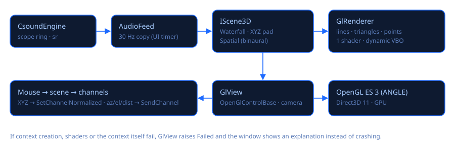

# 3D views (OpenGL)

Open them with **3D** in the toolbar (Ctrl+3). The window is independent: move it to a second
monitor or projector and press **F11** for full screen (F11 or Esc to return).

## Scenes

| Scene | What it shows / does | Controls |
|---|---|---|
| **Espectrograma en cascada** | The output spectrum as a terrain: the front row is now, older rows recede and fade. Numbered axes: **frequency in Hz** (50 … 20k, logarithmic), **level in dBFS** (−90 … 0) and **time** (now, −1 s, −2 s…). **Colores** picker: Amber, Viridis, Magma, Inferno, Rainbow (Turbo), Ice, Greyscale (remembered). **Resolution** pickers: bands (32–256), rows per second (10–60) and seconds of history (2–20); the bottom bar shows the analysis (FFT 2048 samples ≈ 43 ms, Hz per bin, real rows/s) and the GPU frame rate. | Drag to orbit, wheel to zoom, double-click or «Vista inicial» to reset. |
| **Pad XYZ** | A sphere in a cube controls **three channels at once** (chosen in the X/Y/Z pickers; each axis spans its slider's range, exponentially for exponential channels). Projections to the floor and walls and a fading trail show the gesture. | Left-drag: X (horizontal) and Y (vertical). Shift+drag or wheel: Z. Right-drag orbits, Ctrl+wheel zooms. The cube edges show each channel's name with its minimum and maximum, and the sphere its current values. «Controla: …» names the document whose sliders are driven (the one shown in the main window); when the pad opens or the document changes, the sphere moves to where the sliders are, without changing them. |
| **Panorámica espacial (binaural)** | A listener's head (nose = front) and a sound source you place around it. Sends **az** (0° front, clockwise), **el** (−40°…90°) and **dist** to the channels with those names. | Drag on the floor; Shift+drag or wheel: height. |

**Abrir plantilla binaural** opens `Binaural3D.csd`: a pulsed source spatialised with
`hrtfmove2`, using the HRTF data that ships with Csound (`samples\hrtf-*-left/right.dat`, chosen
by `sr`). Distance lowers the level and darkens the sound. Listen with headphones.

## Technology

* **Avalonia `OpenGlControlBase`**: Avalonia owns the context. On Windows that is **OpenGL ES 3.0
  over ANGLE / Direct3D 11**, the most robust path across GPUs and drivers. Verified on the
  development PC: *OpenGL ES 3.0 · ANGLE (NVIDIA GeForce RTX 3090 Ti, Direct3D11)*.
* **Silk.NET.OpenGLES 2.23** loads the GL functions from Avalonia's context
  (`GL.GetApi(GetProcAddress)`).
* **GlRenderer**: one shader (position + colour), one dynamic vertex buffer, lines, triangles
  and points, alpha blending and depth test. The shader header switches between GLSL ES 3.00 and
  GLSL 3.30 for desktop GL.
* **GlView**: orbit camera (System.Numerics matrices), continuous redraw
  (`RequestNextFrameRendering`), mouse routing to the scene.
* **LabelOverlay**: axis numbers and names are drawn with Avalonia text over the GPU image, projected with the same camera (`GlView.ViewProjection`), so they stick to the geometry.
* **Bug fixed (2026-11-03)**: the GL image lives in a child composition visual, so the control had no content of its own and Avalonia's hit test went through it: the mouse never arrived (no orbiting, no dragging). `GlView` now implements `ICustomHitTest`.
* **AudioFeed**: a 30 Hz UI timer copies the engine's output buffer. The audio thread is never
  touched by the GPU code.
* **Robustness**: failures in context creation, shader compilation or rendering, and context
  loss, raise `Failed`. The window then explains the problem and the 2D views keep working.
  Closing the main window also closes the 3D window.

## Ideas for later

Vulkan through Avalonia `GpuInterop` if OpenGL ever falls short; a stereo 3D scope (L/R phase
spiral); a wavetable 3D surface; a performance visualiser driven by channels and spectrum bands;
a 3D instrument graph.

Source: `src/CsoundVisual/Visual3D/` (`GlView`, `GlRenderer`, `Scenes`) and
`Views/Visual3DWindow.cs`.
