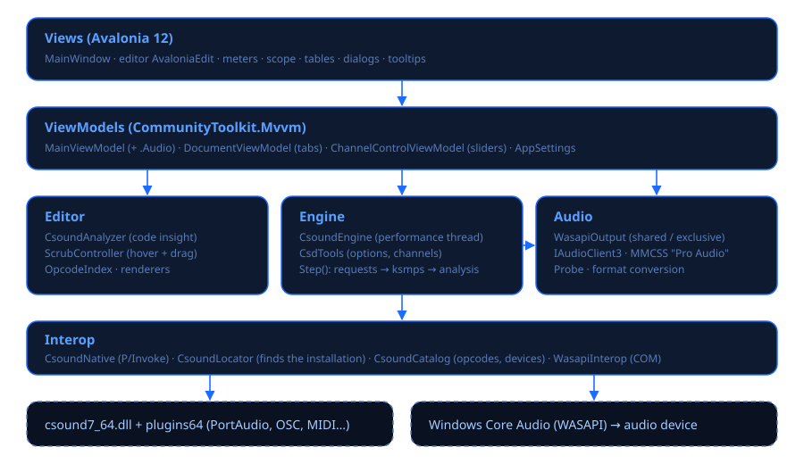
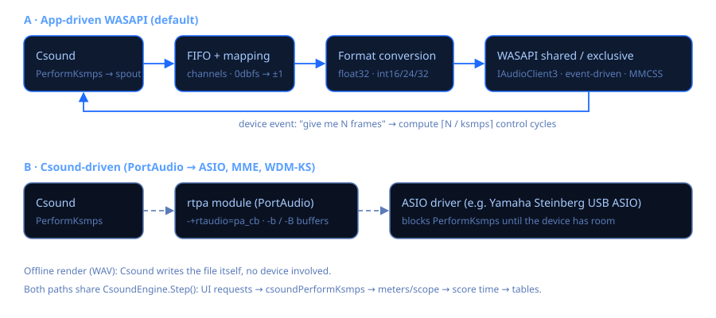
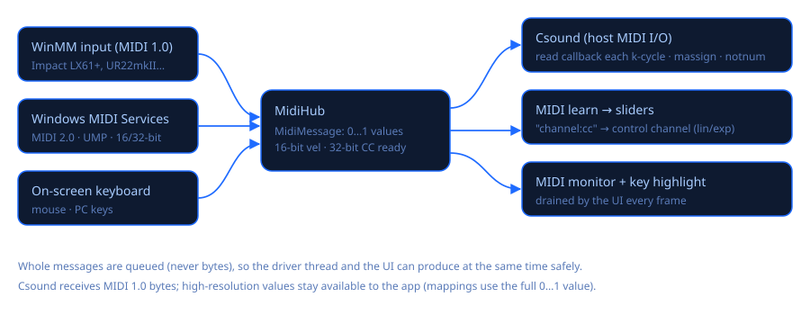
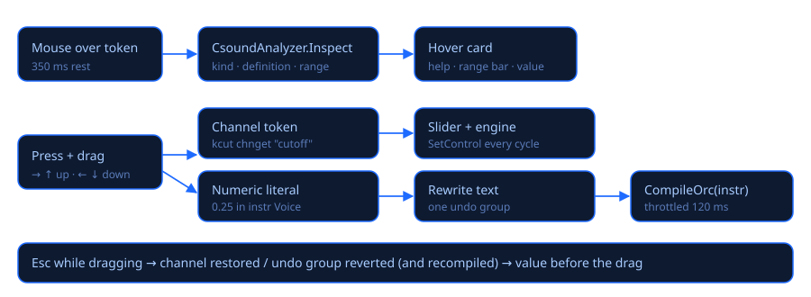

# Arquitectura

Csound Visual es una aplicación de escritorio en C# (.NET 10) con Avalonia 12, AvaloniaEdit y
CommunityToolkit.Mvvm. Usa la biblioteca nativa de Csound 7 (`csound7_64.dll`, doubles de 64
bits) por P/Invoke y solo funciona en Windows.



## Estructura del repositorio

```
CSound Visual.code-workspace   Workspace de VS Code (dos carpetas + tareas de Csound)
.vscode/                       Ajustes de la carpeta (tema amarillo oscuro), tareas de compilar y ejecutar
@Source/Csound7/               Instalación binaria de Csound 7.0 (DLL, headers, plugins, ejemplos) — no se modifica
src/CsoundVisual.slnx          Solución
src/CsoundVisual/
  Program.cs, App.axaml(.cs)   Punto de entrada (+ --audio-probe / --audio-test), tema, ventana principal
  Audio/                       Salida WASAPI propia: WasapiOutput (compartido/exclusivo), WasapiInterop (COM)
  Interop/                     CsoundNative (P/Invoke), CsoundLocator, CsoundCatalog (opcodes, dispositivos)
  Engine/                      CsoundEngine (hilo de performance), LiveValueMonitor, WavRecorder, CsdTools
  Midi/                        MidiMessage (alta resolución), WinMmMidiInput, MidiHub
  Music/                       Etapa 4: TransportScheduler (anticipación, reloj de Csound), PianoRollModel, StepPattern, ScoreBlocks, PFields
  Editor/                      CsoundAnalyzer, ScrubController, CompletionProvider, OpcodeIndex, renderers, Csound.xshd
  Controls/                    LevelMeter, Oscilloscope, SpectrumView, TableView, Sparkline, RangeIndicator, PianoKeyboard
  ViewModels/                  MainViewModel (+ .Audio, .Live, .Midi, .LiveCoding), DocumentViewModel, ChannelControlViewModel, AppSettings
  Views/                       MainWindow, ConfirmSaveDialog, InfoDialog
  Styles/Theme.axaml           Tema, iconos, clases de estilo, ayudas emergentes
  Assets/                      Demo.csd, app.ico, app.png
docs/                          en/, es/, diagrams/, html/ (generado)
tools/                         build_docs.py (documentación HTML), make_icon.py (ícono)
```

## Capas y responsabilidades

* **Interop** conecta con la biblioteca nativa. `CsoundLocator` busca la instalación
  (`CSOUND_VISUAL_HOME`, una carpeta `@Source\Csound7` sobre el ejecutable o
  `%ProgramFiles%\Csound7`). `CsoundNative` declara la parte de la API que se usa: núcleo, E/S
  de audio y MIDI del host, y debugger. `CsoundCatalog` usa instancias de corta vida para listar
  opcodes y los módulos y dispositivos de audio de Csound.
* **Audio** es la salida propia de baja latencia. Ver [Motor de audio y latencia](motor-de-audio.md).
* **Engine** maneja una ejecución: un `CSOUND*` por cada vez que tocas, en su propio hilo. También
  tiene el monitor de valores en vivo (callback del debugger), la grabadora y el puente MIDI.
* **Midi** junta el MIDI de los puertos y del teclado en pantalla en un tipo de mensaje neutro y
  de alta resolución, y lo reparte a Csound, a la interfaz y al MIDI learn.
* **Editor** es la capa de inteligencia del código: análisis, ayuda y arrastre, autocompletado
  y resaltado.
* **ViewModels** guardan el estado y los comandos y nunca tocan controles de Avalonia. La ventana
  entrega los selectores de archivo, los diálogos y el movimiento del cursor mediante delegados
  y eventos.

## El hilo de performance

1. Si corresponde, abre el dispositivo WASAPI (su frecuencia pasa a `--sample-rate`) y registra
   el hilo en MMCSS como *Pro Audio*.
2. `csoundCreate` → callback de mensajes → `csoundSetHostAudioIO` / `csoundSetHostMIDIIO` con el
   callback de lectura MIDI → `csoundSetOption` → `csoundCompileCSD` (texto) → debugger y
   callback de valores en vivo → `csoundStart`.
3. El ciclo. En cada ciclo de control corre `Step()`: aplica lo que pidió la interfaz (canales,
   eventos, recompilaciones), llama a `csoundPerformKsmps` y actualiza medidores, osciloscopio,
   grabadora, tiempo y tablas. Con la salida propia, el ciclo lo marca el evento del dispositivo
   y se miden la carga de DSP y los cortes.
4. Fade-out, se suelta el debugger, `csoundDestroy` y se avisa `Finished`.

La interfaz nunca llama a Csound. Encola pedidos en colecciones concurrentes y lee
instantáneas en cada cuadro: medidores, osciloscopio, mensajes, diccionarios inmutables de
valores en vivo y la cola MIDI.



## Herramientas musicales

El piano roll y el secuenciador por pasos (`Music/`, `Views/PianoRollWindow.cs`, `Views/StepSequencerWindow.cs`) comparten un hilo `TransportScheduler` que lee el tiempo de partitura de Csound y encola las notas con 120 ms de anticipación mediante `CsoundEngine.SendEventAt`; el hilo de interpretación convierte cada tiempo absoluto en el p2 de la sentencia `i` justo antes del ciclo de control. Los patrones llegan al programador como copias inmutables. Ver [Herramientas musicales](herramientas-musicales.md).

## Paint Rooms

`Paint/` contiene la base que comparten las pestañas de Paint Rooms (`Views/PaintRoomsWindow.cs`;
una clase por sala que implementa `IPaintRoom`): `SpectralImage` (columnas de tiempo × filas de
altura, dos capas float I/D, por columnas), `PitchAxis`/`ScalaScale`, `PaintSession` (imagen,
historial de deshacer con memoria acotada, ajustes de síntesis, portapapeles; vive en
`MainViewModel.PaintSession`), `BrushEngine`, `ImageOps` (registro de operaciones), `ImageCodec`
(SkiaSharp), `Stft`, `WavIO`. El sonido: `PaintTables` convierte la imagen en datos de tablas de
Csound y `PaintCsoundCode` escribe el instrumento (`instr 9301`: en cada período de control
recorta las columnas actuales de las tablas de imagen con `ftslice`, las suaviza con aritmética de
arreglos y maneja bancos de osciladores `adsynt2`). `PaintLivePlayer` toca por el motor de la app
con `CsoundEngine.InvokeOnCsoundThread`: una secuencia de acciones cortas, una por ciclo de
control, que compila el código, crea un juego de tablas nuevo, copia los datos directo a la
memoria de las tablas (`csoundGetTable`) y empieza una nota sostenida con número de instrumento
fraccionario; las ediciones se vuelven a subir columna por columna. Con Csound detenido,
`MainViewModel` (como `IPaintEngineHost`) inicia una pequeña orquesta anfitriona que ya trae el
instrumento. `PaintRenderer` escribe un `.csd` independiente con sus tablas en archivos de datos
(GEN01/GEN23) y lo renderiza en una instancia privada del motor. Ver
[Paint Rooms](salas-de-pintura.md).

**Filtro de imagen** (`Views/ImageFilterRoom.cs`, `Paint/ImageFilter*.cs`): la sala tiene su propia
`PaintSession` (lienzo, deshacer y eje propios) por sesión compartida. `ImageFilterTables` lleva las
filas de la imagen a los bins de la FFT (máximo de las filas cubiertas / interpolación entre filas) y
guarda una ganancia por bin y columna; `instr 9351` (tablas 33500…) recorta la columna actual en cada
período de control, la mezcla y suaviza con aritmética de arreglos y la aplica con `pvsanal` →
`pvsmaska` → `pvsynth` por canal (fuente: `diskin2` sobre una copia estéreo temporal del WAV, o
`inch 1/2`). La latencia N + 2·salto se compensa en el render y en la señal seca. `ImageFilterPlayer`
reusa la subida por etapas de `PaintLivePlayer` sobre el mismo «Paint Rooms host».

**Spectrum Room** (`Views/SpectrumRoom.cs`): también con una `PaintSession` privada; cada imagen
analizada queda ligada a su `SpectrumAnalysis` (sonido, ajustes, original intacto) mediante una
`ConditionalWeakTable`, así deshacer entre re-análisis sigue siendo coherente. `SpectralAnalysis`
hace una STFT en flujo (sin guardar las ventanas) en bloques de columnas en paralelo, pone la potencia
de cada bin en las filas alrededor de su frecuencia verdadera (vocoder de fase; las filas de los
bordes recogen lo que queda fuera del eje) y guarda niveles en dB. `SpectralMask` convierte
editada ÷ original en ganancias por celda y las aplica con STFT → ganancia → ISTFT (suma solapada
ponderada, identidad exacta sin ediciones; las ventanas con ganancia 1 se saltan la FFT). Escucha: el
resultado de la máscara se calcula en C# a un WAV estéreo temporal y lo toca `SoundPreviewPlayer`
(`instr 9311`, `diskin2`, compilado en la interpretación en curso; el mismo patrón de orquesta
anfitriona que `PaintLivePlayer`). La vía aditiva convierte los niveles a los de Paint Synth y usa
`PaintLivePlayer`/`PaintRenderer`. Los archivos que no son WAV los decodifica `SoundFileLoader` con dos
ejecuciones de `csound.exe` (información, luego `diskin2` a la frecuencia propia del archivo).

**Capa de ruido e imágenes de 16 bits**: `SpectralImage.Noise` es una tercera capa float opcional (ruido
por celda, 0 = tono … 1 = banda de ruido; `null` hasta que se usa) que viaja en las entradas por
columnas de `ImageHistory`, en la instantánea / mezcla por máscara / portapapeles / mover de
`PaintSession`, en las operaciones geométricas de `ImageOps`, en los pinceles (`BrushSettings.Noise` /
`NoiseOnly`) y en `Retuned`. En el modo Senos una imagen ruidosa activa `PaintTables.Mixed`: instr 9301
recibe p14 = 1 y la tabla 13 de su juego (ruido, `(W+1)·H`); la amplitud a de cada fila se reparte con
igual potencia en a·√(1−n) (tono) y a·√n (banda de ruido) y el tono viaja sobre el banco seno de las
bandas de ruido, así que la mezcla cuesta lo mismo que Bandas de ruido. `ImageCodec` decodifica PNG/TIFF
de 16 bits con WIC como `Rgba16` directo y sin gestión de color, y lo convierte con un remuestreo
separable en coma flotante (`FromPixels`, que usan también las lecturas RGB / RGBA: azul = ruido, alfa =
máscara de volumen); `WritePng16` es un escritor mínimo de PNG RGBA de 16 bits para exportar.

**Image Sequencer** (`Views/ImageSequencerRoom.cs`, `Paint/ImageSequencer.cs`,
`Controls/SequencerTimeline.cs`): los patrones son `SpectralImage` pequeñas (una columna por paso), cada
una en su propia `PaintSession` (su propio deshacer); los clips (registros `SeqClip`: patrón, pista,
paso inicial, repeticiones, transposición, al revés, invertir, ganancia) se ordenan en pistas ×
compases. `SequencerComposer.Compose` estampa los clips en un lienzo de pasos × 8 columnas (el gate se
escribe como columnas encendidas por paso) que dura lo que el arreglo, y lo toca el `PaintLivePlayer`
propio de la sala (ranura 1: su propio anillo de tablas 31640… y rango de instancias 9301.5001…, para
sonar junto al de Paint Synth en la misma interpretación; `HostInUseByOthers` evita que uno detenga la
orquesta anfitriona del otro). Las ediciones mientras suena se comparan columna por columna
(`CopyChanged`) y se suben como trazos de pincel. El documento se guarda en
`PaintRoomSettings.Sequencer` (niveles en base64 de 16 bits).

## MIDI



`WinMmMidiInput` (MIDI 1.0) alimenta al `MidiHub`. Un backend de Windows MIDI Services (MIDI 2.0
/ UMP) podrá alimentarlo igual: `MidiMessage.FromUmp` ya decodifica los paquetes de voz de canal
de MIDI 2.0 con velocidad de 16 bits y controladores de 32 bits. Csound recibe bytes MIDI 1.0,
que pide con su callback de lectura en cada ciclo de control. El MIDI learn usa el valor con
resolución completa.

## Valores en vivo

`LiveValueMonitor` registra `csoundSetDebugCallback`. Unas 30 veces por segundo recorre las
instancias activas (`csoundDebugGetInstrInstances`), lee las variables numéricas y de audio
(`csoundDebugGetVariables`, `csoundDebugGetGlobalVariables`) y publica un diccionario inmutable.
La clave es (número de instrumento, nombre de variable) y guarda el valor, el mínimo y el máximo,
la polifonía y un historial. Los instrumentos con nombre se resuelven con `csoundGetInstrNumber`.

## Live coding



| Gesto | Efecto | Implementación |
|---|---|---|
| Mover un slider | Cambia el canal | `ChannelControlViewModel` → `CsoundEngine.SetControl` |
| Arrastrar una variable de canal o el nombre del canal | El mismo canal; el slider la sigue | `ScrubController` → `IScrubHost.SetChannelValue` |
| Arrastrar un número dentro de un `instr` | Se reescribe el número y se recompila el instrumento | `LiteralScrubbed` → `CompileOrc(bloque)` con límite de frecuencia |
| Ctrl+Enter | Se recompila la selección o el instrumento | `MainViewModel.EvaluateCode` → `CompileOrc` |
| Ctrl+Shift+Enter | Las líneas de partitura se envían como eventos | `SendScoreLines` → `SendEvent` |

## Análisis del código

`CsoundAnalyzer` es heurístico y trabaja por líneas:
- separa secciones y bloques;
- interpreta instrucciones: sintaxis clásica, asignaciones y líneas de solo opcode;
- clasifica lo que está bajo el mouse: variable, número, p-field, constante del encabezado,
  nombre de canal u opcode.

Usa la lista real de opcodes (`OpcodeIndex`) para distinguir variables de opcodes. El rango lo
deduce de la definición: lecturas de canal, literales, `random`, `limit`, generadores de
segmentos, envolventes, amplitud de osciladores, disparos y cadenas de suavizado.

Límites conocidos: entiende solo en parte las macros, los `#include` y las instrucciones de
varias líneas.

## Compilar

```
dotnet build src/CsoundVisual.slnx
dotnet run --project src/CsoundVisual/CsoundVisual.csproj
python tools/build_docs.py        # regenera docs/html
```
