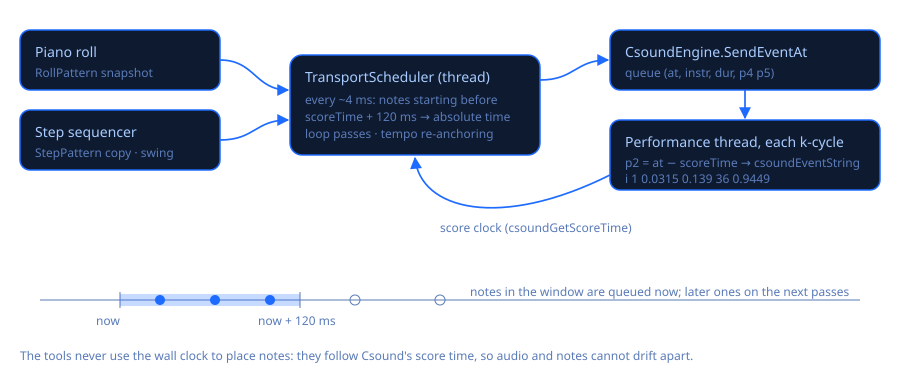

# Herramientas musicales: piano roll y secuenciador por pasos

La etapa 4 agrega dos herramientas que **tocan los instrumentos del documento en vivo con
Csound** y pueden **escribir lo que hiciste en la partitura**. Se abren con **Herramientas** en la
barra superior (el botón con el ícono de piano roll) o con los atajos:

| Herramienta | Atajo | Para |
|---|---|---|
| **Piano roll** | Ctrl+P | Dibujar melodías, acordes y bajos en una cuadrícula altura × tiempo |
| **Secuenciador por pasos** | Ctrl+Shift+P | Ritmos: pistas × semicorcheas, con un kit de batería sintetizado |
| **Abrir kit de batería** (menú Herramientas o secuenciador) | — | La plantilla `DrumKit.csd` (instrumentos 1 a 8) en una pestaña nueva |

Las dos ventanas pueden quedar abiertas junto al editor (o en un segundo monitor). Al cerrarlas
se conserva lo que hiciste durante la sesión; al cerrar la ventana principal se cierran.

## Csound tiene que estar tocando

Las herramientas no suenan por sí mismas: envían notas (sentencias `i`) a la interpretación de
Csound en curso. Si Csound **no** está en Tocar cuando presionas **▶ Tocar** en la herramienta,
esta lo inicia con el documento elegido (como si presionaras F5) y empieza en cuanto la
interpretación corre. Si Csound está renderizando, o el documento no compila, la herramienta lo
dice en su línea de estado (abajo a la derecha) y aparece la burbuja «presiona Tocar» de la
ventana principal.

**Documento elegido**: el que está sonando; con Csound detenido, el que se ve en el editor. Su
nombre aparece bajo la barra de la herramienta. Las listas de instrumentos salen de sus líneas
`instr` (números o nombres; el comentario de `instr 1 ; Kick` se muestra como «1 · Kick») y se
actualizan cuando cambia el documento. Un instrumento que no está en el documento aparece como
«no está en el documento» y la herramienta avisa antes de tocar.

Si la partitura del documento termina (por ejemplo una partitura de prueba de 4 segundos),
Csound se detiene y el transporte también: dale a la partitura un evento largo como
`i "Reverb" 0 3600` o `f 0 3600`. La demo y el kit de batería ya lo tienen.

## Piano roll

| Zona | Qué haces |
|---|---|
| **Cuadrícula** | Clic en vacío = nota nueva (mantén el botón y arrastra: **derecha = duración, arriba/abajo = velocidad**). **Clic derecho y arrastrar en vacío = selección con recuadro**, y **Supr** borra las notas seleccionadas (Shift/Ctrl suma a la selección; Ctrl+arrastrar con el izquierdo también dibuja el recuadro). Arrastrar una nota = moverla (las seleccionadas se mueven juntas); **Alt+arrastrar** copia. Arrastrar el **borde derecho** = duración. **Clic derecho** o doble clic = borrar (toda la selección si la nota está seleccionada). **Ctrl+clic** agrega/quita una nota de la selección. Botón del medio = desplazar. |
| **Teclas** (izquierda) | Clic (y arrastrar) para escuchar notas mientras Csound toca. Rótulo en cada Do: C4 = MIDI 60 = Do central (Cubase lo llama C3; la línea de estado siempre muestra el número MIDI). |
| **Regla** (arriba) | Clic = posición de inicio (línea verde punteada; la reproducción y el pegado empiezan ahí). Arrastrar = rango del loop (también activa Loop). |
| **Carril de velocidad** (abajo) | Arrastra sobre las barras para dibujar velocidades como una línea; con selección solo cambian las notas seleccionadas. La intensidad del color de la nota también muestra la velocidad. |
| **Rueda** | Rueda = altura, Shift+rueda = tiempo, **Ctrl+rueda = zoom de tiempo** alrededor del mouse, Ctrl+Shift+rueda (o Alt+rueda) = zoom de altura. |
| **Teclado** (cuadrícula con foco) | Supr, Ctrl+A, Ctrl+C / Ctrl+V (pega en la línea verde), Ctrl+D (duplica tras la selección), **Ctrl+Z / Ctrl+Y** (deshacer/rehacer, 200 pasos), flechas (mueven un paso de cuadrícula / un semitono; Shift+↑↓ = octava), Q (cuantiza los inicios), Esc (deselecciona), **Espacio** = tocar/detener. |

Barra: **Tocar/Detener**, **Loop**, **Tempo** (BPM, se puede cambiar mientras suena),
**Cuadrícula** (1/1 … 1/32, tresillos 1/4 T, 1/8 T, 1/16 T, «—» = libre), **Instrumento**, cómo se
escriben **p4** y **p5**, **Grabar MIDI**, **Insertar en la partitura**, **Importar** y «⋯»
(deshacer/rehacer, seleccionar todo, cuantizar, duplicar, borrar, loop a las notas, ver todas,
volver al inicio, quitar el bloque).

### Cómo se escriben los p-fields

Cada nota se convierte en `i <instr> <inicio> <duración> <p4> <p5>`:

| Opción de p4 | Valor del Do central | En el instrumento |
|---|---|---|
| Nota MIDI (predeterminada) | `60` | `cpsmidinn(p4)` (la `Voice` de la demo), `mtof:i(p4)` |
| Hz | `261.6256` | `p4` directamente |
| cpspch | `8.00` (La4 = `8.09`) | `cpspch(p4)` |
| oct | `8` (La4 = `8.75`) | `cpsoct(p4)` |

p5 es la velocidad como **0…1** (velocidad / 127, lista para multiplicar una amplitud, como hace
`Voice` con `asig * p5`) o **0…127**.

### Grabar MIDI

Activa **Grabar MIDI** y presiona Tocar: las notas que tocas en tu teclado MIDI (o el de pantalla)
mientras corre el transporte se agregan al piano roll, ajustadas a la cuadrícula (el inicio a la
línea más cercana, la duración a pasos enteros). Con Loop puedes grabar por capas. Toda la toma es
un solo paso de deshacer (Ctrl+Z).

## Secuenciador por pasos

Cada **fila** es una pista: nombre, **instrumento** (p1), **nota** (p4; en el kit afina el tambor,
el tom la usa como altura), **velocidad** para los pasos nuevos, **probabilidad** (0–100 %: cada
paso encendido suena con esa probabilidad en cada vuelta), **M** (silenciar) y **S** (solo: si
alguna pista está en solo, solo suenan esas) y «⋯» (relleno euclidiano de 1 a 16 golpes, aleatorio,
rotar a izquierda/derecha, borrar, escuchar, quitar la pista). **+ Pista** agrega filas (hasta 16).

**Pasos**: clic = encender/apagar; mantén el botón y barre hacia el lado para pintar varios; **mantén el botón y mueve arriba/abajo** sobre la celda (o **Shift+arrastrar
arriba/abajo** o la **rueda** sobre un paso = su velocidad (altura de la barra); **clic derecho** =
acento (127) sí/no. Mientras suena se resalta el paso que se escucha. Ctrl+Z / Ctrl+Y deshacen y
rehacen.

Generales: **Tempo**, **Swing** 0–75 % (retrasa cada segunda semicorchea esa fracción de paso:
33 % ≈ tresillo, 50 % = puntillo), **Pasos** 8 / 16 / 32 (medio compás, uno, dos; los pasos que
sobran se conservan), **Abrir kit de batería**, **Exportar a partitura** con **Vueltas**,
**Importar** y «⋯» (patrón de ejemplo, aleatorio en todas, borrar todo, quitar mute/solo, p4/p5,
quitar el bloque).

### El kit de batería (`Assets/DrumKit.csd`)

Ocho tambores sintetizados, sin samples: **1 bombo, 2 caja, 3 hi-hat cerrado, 4 hi-hat abierto,
5 palmas, 6 tom, 7 aro, 8 cencerro**, más **instr 100 Master** (envío a reverb, saturación suave,
volumen). 48 kHz, estéreo, `0dbfs = 1`. Cada tambor recibe **p4 = nota MIDI** (afinación respecto
de su nota General MIDI: bombo 36, caja 38, hi-hat cerrado 42, abierto 46, palmas 39, tom 45, aro
37, cencerro 56; 0 = la de siempre) y **p5 = velocidad 0…1** (0 = 0,8), así que el piano roll
también puede tocarlo. El hi-hat cerrado corta al abierto. Sliders: **volume**, **reverb**,
**drive**. Pruébalo a mano: `i 1 0 1 36 0.9` en el evento en vivo.

Las pistas por defecto apuntan al kit (pista *n* → instrumento *n*) y traen un groove funk/pop
a 108 BPM con un poco de swing: **Abrir kit de batería** y luego **▶ Tocar**; Csound arranca con
el kit y suena el groove.

## Tiempo: cómo se programan las notas



* Las dos herramientas comparten un **programador con anticipación** (`Music/TransportScheduler.cs`)
  en su propio hilo de prioridad alta, que despierta cada ~4 ms medidos con `Stopwatch`.
* El reloj es **el tiempo de partitura de Csound** (`csoundGetScoreTime`, que se publica tras cada
  ciclo de control), no el reloj de pared: no hay deriva entre las herramientas y el audio,
  cualquiera sea la frecuencia real del dispositivo.
* En cada pasada el programador pide al patrón las notas que empiezan antes de **tiempo de
  partitura + 120 ms** y las encola con su **tiempo absoluto** (`CsoundEngine.SendEventAt`). El
  hilo de interpretación lo convierte en el desfase p2 **justo antes del ciclo de control** que
  la recibe: `i 1 0.0315 0.139 36 0.9449`. Así la nota empieza en el periodo de control exacto
  (1,3 ms con ksmps 64 a 48 kHz; usa `--sample-accurate` para precisión de muestra), sin importar
  el jitter del hilo ni el tamaño del búfer de audio (el reloj avanza de a un búfer; la
  anticipación cubre búferes de hasta ~100 ms).
* Las notas con más de 250 ms de atraso (tras un bloqueo) se descartan en vez de sonar todas
  juntas; la herramienta avisa cuántas.
* **Loop**: el transporte cuenta pulsos lineales; cada vuelta se lleva a la región del loop con un
  desfase calculado del número de vuelta, así que una nota justo en el punto de vuelta se envía
  exactamente una vez. El piano roll toca una vez lo que hay antes del inicio del loop y luego
  repite la región; una nota que cruza el final del loop se acorta.
* **Cambios de tempo**: el mapa pulso ↔ tiempo se re-ancla en el punto ya programado; nada se
  envía dos veces ni se salta.
* Lo que editas mientras suena se oye en la vuelta siguiente: las herramientas le entregan al
  programador una copia inmutable tras cada edición.
* Detener termina el transporte; las notas ya empezadas terminan su duración. Si Csound se
  detiene, el transporte también.

## Formato en la partitura (exportar / importar)

Las herramientas escriben un **bloque marcado** al final de `<CsScore>`; al exportar de nuevo se
reemplaza y no se toca nada más de la partitura (Ctrl+Z en el editor lo deshace). Un CSD sin
partitura recibe una.

```
; --- piano roll begin ---
; Csound Visual · piano roll (Tools › Piano roll). Re-exporting replaces this block.
;@roll tempo=120 instr=Voice pitch=midi vel=unit snap=0.25 loop=0:16:1
; times in seconds at 120 BPM (1 beat = 0.5 s) · p4 = MIDI note · p5 = velocity 0-1
i "Voice" 0          0.5        60 0.7874
i "Voice" 0.5        0.5        64 0.7874
; --- piano roll end ---
```

* **Los tiempos van en segundos** (pulsos × 60 / BPM), no en pulsos con una sentencia `t`: una
  sentencia `t` también cambiaría el tiempo de todo lo demás de la partitura (el `i "Reverb" 0
  3600` de la demo pasaría a durar 3600 pulsos) y solo se permite una por sección, así que
  convertir es la única opción segura.
* La línea `;@roll` guarda el tempo y los ajustes, así que **Importar** vuelve a pulsos de forma
  exacta (las posiciones se redondean a 1/960 de pulso). Verificado con una prueba de ida y vuelta:
  60 notas al azar × 4 formatos de p4 × 2 de p5 × 3 tempos vuelven idénticas.
* El secuenciador escribe `;@seq` (tempo, pasos, swing, vueltas, formato) y una línea `;@track`
  por fila (nombre, instrumento, nota, velocidad, mute, solo, probabilidad y la velocidad de cada
  paso), seguidas de las líneas `i` de las **Vueltas** (con swing y mute/solo; la probabilidad se
  sortea con una semilla fija, así que el mismo patrón siempre exporta lo mismo).
* **Importar (piano roll)**: del bloque si existe (también restaura los ajustes); si no, todas las
  sentencias `i` del instrumento elegido en la partitura, al tempo y formato actuales (las líneas
  con `.`, `+`, rampas o expresiones se omiten y se cuentan). **Importar (secuenciador)**: de su
  bloque.
* Al abrir una herramienta, si el documento elegido tiene su bloque (y la herramienta sigue vacía
  o sin tocar), se carga sola: guardas el archivo, lo abres mañana, abres la herramienta y el
  patrón vuelve.

## Código

`Music/` (`TransportScheduler`, `PianoRollModel`, `StepPattern`, `ScoreBlocks`, `PFields`,
`EngineScoreTarget`), `Controls/PianoRollView.cs`, `Controls/StepGridView.cs`,
`Views/PianoRollWindow.cs`, `Views/StepSequencerWindow.cs`, `Views/ToolTransport.cs`,
`ViewModels/MainViewModel.MusicTools.cs`, `Engine/CsoundEngine.cs` (`SendEventAt`),
`Assets/DrumKit.csd`.
