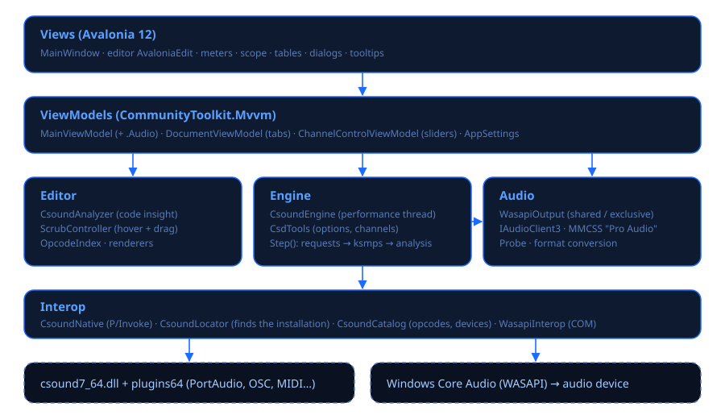

# Csound Visual

**Csound Visual** es un entorno gráfico para hacer música con [Csound 7](https://csound.com) en
Windows. Lo escribes en código y lo tocas, lo ves y lo controlas en vivo: cada variable, número o
canal del código se puede inspeccionar y arrastrar mientras suena.

> **Hecho 100% con vibe coding.** Cada línea de código, cada prueba y cada página de documentación
> de Csound Visual la escribió una IA ([Claude Code](https://claude.com/claude-code), de
> Anthropic) a partir de conversaciones en lenguaje natural. Su autor dirigió el proyecto, lo
> probó y decidió qué construir, pero no escribió el código a mano.

## Qué puedes hacer

| Área | Funciones |
|---|---|
| **Editor** | Pestañas, resaltado de sintaxis de los ≈2500 opcodes reales, autocompletado con firmas, F1 abre el manual, marca de errores en la línea, aviso de cambios sin guardar. |
| **Ayuda viva** | Pasa el mouse sobre una variable o un número: qué es, dónde se define, su rango y **su valor en vivo** con una mini gráfica. Arrástralo para cambiarlo; Esc vuelve al valor anterior. |
| **Audio** | Motor WASAPI propio: compartido (convive con otras apps) o exclusivo (≈3 ms). PortAudio/ASIO también disponible. Diagnóstico de cada dispositivo. |
| **Tocar en vivo** | Sliders automáticos para cada canal, MIDI learn, teclado en pantalla y del PC, entrada MIDI (WinMM; MIDI 2.0 en camino). |
| **Live coding** | Ctrl+Enter recompila el instrumento bajo el cursor sin cortar el audio; Ctrl+Shift+Enter envía líneas de partitura. |
| **Ver** | Osciloscopio, espectro, medidores de pico, tablas, panel *Observar* con variables fijadas. |
| **Guardar el resultado** | Grabar lo que suena (con tus cambios en vivo) o renderizar el archivo a WAV. |

## Empezar en 1 minuto

1. Abre `CsoundVisual.exe` (o en VS Code: *Tasks: Run Task › Csound Visual: ejecutar*).
2. Presiona **Tocar** (F5). Suena el demo.
3. Mueve los sliders de **Controles en vivo**, toca el **teclado** de abajo o tu controlador MIDI.
4. Pasa el mouse sobre `kcut` en el código y arrástralo hacia la izquierda.

Sigue con la [guía de usuario](guia-de-usuario.md).
