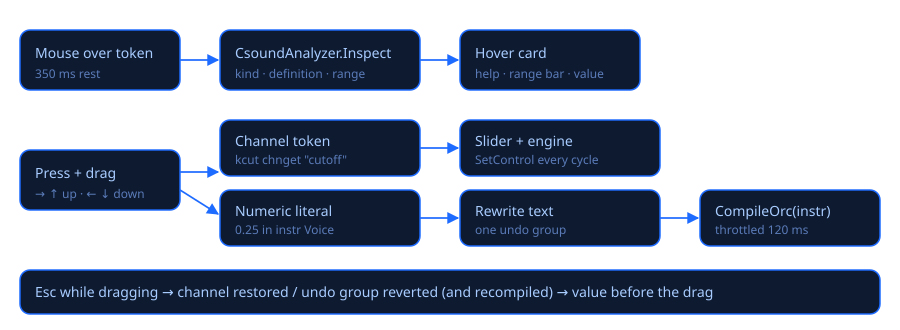

# Ayuda al pasar el mouse y valores en vivo

## La tarjeta de ayuda

Deja el mouse quieto ≈⅓ de segundo sobre algo del código:

| Sobre… | La tarjeta muestra |
|---|---|
| una **variable** (`kcut`, `aL`, `gaRevL`) | tipo (audio/control/init/texto, global o local), dónde se define, dónde se reasigna, cuántas veces se usa, qué hace (lee un canal, es una envolvente ADSR de 0 a 1, un oscilador de ±amp, un aleatorio entre a y b…) y su **rango posible** |
| un **número** | qué argumento de qué opcode es, el tipo que espera el opcode, un rango sugerido (corte, resonancia, paneo, tiempos de ADSR…), los campos de `chnk`, las constantes del encabezado y los p-fields de la partitura |
| un **p-field** (`p4`) | qué significa, los valores que toma en la partitura y las expresiones que le mandan `schedule`/`schedulek`/`event` |
| un **nombre de canal** (`"cutoff"`) | su rango y valor actual |
| un **opcode** | sus firmas legibles (entradas y salidas) |

### Valores en vivo

Mientras suena, la tarjeta de una variable muestra además **su valor en este instante**, el
mínimo y el máximo vistos, cuántas notas del instrumento están activas y una **mini gráfica** de
los últimos ≈3 segundos. Para variables de audio se muestra el pico del bloque.

Se usa el debugger de Csound 7 (`csoundSetDebugCallback`): después de cada ciclo de control, ≈30
veces por segundo, la app lee las variables de cada instancia activa. Si hay varias notas del
mismo instrumento, muestra la más reciente. Se puede desactivar con **Valores en vivo** en la
tarjeta *Observar*.

### Observar

Clic derecho sobre una variable › **Observar «nombre»** la fija en el panel *Observar* con su
valor, rango y gráfica en vivo. El mismo menú ofrece **Ir a la definición**, **Ayuda del opcode
(F1)**, deshacer/rehacer y cortar/copiar/pegar.

## Arrastrar para cambiar valores

Presiona sobre una variable que lee un canal, sobre un nombre de canal o sobre un número, y mueve
el mouse:

* **derecha o arriba** sube, **izquierda o abajo** baja, siempre dentro del mínimo y el máximo;
* **Shift** = 10 veces más fino, **Ctrl** = 10 veces más rápido;
* **Esc** (sin soltar) vuelve al valor de antes;
* un clic sin mover se comporta como un clic normal.

| Lo que arrastras | Qué cambia |
|---|---|
| Variable que lee un canal (`kcut chnget "cutoff"`) o el nombre del canal | El canal, en tiempo real, y su slider. El código no cambia. |
| Número dentro de un `instr` | El número en el código; **mientras suena se recompila el instrumento** (cada 120 ms como máximo) y las notas nuevas usan el valor nuevo. |
| Valor por defecto de un `chnk` | El número en el código y el canal en vivo. |
| Número del encabezado o de la partitura | El número en el código; se aplica al volver a tocar. |

Un arrastre completo es un solo paso de deshacer (Ctrl+Z).

## Autocompletar y manual

* Después de dos letras aparece la lista: variables del archivo, palabras clave y opcodes con
  su firma. Enter o Tab acepta, Esc cierra. **Ctrl+Espacio** la abre a mano.
* **F1** sobre un opcode abre su página del manual de Csound.

## Live coding

* **Ctrl+Enter**: evalúa la selección o el `instr … endin` bajo el cursor sin cortar el audio
  (`csoundCompileOrc`). Las líneas evaluadas destellan en verde.
* **Ctrl+Shift+Enter**: envía la línea de partitura bajo el cursor (o las seleccionadas) como
  eventos en vivo.

## Breakpoints

Detener la interpretación en una línea de un instrumento y ver todas las variables de esa nota.

| Acción | Cómo |
|---|---|
| Poner / quitar un breakpoint | Clic en la franja angosta a la izquierda de los números de línea (aparece un punto rojo), **F9** en la línea del cursor, o clic derecho › *Poner breakpoint* |
| Quitar todos | **Shift+F9**, clic derecho › *Quitar todos los breakpoints*, o *Quitar todos* en el panel Depurar |
| Continuar | **F5** en pausa (si no, F5 es Tocar) o *Continuar* |
| Siguiente ciclo de control | **F10** en pausa o *Siguiente ciclo* |
| Detener | *Detener* en el panel Depurar, o Shift+F5 |

Cuando una nota llega a la línea, Csound se detiene **antes** de ejecutarla: el dispositivo sigue
andando pero suena **silencio** (no se cuentan cortes), la línea se pone amarilla con una flecha en
el margen, el editor la muestra, la barra de estado dice «⏸ En pausa en la línea 42 · instr Voice ·
F5 continuar» y se abre el panel **Depurar** sobre el lado derecho del editor con:

* el instrumento, la línea y el opcode que viene, qué nota es («nota 2 de 3»), p1, p2, p3, el
  tiempo de la partitura y el contador de ciclos de control de Csound;
* todas las variables locales (nombre, tasa, valor): `i`/`k` como número, `a` como RMS y pico del
  bloque más sus primeras muestras, arreglos con sus primeros elementos, cadenas `S`, señales `f`
  con el tamaño de la FFT y el bin más fuerte; después las globales (`gk…`, `ga…`, `gi…`).

**Continuar o siguiente ciclo.** Una línea corre una vez por ciclo de control (cientos de veces por
segundo), así que *Continuar* solo se detiene donde una nota **todavía no** se detuvo: otra línea
con breakpoint, otra nota que suena al mismo tiempo, o la próxima nota nueva. *Siguiente ciclo* se
detiene en el próximo breakpoint, como mucho la misma línea un ciclo de control (ksmps muestras)
después: sirve para ver avanzar una envolvente paso a paso.

Dónde funciona:

* solo en líneas dentro de `instr … endin` que corren a tasa k o a. Las líneas que solo corren al
  empezar la nota (`ifreq = p4`), las líneas `instr`/`endin`, líneas vacías, comentarios, el
  encabezado y el cuerpo de los UDO no pueden detenerse: al hacer clic, la barra de estado explica
  por qué. Para un UDO, pon el breakpoint en la línea del instrumento que lo llama;
* solo al **tocar** con el motor de audio de la app (Configuración › Audio › Windows · WASAPI). Al
  renderizar a WAV, o con un módulo de Csound (PortAudio/ASIO), se ignoran y la consola lo dice una vez;
* los breakpoints son del archivo abierto, siguen a su línea mientras editas y duran la sesión (no
  se guardan en el .csd).

Los breakpoints que pones mientras suena funcionan al tiro si *Valores en vivo* está activo (lo
normal), porque las dos funciones usan el depurador de Csound. Con *Valores en vivo* apagado, pon al
menos un breakpoint antes de Tocar.

**Editar mientras suena o en pausa.** Los números de línea de Csound son los del código que está
corriendo. Si insertas líneas sobre un instrumento, la app sabe dónde quedó cada línea que corre
(la pausa se muestra en la línea correcta). **Ctrl+Enter** (o arrastrar un número) recompila el
instrumento numerado como lo muestra el editor ahora, y sus breakpoints pasan al código nuevo. Una
recompilación pedida en pausa se aplica al continuar.

Límites del depurador de Csound 7.0 (verificados; la app los esquiva donde se puede):

* solo se detiene *antes* de una línea, no entre los opcodes de una misma línea, y no hay «entrar
  al UDO» ni «ir a la línea siguiente»: *Siguiente ciclo* es el paso más fino;
* las operaciones de una expresión a veces quedan marcadas con la línea siguiente (un breakpoint en
  `kcut = 500 + kenv * 2000` puede detenerse en `=` mientras el `*` pertenece a la línea de abajo);
* al reanudar a mitad de una línea con varios opcodes, Csound se detendría para siempre en el mismo
  opcode e informa la nota equivocada en las pausas siguientes del mismo ciclo; la app quita esa
  línea por el resto del ciclo y la vuelve a poner antes del siguiente;
* si dos notas del mismo instrumento se detienen en el mismo ciclo, el panel muestra la primera.

Prueba sin sonido (usa el motor WASAPI real, silenciado):
`CsoundVisual.exe --breakpoint-test archivo.csd LÍNEA [DESPLAZAMIENTO]` imprime las variables en
cada pausa y comprueba la pausa, el tiempo congelado sin cortes, el siguiente ciclo, continuar a otra
nota, una recompilación desplazada en DESPLAZAMIENTO líneas, quitar todos y detener en pausa.

Código: `src/CsoundVisual/Editor/` (`CsoundAnalyzer`, `ScrubController`, `CompletionProvider`) y
`Engine/LiveValueMonitor.cs`; breakpoints: `Editor/Breakpoints.cs`, `Engine/BreakpointSession.cs`,
`Engine/CsoundEngine.Debugger.cs`, `ViewModels/MainViewModel.Debug.cs`, `Views/DebugPanel.cs`.
