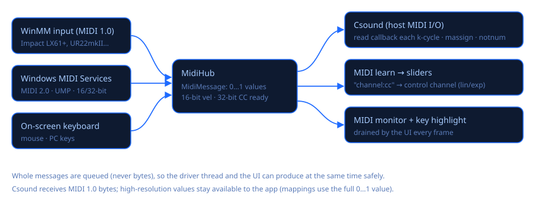

# MIDI (MIDI 2.0 y clásico)

Csound Visual tiene dos backends de entrada MIDI detrás de un mismo repartidor (`MidiHub`):

| Backend (como aparece) | API | Resolución | Notas |
|---|---|---|---|
| **MIDI 2.0** | Windows MIDI Services, `Windows.Devices.Midi2` (WinRT) | velocidad de 16 bits; controladores, presión y pitch bend de 32 bits | Recomendado. Aquí aparecen todos los dispositivos, también los MIDI 1.0 (el servicio los envuelve en UMP). |
| **WinMM** | `midiIn*` clásico | 7 bits (pitch bend de 14) | Alternativa clásica; funciona en cualquier Windows. |

El mismo teclado suele aparecer en los dos. **Activa solo uno**, si no cada nota llega dos veces.

## Modelo de mensajes

`MidiMessage` guarda los valores normalizados de 0 a 1 como double, así no se pierde nada de
lo que manda un dispositivo MIDI 2.0. Para Csound se convierte a bytes MIDI 1.0, que es lo que
leen sus opcodes MIDI (`massign`, `notnum`, `veloc`, `ctrl7`…) mediante los callbacks de MIDI del
host. El MIDI learn usa el valor con resolución completa, así que un controlador de 32 bits mueve
el slider sin escalones.

Paquetes UMP que se decodifican:

* **tipo 0x2**: voz de canal MIDI 1.0 en una palabra (`grupo | status | dato1 | dato2`);
* **tipo 0x4**: voz de canal MIDI 2.0 en dos palabras. Nota on/off lleva la velocidad de 16 bits
  en la mitad alta de la palabra 1. CC, presión de canal y polifónica y pitch bend llevan
  valores de 32 bits en la palabra 1.

Los demás tipos (sistema, SysEx, stream, utilidades, flex data) se ignoran por ahora.

## Integración con Windows MIDI Services

* Paquete: `Windows.Devices.Midi2` **0.99.92-preview.11**. La API está congelada y el paquete
  tiene licencia «go-live». Microsoft lo publica en GitHub
  ([release inbox-preview-11](https://github.com/microsoft/MIDI/releases/tag/inbox-preview-11)),
  no en nuget.org. Por eso está en `src/packages-local/` y se referencia desde `src/nuget.config`.
* El paquete no trae proyección .NET. La genera **C#/WinRT** (`Microsoft.Windows.CsWinRT` 2.2.0)
  a partir del `.winmd` al compilar. Eso exige un framework de Windows: el proyecto apunta a
  `net10.0-windows10.0.26100.0`, pero conserva `bin\<Configuración>\net10.0\` como carpeta de salida.
* La copia local de `Windows.Devices.Midi2.dll` + `.pri` se copia junto al ejecutable. Cuando
  Windows traiga la API en System32, usará la suya. La tarjeta MIDI muestra cuál está activa
  (`MidiApi.IsSystemProvided()`).
* Al iniciar, `MidiApi.EnsureServiceAvailable()` arranca el servicio `midisrv` si hace falta.
  Los endpoints salen de `MidiEndpointDeviceInformation.FindAll(…, AllStandardEndpoints)`, sin
  los loopbacks de diagnóstico. Una sola `MidiSession` («Csound Visual») tiene todas las
  conexiones. Los mensajes se leen con `MidiMessageReceivedEventArgs.FillWords`, que no crea
  objetos por mensaje.

## Bugs y advertencias conocidos (Preview 11 a 13)

Reunidos de las notas de Microsoft y de esta integración:

1. **Requiere Windows 11 25H2 o posterior.** Microsoft no da soporte a 24H2 ni a Windows 10. En
   esos sistemas el backend se declara no disponible y WinMM sigue funcionando.
2. **Las fallas de activación llegan como excepciones.** Si no se puede activar el servicio o la
   API, WinRT lanza una excepción. La app la captura una vez (`Midi2Input.IsAvailable`) y
   muestra el motivo en la tarjeta MIDI.
3. **Bug del instalador de los paquetes opcionales Tools/Transports**
   ([#1323](https://github.com/microsoft/MIDI/issues/1323)): hay que desinstalar las previews
   anteriores antes de instalar las nuevas. Csound Visual no necesita esos instaladores; basta
   con el servicio que trae Windows.
4. **Destruir dispositivos virtuales podía colgarse** en versiones anteriores a noviembre de
   2026. Csound Visual todavía no crea dispositivos virtuales.
5. **Dos copias de la API**: si Windows tiene la API en System32, esa le gana a la de la app. El
   comportamiento puede variar un poco respecto de la preview hasta la versión 1.0.
6. **Condiciones «go-live»** para distribuir la DLL preview: actualizar la app cuando la API
   llegue a Windows, avisar que se usa una API preview (la tarjeta MIDI lo dice) y no
   distribuirla a versiones anteriores a 25H2.
7. **C#/WinRT y .NET**: la proyección generada necesita un framework `-windows10.0.x`, y el
   paquete no debe pasar a otros proyectos que dependan de este. Por eso se referencia con
   `PrivateAssets="all"`; si no, un proyecto `net10.0` dependiente falla con `NETSDK1130`.
8. **Dispositivos duplicados** (ver arriba): el mismo dispositivo aparece como endpoint MIDI 2.0
   y como puertos WinMM. Activa solo uno.

## Verificado

* `EnsureServiceAvailable` → true; origen de la API: preview incluida con la app.
* Endpoints encontrados en este PC: Impact LX61+, Steinberg UR22mkII, Vienna Instruments MIDI.
* Ida y vuelta por el loopback de diagnóstico A→B: una nota MIDI 2.0 con velocidad `0xC000` llegó
  como 0,750011; un CC de 32 bits como 0,5; una nota MIDI 1.0 en UMP como nota 60, velocidad 0,787.
* De WinMM a Csound: las notas 60 y 67 llegan al instrumento con su velocidad (`notnum`/`veloc`).

Código: `src/CsoundVisual/Midi/` (`MidiMessage`, `Midi2Input`, `WinMmMidiInput`, `MidiHub`).
