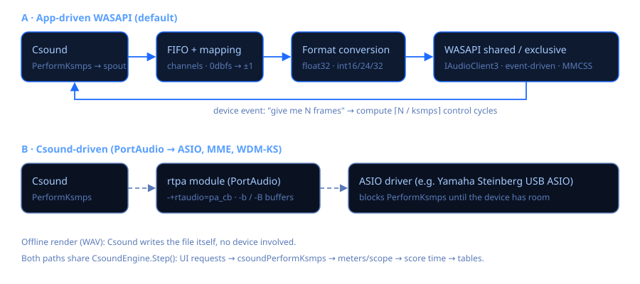

# Motor de audio y latencia

Csound Visual puede manejar el dispositivo de audio de dos maneras. Se elige en la tarjeta
**Audio** (*Motor*), y la app recuerda la elección, el dispositivo, la latencia y el ksmps.



## Motores

| Motor (como aparece en la app) | Quién maneja el dispositivo | Latencia típica | Cuándo usarlo |
|---|---|---|---|
| **Windows · WASAPI compartido (recomendado)** | la app (`WasapiOutput`, modo compartido) | 3–10 ms (según el driver) | El uso diario. Es la salida estándar de Windows 11 y las demás apps siguen sonando. |
| **Windows · WASAPI exclusivo (latencia mínima)** | la app (modo exclusivo) | periodo de ≈3 ms | Tocar en vivo sin ASIO. Las demás apps se silencian mientras suena. |
| **Csound · PortAudio (ASIO, MME, WDM-KS)** | el módulo `rtpa` de Csound | según `-b`/`-B` y el driver | Drivers ASIO como *Yamaha Steinberg USB ASIO*. |
| Csound · PortAudio bloqueante | Csound (`pa_bl`) | igual que el anterior | Compatibilidad. |
| Csound · WASAPI interno | el `rtwasapi` de Csound | ≈22 ms, fija | Solo compatibilidad (ver abajo). |

### Por qué la app tiene su propio WASAPI

Esto se midió en el equipo de desarrollo con el módulo `rtwasapi` que trae Csound 7.0:

* **siempre abrió un buffer compartido de 1056 frames (≈22 ms)**, sin importar `-b`/`-B`;
* el modo exclusivo **falló en todos los dispositivos** (`0x88890008`, formato no soportado).
  El módulo solo prueba float de 32 bits, y la mayoría del hardware pide enteros de 16 o
  24 bits en modo exclusivo.

El `WasapiOutput` de la app resuelve las dos cosas:

* **Compartido:** usa `IAudioClient3::InitializeSharedAudioStream` con el periodo más corto
  que ofrezca el driver. Por ejemplo, 336 frames (7 ms) en un dispositivo USB Realtek en vez
  de 480 (10 ms). Si el driver no tiene periodos cortos, abre un stream compartido clásico por
  eventos.
* **Exclusivo:** negocia un formato que el hardware acepte, en este orden: float32, int32,
  int24 en 32, int24 empaquetado e int16. Prueba primero la frecuencia del dispositivo, luego
  48 y 44,1 kHz, y usa el periodo mínimo. Si el driver responde
  `AUDCLNT_E_BUFFER_SIZE_NOT_ALIGNED`, realinea el buffer al tamaño que pide.
* El hilo de audio se registra en **MMCSS** como *Pro Audio*, así Windows lo trata como audio
  profesional.

### Resultados medidos (prueba en silencio, 0 cortes en todos los casos)

| Dispositivo | Modo / latencia | Periodo | Latencia estimada | DSP |
|---|---|---|---|---|
| Steinberg UR22mkII | exclusivo / Mínima | 132 frames a 44,1 kHz (2,99 ms), int24 | ≈6 ms | 1,6 % |
| Steinberg UR22mkII | exclusivo / Baja | 265 frames (6 ms) | ≈12 ms | 1,3 % |
| Realtek USB SPDIF | compartido baja latencia / Mínima | 336 frames a 48 kHz (7 ms) | ≈7 ms | 1,7 % |
| LG ULTRAGEAR (HDMI NVIDIA) | exclusivo / Mínima | 144 frames (3 ms), int24 en 32 | ≈6 ms | 2,6 % |

Los audífonos Bluetooth siempre agregan su propia latencia (a menudo 100 ms o más), y eso no
lo puede quitar ninguna aplicación.

### Dispositivos a 44,1 kHz y modo exclusivo

Los drivers de audio USB trabajan en paquetes de 1 ms. A 44,1 kHz un periodo de 3 ms son 132,3
frames y uno de 6 ms, 264,6: el driver se desfasa una fracción de muestra en cada periodo y el
sonido cruje. Por eso el modo exclusivo prueba **primero 48 kHz** y solo usa periodos que sean un
número entero de milisegundos *y* de frames. Si un dispositivo solo acepta 44,1 kHz en exclusivo
(la UR22mkII cuando Windows la tiene a 44,1 kHz), recibe un periodo exacto de 10 ms. En ese caso
la consola sugiere cambiarlo a 48 kHz (*Configuración › Sonido › dispositivo › Propiedades ›
Opciones avanzadas*) para llegar a ≈3 ms.

El motor también cuenta un corte cuando el hilo de audio despierta mucho más tarde que un
periodo, y mantiene el recolector de basura de .NET en modo *SustainedLowLatency* mientras suena.

### Usar el *WASAPI Driver for ASIO*

El driver ([0.9.15](https://github.com/irregbex/WASAPI-Driver-for-ASIO/releases)) aparece en el
motor **Csound · PortAudio** como **ASIO · WASAPI Driver for ASIO**. Valen sus propias
recomendaciones: modo compartido con *Low latency in Shared* y buffer de 128 o 256 para audio USB
o integrado (exclusivo con 64–128 para la latencia mínima; 512 o más para Bluetooth). El buffer
real lo fija su panel; los presets `-b/-B` de Csound solo tienen que ser iguales o mayores (*Baja*
= 256/512 calza bien). Su KNOWN-ISSUES KI-12 coincide con lo que se midió aquí: la UR22mkII en
exclusivo necesita el driver Yamaha Steinberg USB a la frecuencia del proyecto.

## Niveles de latencia

| Nivel | WASAPI de la app | Csound/PortAudio |
|---|---|---|
| **Mínima** | el periodo mínimo del dispositivo | `-b128 -B256` |
| **Baja** | cerca del doble del mínimo | `-b256 -B512` |
| **Normal (estable)** | el periodo por defecto (≈10 ms) | `-b512 -B2048` |

Si oyes clics o cortes, sube un nivel. La barra de estado muestra dos indicadores:
- **DSP %**: el tiempo que Csound usa para calcular el audio dividido por el tiempo disponible. Sobre 100 % el audio se corta.
- **cortes**: cuántas veces el dispositivo se quedó sin muestras.

### ksmps

*ksmps* son las muestras por ciclo de control. Más chico da controles y MIDI más precisos,
pero usa más CPU. *Del archivo* respeta el valor del `.csd`; cualquier otra opción pasa
`--ksmps=N`.

### Frecuencia de muestreo

Con la salida propia de la app, el `sr` de la orquesta se ajusta al del dispositivo
(`--sample-rate`). Es necesario porque el modo compartido corre a la frecuencia configurada en
*Configuración › Sonido*. La consola muestra el stream que se abrió de verdad, por ejemplo:

```
🔊 WASAPI exclusivo · Line (Steinberg UR22mkII ) · 44100 Hz · 2 ch · int24 · periodo 132 frames (2,99 ms) · latencia ≈ 6 ms
🔊 dispositivo 44100 Hz · Csound sr 44100 Hz
```

La segunda línea (que también se agrega a la línea del stream en *Configuración › Audio*)
indica la frecuencia real del dispositivo en Windows y el `sr` de Csound, para que un `.csd`
que dice `sr = 48000` en un dispositivo a 44,1 kHz no confunda: con el motor de la app siempre
coinciden, porque el `sr` del archivo se reemplaza. En exclusivo el stream puede correr a otra
frecuencia que la de Windows; entonces se muestran ambas (`48000 Hz (Windows: 44100 Hz)`).
Cuando Csound maneja el dispositivo (PortAudio, WASAPI de Csound) la línea dice, por ejemplo,
`WASAPI · Altavoces (X) · dispositivo 44100 Hz · Csound sr 48000 Hz (Windows convierte)`; los
drivers ASIO se ponen a la frecuencia de Csound, así que para ellos solo se muestra el `sr`.

## Entrada de audio en vivo

Las orquestas que leen `ain1, ain2 in` (o `inch`) pueden procesar un micrófono o la entrada de
una interfaz dentro de la app, sin DAW. Se elige en *Configuración › Audio › Entrada*:

* **Ninguna** (por defecto): no cambia nada; `in` lee silencio, como antes.
* **Predeterminado de Windows**: el dispositivo de grabación predeterminado de
  *Configuración › Sonido › Entrada*.
* Un dispositivo concreto, p. ej. *Line (Steinberg UR22mkII)*. Se guarda por su id.

Funciona con los motores propios de la app (*Windows · WASAPI compartido/exclusivo*). Con
PortAudio/ASIO es Csound quien abre la entrada: agrega `-iadc` (o `-iadcN`) en `<CsOptions>`.

**Canales de entrada.** Una interfaz como la UR22mkII entrega sus dos entradas como **un solo
dispositivo estéreo** (entrada 1 = izquierda, entrada 2 = derecha). *Configuración › Audio ›
Canales de entrada* decide cómo llegan a Csound; se aplica al instante, también mientras suena:

| Opción | Lo que recibe Csound | Cuándo usarla |
|---|---|---|
| **Estéreo** (por defecto) | `inch 1` = entrada 1, `inch 2` = entrada 2: dos canales mono independientes | dos fuentes (p. ej. micrófono + guitarra) o una fuente estéreo real; la orquesta decide qué hacer con cada una (`a1 inch 1`, `a2 inch 2`) |
| **Mono: solo la entrada 1** | la entrada 1 en todos los canales | un micrófono en la entrada 1 y un efecto estéreo (`ain1, ain2 in`): lo escucha en ambos lados |
| **Mono: solo la entrada 2** | la entrada 2 en todos los canales | una fuente en la entrada 2 |
| **Mono: entradas 1 + 2 sumadas** | la suma en todos los canales | dos fuentes mezcladas en una |

Ejemplo que trata las dos entradas como instrumentos separados en modo *Estéreo*:

```csound
instr 1
  aVoz     inch 1                 ; micrófono en la entrada 1
  aGuitarra inch 2                ; guitarra en la entrada 2
  aVerb    reverb aVoz, 2.5       ; reverb solo a la voz
  aDist    distort1 aGuitarra, 4, 0.5, 0, 0   ; saturación solo a la guitarra
  outs aVerb * 0.4 + aDist * 0.3, aVerb * 0.4 + aDist * 0.3
endin
```

**Solo modo compartido.** La captura (`Audio/WasapiInput.cs`) es siempre compartida, así que
Cubase, el navegador o una llamada pueden usar la misma entrada a la vez. Con latencia
*Mínima* o *Baja* pide el periodo corto de IAudioClient3 (≈3 ms) si el driver lo ofrece; si no,
el de ≈10 ms. El formato de mezcla se convierte a float (float32, int16, int24 empaquetado,
int32/24 en 32, cualquier número de canales). Su propio hilo MMCSS «Pro Audio» solo copia
muestras a un anillo sin bloqueos y preasignado (un productor, un consumidor:
`Audio/InputRingBuffer.cs`).

**Hacia Csound.** Antes de cada `csoundPerformKsmps` el motor escribe un bloque de control en el
buffer de entrada de Csound (`csoundGetSpin`); con E/S de audio del host, Csound 7 lo lee con
`in` e `inch` y nunca lo borra (verificado), y no hace falta la opción `-i`. `nchnls_i` *no* se
fuerza (Csound lo iguala a `nchnls`; forzar 2 rompería las orquestas mono que usan `ain in`): el
canal *c* de la entrada va al canal *c* de Csound, una entrada mono va a todos los canales y
los canales de Csound que sobran reciben silencio. Los valores se escalan por `0dbfs`.

**Relojes y frecuencias distintas.** La entrada y la salida pueden ser dispositivos distintos
(entrada de la UR22, salida por audífonos Bluetooth). Aunque tengan la misma frecuencia nominal,
sus cristales difieren en decenas de ppm, así que un FIFO simple se vaciaría o crecería de a
poco. `AdaptiveInputReader` lee el anillo con un paso fraccional `inRate / sr × (1 + c)` e
interpolación cúbica de 4 puntos (Catmull-Rom):

* `c` es una corrección proporcional `(llenado − objetivo) / (inRate × 4 s)`, limitada a ±0,5 %.
  Una deriva de *d* ppm se compensa con un desvío del llenado de apenas ≈ *d* × 0,2 frames a
  48 kHz, y 100 ppm equivalen a 0,17 cent de afinación: inaudible.
* El llenado se estima de forma *continua*: `cantidad + (ahora − hora del último paquete) × inRate`
  (muestras ya grabadas pero aún no entregadas), suavizado en ≈0,5 s. Mirar la cantidad cruda
  dependería de la fase entre los periodos de los dos dispositivos, que se desplaza con la
  deriva, y el control divagaría.
* Llenado objetivo (la latencia que agrega la entrada) = un periodo de captura + un periodo de
  salida + un bloque ksmps + 3 ms; p. ej. ≈24 ms con periodos de 10 ms, ≈10 ms con 3 ms.
* Si el anillo se vacía (entrada detenida o desconectada) la entrada queda en silencio hasta
  que vuelve al objetivo y entra con un fundido de un bloque. Si crece muy por encima del
  objetivo (salida detenida) se descartan las muestras más antiguas. La salida nunca se corta.
* Las frecuencias nominales distintas (entrada 44,1 kHz, salida 48 kHz) usan el mismo
  remuestreador. Subir de frecuencia es limpio; bajar (96 → 48 kHz) no tiene filtro
  antialiasing, así que lo que haya sobre 24 kHz podría reflejarse (los micrófonos e
  instrumentos casi no tienen contenido ahí).

Medido en una simulación sin tiempo real, con 1,5 ms de retraso aleatorio en el hilo de captura:
la corrección se fija en la deriva simulada (+200 ppm → +190, −150 → −146, +80 → +83,
+50 → +46 ppm), sin cortes; una entrada detenida 150 ms se recupera en un bloque, y el residuo
contra un seno ideal queda 53–64 dB por debajo.

**Errores.** Si el dispositivo se desconecta o se desactiva, la consola lo avisa una vez
(`⚠ La entrada de audio se desconectó…`) y la salida sigue sonando con la entrada en silencio.
Si Windows bloquea el acceso al micrófono (*Configuración › Privacidad y seguridad ›
Micrófono*, que también cubre las entradas de línea de las interfaces) la entrada no se puede
abrir: la consola explica dónde activarlo y la ejecución sigue sin entrada.

**Medidor.** Mientras una entrada alimenta a Csound, bajo los medidores de salida del panel
lateral aparece un medidor **ENT** (picos por canal de entrada, antes de Csound). La barra de
estado agrega los cortes de la entrada.

Orquesta de prueba: *Ejemplos › AudioFX › Live › L0 Prueba de entrada* (auto-wah, delay
ping-pong, reverb; muestra el nivel de entrada cada segundo). Usa audífonos para evitar acoples.

## Cuando el dispositivo elegido falla

* **No está disponible** (desconectado, desactivado u ocupado): la app abre la **salida
  predeterminada de Windows** en su lugar y lo avisa en la consola. Tu elección guardada no cambia.
* **Se abre pero nunca pide muestras** (su reloj se detuvo; pasa con una interfaz USB cuyo driver
  se colgó): a los 2 s la ejecución termina con un aviso en la consola, se suelta el dispositivo y
  **se vuelve a tocar una vez con la salida predeterminada de Windows**. Las siguientes ejecuciones
  de la sesión siguen usando la predeterminada hasta que elijas una salida de nuevo en
  *Configuración › Audio*. Stop funciona siempre, aunque el dispositivo esté colgado. El dispositivo
  se arregla desconectándolo y volviéndolo a conectar.
* **La entrada no está disponible** (desconectada, o el micrófono bloqueado en la privacidad de
  Windows): la ejecución sigue sin entrada (`in` lee silencio) y la consola dice por qué.

## Diagnóstico

* **Diagnóstico de audio** (botón en la tarjeta Audio) muestra cada salida con su formato,
  sus periodos en modo compartido y su soporte exclusivo (formato y periodo mínimo). No
  reproduce nada.
* Desde una terminal:

```
CsoundVisual.exe --audio-probe
CsoundVisual.exe --audio-test exclusive minimum UR22
```

`--audio-test [shared|exclusive] [minimum|low|normal] ["parte del nombre"]` corre 3 segundos
de Csound en silencio por el motor completo e informa el stream, la carga y los cortes.

Para la entrada:

```
CsoundVisual.exe --input-probe              (lista las entradas y graba 2 s de la predeterminada)
CsoundVisual.exe --input-probe UR22 3       (graba 3 s de la entrada de la UR22 y muestra niveles)
CsoundVisual.exe --input-probe loopback     (graba lo que Windows está reproduciendo: prueba la
                                             captura aunque el micrófono esté bloqueado)
CsoundVisual.exe --input-test UR22 5        (motor completo: salida en silencio + entrada al `in`
                                             de Csound; muestra el RMS que mide Csound y la deriva)
```

Ninguno reproduce nada audible. (Como es WinExe, redirige la salida para verla: `| more`.)

## Cómo funciona el ciclo del host

1. El dispositivo avisa con su evento: «tengo espacio para N frames».
2. El motor corre los ciclos de control de Csound que hagan falta (`⌈N / ksmps⌉`). En cada uno
   aplica lo que pidió la interfaz (sliders, eventos, recompilaciones en vivo), llama a
   `csoundPerformKsmps` y actualiza medidores, osciloscopio, tiempo y tablas.
3. Las muestras se asignan a los canales del dispositivo (el mono se duplica y los canales
   sobrantes se descartan) y se escalan por `1 / 0dbfs`.
4. Se convierten al formato del dispositivo y se escriben. Se mide el tiempo de DSP del
   periodo, y se cuenta un corte si supera el periodo o si el buffer compartido quedó vacío.
5. Al presionar *Detener* se escribe un fade-out corto para evitar el clic.

Con entrada en vivo, el paso 2 además escribe un bloque del audio capturado en `spin` antes de
cada `csoundPerformKsmps` (ver *Entrada de audio en vivo*).

Código: `src/CsoundVisual/Audio/WasapiOutput.cs`, `WasapiInput.cs`, `InputRingBuffer.cs`,
`WasapiInterop.cs`, `Engine/CsoundEngine.cs` (`PerformHost`, `StartInput`, `Step`).
