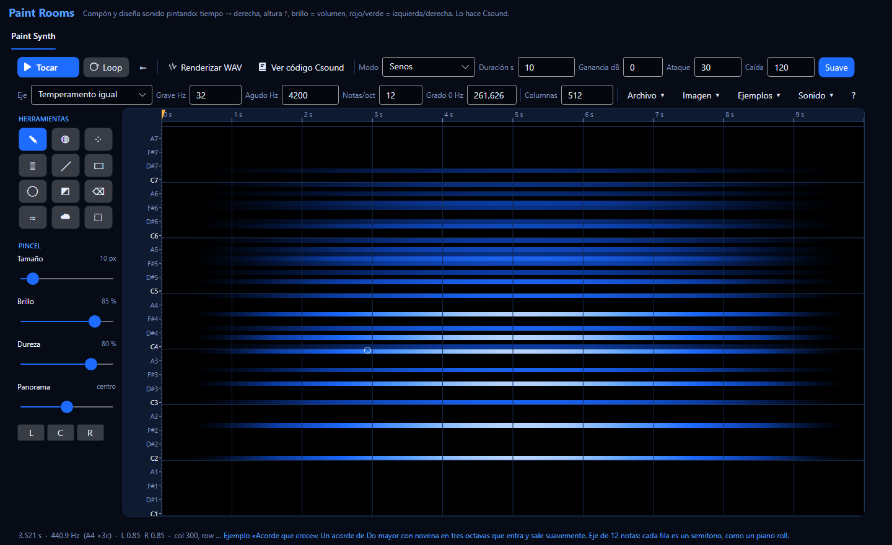
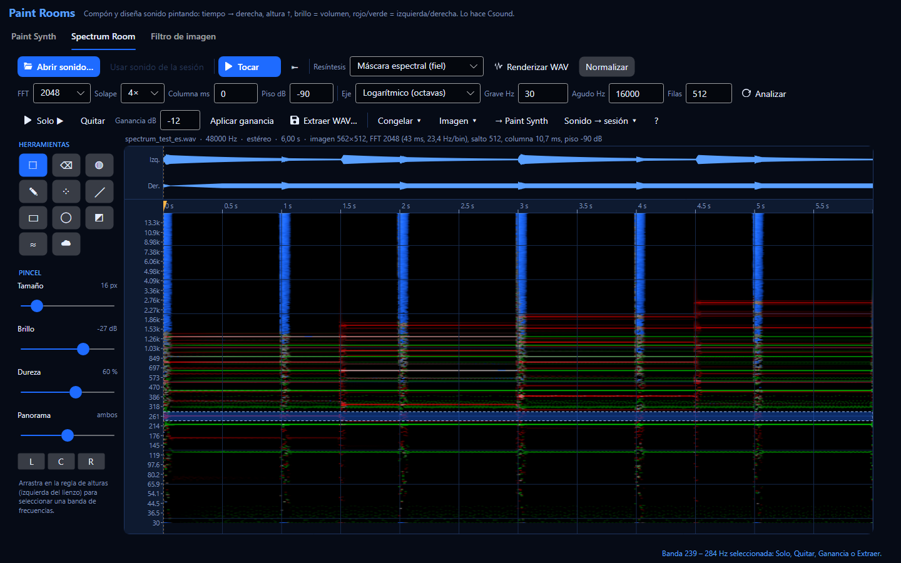
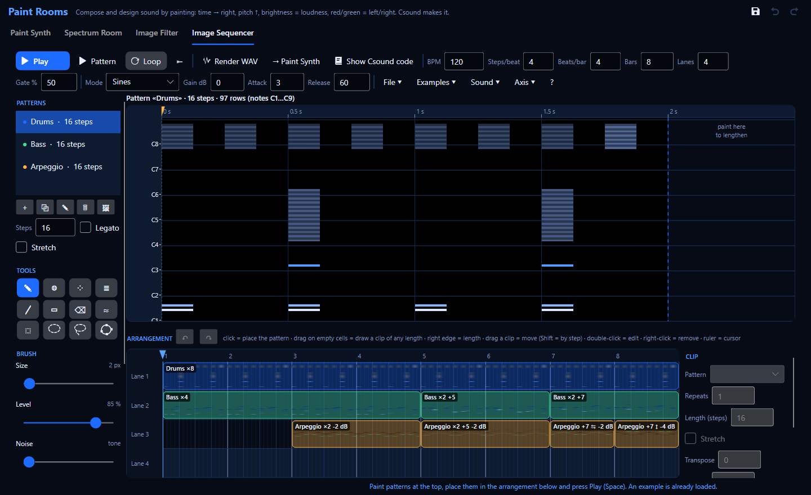

# Paint Rooms: compón y diseña sonido pintando

**Paint Rooms** («salas de pintura») es una familia de herramientas para hacer sonido con
imágenes. Se abre con **Ctrl+Shift+I**. La primera sala, **Paint Synth**, es un lienzo donde:

* **de izquierda a derecha corre el tiempo** (la regla de arriba está en segundos),
* **de abajo hacia arriba sube la altura** (la regla de la izquierda dice qué frecuencia o nota es
  cada fila),
* **el brillo es el volumen** (negro = silencio, brillante = fuerte),
* **el color es la posición**: **rojo = solo izquierda, verde = solo derecha**; el color del tema
  (o el amarillo en una imagen importada) = los dos lados.

Cada fila de la imagen es una voz —un seno, una banda angosta de ruido o un sample en loop— y el
sonido lo hace **Csound**: cuando presionas **Tocar**, la app escribe la imagen en tablas de
Csound y la toca con un instrumento de síntesis aditiva; **Renderizar WAV** corre el mismo
instrumento sin tiempo real; **Ver código Csound** abre ese instrumento en el editor para que lo
estudies.

Otras tres salas comparten el mismo lienzo y las mismas herramientas: el **Spectrum Room** convierte
una grabación en una imagen que puedes editar y volver a convertir en sonido (ver
[Spectrum Room](#spectrum-room-convierte-una-grabación-en-imagen-edítala-y-vuelve-a-escucharla)), el
**Filtro de imagen** usa una imagen como ecualizador estéreo que cambia en el tiempo, y el
**Image Sequencer** arma frases y loops con patrones pequeños pintados y ordenados en el tiempo (ver
[Image Sequencer](#image-sequencer-frases-y-loops-hechos-de-imágenes)).

## Tu primer sonido pintado en 5 minutos

1. **Abre Paint Rooms**: Ctrl+Shift+I en la ventana principal. Aparece un lienzo negro, vacío.
2. **Elige un eje tipo piano**: en **Eje** elige **Temperamento igual** (12 notas por octava).
   Ahora cada fila es un semitono y la regla muestra nombres de notas (C4 = Do central).
3. **Dibuja un acorde**: el **Lápiz** (✎, tecla **P**) ya está elegido. Arrastra tres líneas
   horizontales en las filas **C4**, **E4** y **G4** (Do, Mi, Sol), más o menos de 1 s a 6 s. Cada
   línea es una nota sostenida.
4. **Escúchalo**: presiona **Tocar** (o la **barra espaciadora**). Si Csound estaba detenido, se
   inicia solo; la línea verde muestra lo que estás oyendo. Pinta más mientras suena: se escucha al
   instante.
5. **Dale un timbre**: elige el **pincel armónico** (≣, tecla **H**) y pinta otra línea en **C3**.
   Pinta la nota *y* sus armónicos (2, 3, 4 veces la frecuencia…), cada uno más suave: el sonido se
   vuelve más rico, como una cuerda o un bronce. Prueba **Caída** 2 (suave) o 0,5 (brillante), y
   **Solo impares** (hueco, como un clarinete).
6. **Cambia la afinación**: en **Eje** elige **Escala Scala (.scl)** y escoge un archivo de
   afinación (hay miles gratis en el archivo de Scala, huygens-fokker.org). Lo que pintaste se
   mueve a la nota más cercana de la nueva escala. Ctrl+Z vuelve atrás.
7. **Importa una foto**: **Archivo ▾ › Importar imagen…** (o arrastra la imagen al lienzo).
   **Sirve cualquier imagen de cualquier tamaño**: PNG, JPG, BMP, GIF, WebP, TIFF, HEIC/HEIF (fotos
   de iPhone), AVIF, ICO o JPEG XR; las fotos de celular se enderezan solas. El cuadro de
   importar muestra a la derecha una **vista previa en vivo** (el lienzo tal como quedará, con sus
   reglas de altura y tiempo), que cambia mientras ajustas:
   * **Forma**: **Detalle completo** (recomendado: una columna por píxel, tan nítida en el tiempo
     como el original; la duración solo decide qué tan rápido se tocan), **Mantener proporciones
     con las filas**, **Estirar a las columnas elegidas** o **Encajar dentro de las columnas
     elegidas** (bordes negros, en silencio);
   * **Resolución y eje de altura**: la imagen se reescala exactamente a *columnas × filas* celdas,
     así que el detalle más fino que esa grilla se vuelve **escalones**. Sube las **Filas**
     (vertical) y las **Columnas** (horizontal) para líneas más suaves — **= imagen** junto a las
     filas da una fila por píxel de alto; la **duración** no agrega detalle, solo estira las mismas
     columnas. Los números escritos cuentan al instante (Enter en una caja nunca importa). El **Eje** decide cómo se reparten las filas entre
     las frecuencias: el actual del lienzo, **Logarítmico** (musical: cada octava igual de alta; lo
     normal para dibujos y fotos) o **Lineal** (Hz parejos: los graves quedan apretados). Un eje de
     notas (temperamento igual, Scala) siempre redondea a notas: los escalones verticales son parte
     de él;
   * **Qué significan los colores**, con una explicación de la opción elegida debajo de la lista
     (las mismas explicaciones están en la ayuda **?** de Paint Synth). «No volver a preguntar» hace
     que las imágenes que sueltes se importen directo con lo último elegido.

   Suenan las partes claras. Las fotos tienen mucho detalle
   tenue: **Selección ▾ › Umbral** (0,3) o **Contraste** (exponente 2–3) lo limpia y deja solo las
   formas fuertes.
8. **Renderiza y llévalo a Cubase**: **Renderizar WAV**, elige un nombre. El archivo queda en 24
   bits, normalizado a −1 dBFS. Arrástralo desde el Explorador a una pista de audio de Cubase (o
   ábrelo en SpectraLayers: vas a reconocer tu dibujo en su espectrograma).

## La ventana

**Fila 1: transporte y sonido**

| Control | Qué hace |
|---|---|
| **Tocar / Detener** (Espacio) | Toca desde el cursor amarillo con Csound. Haz clic o arrastra en la regla del tiempo para moverlo; **⇤** (Inicio) lo lleva al comienzo. |
| **Loop** | Repite el lienzo sin fin. |
| **Renderizar WAV** | Escribe el lienzo una vez (sin loop) a un WAV de 24 bits con Csound, tan rápido como permita la CPU. Mientras renderiza, el botón cancela. |
| **Ver código Csound** | Escribe el `.csd` que hace este sonido en `Documentos\Csound Visual\Paint Rooms\<nombre>_<fecha>\` (el instrumento comentado y sus tablas como archivos al lado) y lo abre en una pestaña del editor. Ahí F5 lo toca. |
| **Modo** | **Senos**, **Bandas de ruido** o **Sample en loop** (ver más abajo). |
| **Duración s** | Lo que dura todo el lienzo. No cambia el dibujo: estira o comprime el tiempo. |
| **Ganancia dB** | Volumen sobre el nivel automático. Cambia en vivo. |
| **Ataque / Caída** (ms) | Qué tan rápido sube una fila hacia un píxel más brillante / baja hacia uno más oscuro. Ataque corto = percusivo; caída larga = una cola tipo reverb. Cambian en vivo. |
| **Suave** | Encendido: mezcla las columnas vecinas (continuo). Apagado: salta de columna en columna (rítmico, «pixelado»). |

**Fila 2: eje de altura, tamaño y menús**

| Control | Qué hace |
|---|---|
| **Eje** | **Logarítmico** (cada octava mide lo mismo: lo musical, viene por defecto), **Lineal** (cada fila suma los mismos Hz: bueno para espectros), **Temperamento igual** (una fila por nota, con las notas por octava que quieras), **Escala Scala** (una fila por nota de una afinación `.scl`). Al cambiarlo, lo pintado conserva su altura (Ctrl+Z deshace). |
| **Grave Hz / Agudo Hz** | Rango de frecuencias del lienzo. |
| **Filas** | Resolución de los ejes logarítmico y lineal (512 por defecto). Más filas = altura más fina y más CPU. |
| **Notas/oct** | Notas por octava del temperamento igual: 12 = semitonos, 24 = cuartos de tono, 19, 31, 53… |
| **Grado 0 Hz** | Frecuencia de la primera nota de la escala. 261,63 Hz = Do central con La4 = 440 Hz; usa 256,87 para La = 432 Hz. |
| **Columnas** | Resolución en el tiempo (1024 por defecto). Cambiarla remuestrea la imagen. |
| **Archivo ▾** | Lienzo nuevo, importar imagen, exportar PNG, cargar escala Scala, y qué significan los colores al importar. |
| **Selección ▾** (bajo las herramientas) | Seleccionar todo, quitar o invertir la selección; luego operaciones sobre la selección (o todo el lienzo): ver más abajo. |
| **Ejemplos ▾** | Cuatro imágenes de partida para escuchar y modificar. |
| **Sonido ▾** | Ajustes menos frecuentes: nivel automático, curva brillo → volumen, umbral de silencio, ancho de las bandas de ruido, el sample y su altura original, normalización y frecuencia del render. |

**A la izquierda: herramientas y pincel.** La barra de abajo muestra qué hay bajo el mouse
(tiempo, frecuencia, nota más cercana, nivel izquierdo/derecho), los mensajes y la carga de DSP de
Csound mientras suena.

## Herramientas

| Herramienta | Tecla | Para qué |
|---|---|---|
| ✎ **Lápiz** | P | Pincel redondo de borde duro. Un trazo horizontal es una nota sostenida; una curva es una melodía con deslizamientos. |
| ◍ **Aerógrafo** | A | Pincel suave (gaussiano): fundidos, nubes, crescendos. |
| ⁘ **Spray** | S | Puntos al azar: granos, crepitar, lluvia, insectos. |
| ≣ **Armónicos** | H | Fundamental más N armónicos (k·f) con volumen 1/k^caída. Un trazo = una nota con timbre. Las marquitas junto al cursor muestran dónde caerán los armónicos. |
| ╱ **Línea** | L | Arrastra de un punto a otro. En diagonal = glissando. |
| ▭ **Rectángulo** | R | Un bloque de muchas alturas: clusters, bandas de ruido. |
| ◯ **Elipse** | O | Un bloque redondeado: entra y sale de a poco. |
| ◩ **Degradado** | G | Arrastra: pinta desde el brillo del pincel al inicio hasta nada al final, en la selección (o todo el lienzo). Vertical = inclinación espectral; horizontal = fundido. |
| ⌫ **Goma** | E | Apaga lo que toca. **El botón derecho del mouse borra con cualquier pincel.** |
| ≈ **Desenfocar** | B | Suaviza bajo el pincel: los tonos se vuelven bandas y los ataques se ablandan. |
| ☁ **Difuminar** | U | Arrastra la imagen con el pincel: doblar notas, estirar ataques. |
| ⬚ **Selección** | M | Arrastra un rectángulo. Arrastrar dentro lo mueve. Ctrl+C / Ctrl+X / Ctrl+V (pega en el cursor amarillo), Supr, Esc. Las operaciones de «Selección ▾» se aplican a la selección. |
| ◌ **Selección elíptica** | Mayús+M | Arrastra una caja (Mayús durante el arrastre = círculo). Ver [Selecciones](#selecciones). |
| ➰ **Lazo** | F | Dibuja cualquier forma cerrada; se cierra al soltar. |
| ✦ **Selección spline** | N | Haz clic en puntos; una curva suave pasa por ellos; doble clic o Enter la cierra. |

**Ajustes del pincel**: **Tamaño** (píxeles de pantalla; también `[` y `]`), **Brillo** (qué tan
fuerte suena lo que pintas), **Dureza** (borde nítido o suave), **Panorama** (−1 solo izquierda …
+1 solo derecha; botones L, C, R).

Pintar solo aclara: pasar dos veces por el mismo lugar en un trazo no supera el brillo del pincel,
y pintar el lado izquierdo nunca oscurece el derecho.

## Selecciones

Una selección limita lo que cambias: las operaciones de **Selección ▾**, Supr, copiar / cortar / pegar,
mover, el Degradado y, en el Spectrum Room, **Solo**, **Quitar**, **Aplicar ganancia**, **Extraer WAV…**
y **Congelar** actúan solo dentro de ella. Cuatro herramientas la crean (están en las tres salas):

| Herramienta | Tecla | Cómo |
|---|---|---|
| ⬚ **Rectángulo** | M | Arrastra una caja. |
| ◌ **Elipse** | Mayús+M | Arrastra una caja; la elipse cabe dentro. Aprieta **Mayús durante el arrastre** para un círculo perfecto en pantalla. |
| ➰ **Lazo** | F | Mantén el botón y dibuja cualquier forma alrededor de lo que quieres; al soltar se cierra sola. |
| ✦ **Spline** | N | **Haz clic** para poner puntos: una curva suave y cerrada pasa por todos y la ves mientras los pones. **Doble clic** o **Enter** la cierra, **Esc** cancela, **Retroceso** quita el último punto. |

**Paso a paso — seleccionar los armónicos de una nota con el lazo**

1. Aprieta **F** (lazo).
2. Mantén el botón izquierdo y dibuja un lazo alrededor de la línea brillante que quieres; suelta:
   el lazo se cierra y las «hormigas» (una línea punteada que se mueve) muestran la forma real.
3. Mantén **Mayús** y dibuja otro lazo alrededor del armónico siguiente: se **agrega**. Mantén
   **Alt** y dibuja sobre una parte que no quieres: se **resta**.
4. Ahora aprieta **Supr**, usa **Selección ▾**, o en el Spectrum Room **Solo ▶** / **Quitar** /
   **Extraer WAV…**. Ctrl+Z lo deshace como siempre.

**Bueno saber**

* **Los bordes son suaves.** La elipse, el lazo y la spline seleccionan a medias las celdas del
  borde (antialias), así que una edición se desvanece en una celda en vez de cortar de golpe. Para
  un desvanecido más ancho sube **Suavizado** (en la columna de herramientas, bajo **SELECCIÓN**, en
  píxeles de pantalla): un borrado suavizado en el Spectrum Room no tiene borde duro ni en el tiempo
  ni en la altura, así que no hace clic ni «resuena».
* **Presionar dentro de la selección (sin teclas) = moverla** (rectángulo, elipse y lazo). La spline
  nunca mueve: cada clic es un punto. Para empezar una forma nueva dentro de otra, aprieta Esc antes.
* **Pegar conserva la forma**: lo que copias con una elipse se pega como elipse.
* La **banda de la regla de alturas** del Spectrum Room siempre es un rectángulo sobre todo el tiempo.
* Con una selección, **Congelar** sostiene solo lo que la selección cubre (si el cursor amarillo
  está fuera, se congela su centro).
* Las operaciones de imagen que mueven contenido (transponer, voltear, invertir en el tiempo)
  actúan sobre la caja que rodea la selección y conservan solo lo que cae dentro de la forma.

## Deshacer y rehacer

Ctrl+Z deshace, **Ctrl+Y o Ctrl+Mayús+Z** rehace. Los botones **↶ ↷** arriba a la derecha de la
ventana hacen lo mismo en la sala en que estás (cada sala tiene su propio historial); se ven grises
cuando no hay nada que deshacer o rehacer, y su descripción emergente dice qué paso desharían o
reharían.

El historial guarda **todo lo que cambias en la sala**: la pintura y las operaciones, las
selecciones (forma nueva, seleccionar todo, quitar, invertir), el eje y las columnas, y cada
**ajuste** de las barras de arriba: duración, modo, ganancia, ataque, caída, loop, las opciones de
**Sonido ▾** (Paint Synth), los ajustes del filtro (Image Filter), los del análisis y la resíntesis
(Spectrum Room; deshacer un ajuste del análisis también devuelve la imagen como estaba, sin volver
a analizar) y tempo, pasos, compases, pistas, gate y sonido (Image Sequencer). Varios cambios
seguidos del mismo ajuste (clics en las flechitas, escribir un número) son un solo paso.

## Guardar tu trabajo

Csound Visual nunca descarta trabajo sin preguntar. El botón **💾 Guardar** de arriba a la derecha
(junto a ↶ ↷), o **Ctrl+S**, guarda el trabajo de la sala en que estás. Al cerrar Paint Rooms (o la
aplicación) con trabajo sin guardar, cada sala pregunta **Guardar**, **No guardar** o **Cancelar**.
**No guardar** descarta ese trabajo (ya no está al volver a abrir); **Cancelar**, o cancelar el
cuadro de archivo, deja la ventana abierta:

| Sala | Qué se conserva | Cuándo pregunta | «Guardar» hace |
|---|---|---|---|
| **Paint Synth** | La imagen, hasta que cierras Paint Rooms o la aplicación. | Al cerrar **Paint Rooms** (o la aplicación) después de editar la imagen. | Exportar PNG (16 bits, sin pérdida: se reimporta con el mapeo de colores adecuado). |
| **Spectrum Room** | La imagen editada vive solo mientras Paint Rooms está abierto. | Al cerrar **Paint Rooms** (o la aplicación) después de editar un sonido analizado. | Renderizar WAV del sonido editado. |
| **Image Filter** | La imagen del filtro, hasta que cierras Paint Rooms o la aplicación. | Al cerrar **Paint Rooms** (o la aplicación) después de editarla. | Exportar PNG. |
| **Image Sequencer** | Los patrones y el arreglo quedan para la próxima sesión **solo si se guardan**. | Al cerrar **Paint Rooms** (o la aplicación) con cambios sin guardar. | Los guarda para la próxima sesión (también Archivo ▾ › Guardar para la próxima sesión). |

No pregunta por ejemplos sin tocar, lienzos nuevos vacíos, análisis recién hechos ni trabajo ya guardado.

## Color y estéreo

Las dos capas de la imagen son los canales **izquierdo** y **derecho**:

* pintado con **Panorama C** (ambos) se ve con la escala de color del tema (oscuro → brillante);
* con **Panorama L** se ve **rojo**, con **R** se ve **verde**; entremedio ves la mezcla (rojo +
  verde = amarillo);
* **Archivo ▾ › Exportar PNG** escribe exactamente esa convención (rojo = izquierda, verde =
  derecha): puedes editar la imagen en cualquier programa de dibujo y volver a importarla con
  **«Rojo → izquierda, verde → derecha»**.

Al importar una imagen eliges qué significan sus colores (**Archivo ▾ › Al importar, los
colores son…**): **Brillo → ambos lados** (mono, lo mejor para fotos), **Rojo → izquierda, verde
→ derecha** (las exportaciones de la propia app, o dibujos que hiciste pensando en el estéreo) o
**Brillo → volumen, color → panorama** (rojo y magenta a la izquierda, verde y cian a la derecha,
amarillo, azul y gris al centro).

## Imágenes de 16 bits y RGBA

**Ruido por celda.** Además de su volumen izquierdo y derecho, cada celda puede tener una
**cantidad de ruido**: 0 = un tono puro (el seno de la fila), 1 = una banda angosta de ruido
alrededor de la altura de la fila, y cualquier valor intermedio = una mezcla de ambos. Nunca cambia
el volumen (la mezcla es de «igual potencia»), solo de qué está hecho el sonido: una nota larga
puede pasar de un tono tipo flauta a un soplo, una línea vertical de un acorde a un platillo. Se
escucha en el modo **Senos** (Bandas de ruido ya es todo ruido; Sample en loop lo ignora).

* **Píntalo**: el control **Ruido** del pincel (0 = tono … 1 = ruido). Todas las herramientas de
  pintar pintan también la cantidad de ruido; **Solo ruido** cambia solo el ruido de lo que ya está
  pintado, sin tocar el volumen (vuelve «soplada» una nota existente, o tonal una ruidosa).
* **Míralo**: las celdas ruidosas se dibujan granuladas y con menos color (una textura de damero
  que crece con la cantidad); desmarca **Ver capa de ruido** para esconderla. La lectura de abajo
  muestra `N 0.60` para la celda bajo el mouse.
* **Fíjalo en una selección**: **Selección ▾ › Cantidad de ruido (tono ↔ ruido)…**. Transponer,
  voltear, invertir en el tiempo, estirar, desenfocar, copiar / pegar y mover llevan el ruido junto
  con las notas; Ctrl+Z lo deshace como cualquier otra edición.

**Imágenes RGB y RGBA.** Dos formas de leer los colores (en el diálogo de importación y en
**Archivo ▾ › Al importar, los colores son…**) toman el ruido de la imagen:

| Lectura | Rojo | Verde | Azul | Alfa |
|---|---|---|---|---|
| **RGB: R = izquierda, G = derecha, B = ruido** | volumen izquierdo | volumen derecho | cantidad de ruido (0 = tono, máximo = ruido) | se ignora |
| **RGBA: como RGB + alfa = máscara** | volumen izquierdo | volumen derecho | cantidad de ruido | multiplica el volumen: transparente = silencio, semitransparente = la mitad de fuerte |

Así una imagen dibujada en cualquier programa puede decir, píxel por píxel, *dónde* suena
(posición), *cuán fuerte* (brillo, alfa) y *cuán ruidoso* (azul). Píntala por capas: los canales
rojo y verde para las notas, el azul para soplos y siseos, una goma suave en el canal alfa para los
fundidos.

**16 bits por canal.** Los PNG y TIFF de 16 bits por canal se leen con sus 65 536 niveles (las
imágenes de 8 bits tienen 256): el diálogo de importación muestra **«16 bits por canal»** u **«8
bits por canal»** (y **«+ alfa»** si la imagen tiene transparencia). Los degradados suaves y los
detalles muy tenues se conservan, y los archivos de 16 bits se leen tal como están guardados (sin
gestión de color), así que las imágenes de datos van y vuelven sin cambios.

**Exportar.** **Archivo ▾ › Exportar PNG** ofrece **16 bits por canal (sin pérdida)** —la opción
por defecto— u **8 bits**. Escribe rojo = izquierda, verde = derecha y azul = la cantidad de ruido
si la imagen tiene capa de ruido (reimpórtala con **«RGB: …»**), o azul = el menor entre izquierda y
derecha si no la tiene (el gris clásico; reimpórtala con **«Rojo → izquierda, verde → derecha»**).
Exportar a 16 bits y volver a importar no cambia ningún nivel en más de 0,00001.

## Escalas y afinaciones

* **Logarítmico** es como un piano roll muy fino: 512 filas entre 40 Hz y 12 kHz son unas 57 filas
  por octava (casi 5 por semitono). Bueno para gestos libres, deslizamientos y texturas.
* **Temperamento igual** hace *una fila por nota*. Con 12 notas pintar es igual que en un piano
  roll. Con 24 tienes cuartos de tono; 19 y 31 son afinaciones microtonales clásicas.
* **Scala** carga cualquier archivo `.scl`: entonación justa, temperamentos históricos, gamelán,
  Bohlen–Pierce (que se repite en la «tritava» 3:1 y no en la octava)… Una fila por nota de la
  escala dentro del rango. La regla las marca «octava·grado» (`4·7` = grado 7 de la octava 4).
* **Grado 0 Hz** fija la altura de la primera nota de la escala (en las de 12 notas se llama Do).
  Para afinar todo a La = 432 Hz escribe 256,87.

## Modos de síntesis

| Modo | Cómo suena | Cómo lo hace Csound |
|---|---|---|
| **Senos** | Tonos claros y puros; los trazos armónicos se vuelven instrumentos. | Un oscilador sinusoidal por fila (el banco de osciladores `adsynt2` de Csound), con su volumen leído de la imagen en cada período de control. |
| **Bandas de ruido** | Aire, viento, respiración, mar, platillos. Una fila es una banda angosta de ruido; un bloque vertical es ruido filtrado. | Dos bancos de osciladores (seno y coseno) por lado cuyos volúmenes son números al azar que cambian lento, uno por fila: eso es una banda angosta de ruido alrededor de la frecuencia de la fila. **Sonido ▾ › Ancho de las bandas de ruido** las hace más angostas (más afinadas) o más anchas (más soplido). **Sonido ▾ › Ruido suave** apagado usa un oscilador por fila en vez de dos: la mitad de CPU, y las bandas angostas suenan un poco más a trémolo. |
| **Sample en loop** | Cualquier grabación se vuelve una textura: cada fila repite el sonido transpuesto a su altura. | El sample es la forma de onda del banco de osciladores. Elígelo en **Sonido ▾ › Elegir sample…** (o suelta un WAV en el lienzo) y ajusta su **altura original** (los Hz a los que suena sin transponer). Funcionan mejor los sonidos cortos y de altura estable (una vocal cantada, una nota con arco). |

**Ruido por celda**: en el modo Senos cada celda puede ser además en parte o del todo ruido —el
control **Ruido** del pincel, **Selección ▾ › Cantidad de ruido** o el canal azul de una imagen RGB
(ver [Imágenes de 16 bits y RGBA](#imágenes-de-16-bits-y-rgba))—.

**Volumen**: el brillo se convierte en amplitud con una curva (**Sonido ▾ › Curva brillo →
volumen**, 2 por defecto: un gris al 50 % suena 12 dB más bajo que el blanco). Lo que está bajo
el **umbral de silencio** (0,02 por defecto) no suena, y así desaparece la neblina tenue de las
fotos. El **nivel automático** ajusta la ganancia para que el momento más fuerte quede cerca de
−6 dBFS; un limitador suave de seguridad impide que algo sature; los renders se normalizan a
−1 dBFS.

## Operaciones de imagen (Selección ▾)

Se aplican a la **selección**, o a todo el lienzo si no hay nada seleccionado. Ctrl+Z deshace cada
una.

| Operación | Qué le hace al sonido |
|---|---|
| Borrar todo | Silencio. |
| Invertir | Claro ↔ oscuro: un acorde se vuelve un «hueco» en un muro de sonido. |
| Normalizar | El punto más brillante queda al máximo. |
| Contraste (curva) | Exponente > 1 deja solo lo fuerte (más limpio); < 1 levanta lo tenue (más denso). |
| Umbral | Silencia todo lo que está bajo un nivel. |
| Desenfocar | Suaviza en tiempo y altura: tonos → bandas, ataques → crescendos. |
| Agregar ruido | Puntos al azar: aire, grano, crepitar. |
| Fundido de entrada / salida | Una rampa a lo largo de la selección. |
| Transponer (filas) | Sube o baja. En un eje de 12 notas una fila = un semitono (12 = una octava). |
| Voltear vertical | Grave ↔ agudo: las melodías se invierten. |
| Invertir en el tiempo | Suena al revés. |
| Estirar en el tiempo | Más largo (> 1) o más corto (< 1) sin cambiar la altura: cambian el ancho y la duración. |
| Hacer mono / Intercambiar izquierda/derecha | Ayudas para el estéreo. |
| Panorama… | Pone la selección en una posición del estéreo (−1 izquierda … +1 derecha), conservando su volumen. |
| Barrido de panorama: derecha → izquierda / izquierda → derecha | El sonido de la selección viaja suavemente por el estéreo desde su comienzo hasta su final. **Una línea que va de derecha a izquierda**: pinta la línea, selecciónala (lazo o rectángulo alrededor) y aplica «Barrido de panorama: derecha → izquierda». |

## Ejemplos

| Ejemplo | Qué escuchar |
|---|---|
| **Acorde que crece** | Un Do mayor con novena en tres octavas, en un eje de 12 notas, que entra y sale. Cada nota se pintó con 6 armónicos. |
| **Glissando cruzado** | Dos sonidos armónicos que se deslizan en direcciones opuestas, uno en cada oído. |
| **Textura rítmica** | Dos compases de ráfagas de ruido a 120 BPM (bandas de ruido, sin suavizado): golpes graves, golpes tipo caja y hi-hats a izquierda y derecha. |
| **Paisaje armónico** | Un bordón en La 1 cuyos armónicos se iluminan como colinas que se mueven (formantes), distinto en cada oído. |

## Ideas para diseño sonoro

* **Ritmo**: apaga **Suave** y usa ataque y caída cortos; dibuja bloques verticales cortos. El
  Rectángulo con bandas de ruido hace baterías.
* **Pads**: trazos largos con el Aerógrafo, Suave encendido, ataque 200 ms, caída 1000 ms.
* **Sonidos tipo vocal**: un trazo armónico y luego el Aerógrafo suave con la goma (botón derecho)
  sobre algunos armónicos: estás tallando formantes.
* **Subidas (risers)**: la Línea en diagonal hacia arriba con el pincel armónico y después
  **Selección ▾ › Desenfocar**.
* **Movimiento estéreo**: pinta con Panorama L y el mismo gesto un poco después con Panorama R: un
  ping-pong. O importa una imagen de colores con «color → panorama».
* **Fotos**: las imágenes de alto contraste (siluetas, texto, arquitectura) suenan más claras que
  las suaves. Primero Umbral, luego Contraste.
* **Aprende Csound con esto**: **Ver código Csound** y lee el instrumento: cada sección tiene
  comentarios. Cambia `iGlide` o los tiempos de `linsegr` y presiona F5.

## Atajos

| Teclas | Acción |
|---|---|
| Espacio | Tocar / detener |
| Mayús+Espacio | Image Sequencer: tocar solo el patrón que editas |
| Supr (Image Sequencer) | Quitar el clip elegido (si no hay selección en el patrón, o justo después de hacer clic en el arreglo) |
| P A S H L R O G E B U | Herramientas (ver la tabla) |
| M · Mayús+M · F · N | Selección: rectángulo · elipse · lazo · spline (Mayús = agregar, Alt = restar) |
| Enter / Esc / Retroceso | Mientras pones una spline: cerrar / cancelar / quitar el último punto |
| `[` `]` | Tamaño del pincel |
| Ctrl+Z / Ctrl+Y (o Ctrl+Mayús+Z) | Deshacer / rehacer (pintura, operaciones, cambios de eje, importaciones); también los botones ↶ ↷ |
| Ctrl+C / Ctrl+X / Ctrl+V | Copiar / cortar / pegar la selección (pega en el cursor amarillo) |
| Supr / Esc / Ctrl+A | Borrar la selección / quitarla / seleccionar todo |
| Inicio | Cursor al comienzo |
| Rueda / Shift+rueda | Desplazar en altura / en el tiempo |
| Ctrl+rueda / Alt+rueda | Zoom en el tiempo / en la altura (Ctrl+0 muestra todo) |
| Arrastrar con el botón central | Mover la vista |
| Botón derecho | Borrar (con la herramienta de selección: quitar la selección) |

## Cómo funciona (y cuánto pide a la CPU)

Al presionar Tocar, la imagen se vuelve números en tablas de Csound: una tabla por lado con todas
las columnas una tras otra (una columna = el volumen de cada fila en un instante) y una tabla con
la frecuencia de cada fila. El instrumento `instr 9301` lee, en cada período de control, las dos
columnas que rodean el tiempo actual, las mezcla y suaviza con operaciones sobre arreglos
completos, y escribe el resultado en las tablas que lee `adsynt2` (un banco de osciladores).
Mientras la imagen suena, cada trazo envía solo las columnas que cambió.

Si Csound está detenido, Tocar inicia una pequeña orquesta «Paint Rooms host» (la consola dice
*Tocando Paint Rooms host.csd*); Detener también la detiene. Si ya estás tocando un documento, la
imagen suena encima de él por el mismo motor.

Medido con `CsoundVisual.exe --paint-test` (sin sonido audible; 512 filas × 1024 columnas con todas
las celdas encendidas en ambos canales, 48 kHz, ksmps 32, el motor WASAPI de la app a 10 ms): carga
de DSP promedio de 12–20 % con senos, 20–35 % con ruido suave y 19–21 % con ruido liviano. El
ruido suave en una imagen estéreo grande puede dar cortes ocasionales si el PC está ocupado: la
barra de estado sugiere entonces apagarlo, usar menos filas o una latencia mayor. Renderizar una
imagen estéreo de 21 s tarda 1–2 s.

## Spectrum Room: convierte una grabación en imagen, edítala y vuelve a escucharla

El **Spectrum Room** (segunda pestaña) va en sentido contrario: le das una **grabación** y dibuja su
**espectrograma**, el mismo tipo de imagen que pintas en Paint Synth: el tiempo hacia la derecha, la
altura hacia arriba y el brillo = volumen. Editas esa imagen con los mismos pinceles, la selección y
las operaciones de imagen, y después la vuelves a convertir en sonido de una de dos maneras:

* **Máscara espectral (fiel)**: la app conserva tu *grabación original* y solo cambia cuánto suena
  cada punto de tiempo × altura según lo que editaste. Lo que no tocaste suena **exactamente** igual
  al original (medido: ninguna diferencia); lo que borraste **desaparece** (medido: una nota quitada
  baja más de 60 dB); lo que oscureciste baja justo los dB que le quitaste. Úsala para limpiar,
  quitar, aislar y re-equilibrar.
* **Aditiva (Paint Synth)**: Csound toca la imagen con el motor de Paint Synth, un seno (o una banda
  angosta de ruido) por fila. Se conservan las alturas y el volumen de cada fila, pero no las fases
  originales ni el «grano» de los ruidos: obtienes una **copia pintada** del sonido, más suave y
  sintética. Úsala de forma creativa y para escuchar lo que pintes *encima* de una grabación.

**Cómo leer la imagen.** El brillo está en **decibeles**: blanco = 0 dB (un seno a escala completa),
negro = el **piso** (−90 dB por omisión), medio brillo = a medio camino (−45 dB). La lectura de abajo
muestra los dB exactos de la capa izquierda y derecha bajo el mouse. Un archivo estéreo llena las
dos capas: lo que está en ambos canales se dibuja con el color del tema, lo que está solo a la
izquierda en **rojo** y solo a la derecha en **verde** (la misma regla de Paint Synth). La franja
sobre la imagen es la **forma de onda**, alineada con ella: un golpe de batería en la forma de onda
queda justo sobre su columna.

### Tu primera edición en 3 minutos

1. **Abre Paint Rooms** (Ctrl+Shift+I) y haz clic en la pestaña **Spectrum Room**.
2. **Abre un sonido**: **Abrir sonido…** (o arrastra un archivo desde el Explorador a la imagen). Los
   WAV se leen directo; **AIFF, FLAC, OGG y MP3** los decodifica Csound (la barra de estado lo
   dice). Prueba `Examples\Manual\drumsMlp.wav` de la carpeta de la app. El análisis tarda una
   fracción de segundo.
3. **Escucha**: presiona **Tocar** (o **Espacio**). Con **Máscara espectral** elegida oyes la
   grabación original, intacta.
4. **Borra algo**: elige la **Goma** (⌫, tecla **E**) y frota sobre una zona brillante, o
   simplemente mantén el **botón derecho** y pinta. Vuelve a **Tocar**: esa parte ya no está.
   Mientras suena puedes seguir editando: medio segundo después de soltar el mouse la escucha se
   recalcula y sigue desde donde iba.
5. **Deshaz** con Ctrl+Z y **renderiza** con **Renderizar WAV** (24 bits; **Normalizar** lleva el
   pico a −1 dBFS, si no, se conserva el nivel).

### Tutorial 1 — quitar una nota de una grabación

Tienes una grabación con una nota equivocada (o una resonancia que zumba, o un silbido) y quieres
sacarla sin tocar lo demás.

1. Abre la grabación. Para música ayuda un análisis pensado en notas: **Eje → Temperamento igual**
   (una fila por semitono; la regla muestra los nombres de las notas) y **FFT 4096** (más precisión
   de altura). La imagen se recalcula sola un momento después de cambiar un ajuste (Ctrl+Z vuelve a
   la imagen anterior con sus ediciones).
2. Busca la nota: pasa el mouse sobre la línea brillante; la lectura dice su nota y su nivel (p. ej.
   `E4 · 329.6 Hz · L −18 dB R −20 dB`). Una nota cantada o tocada es una pila de líneas: la
   fundamental y sus armónicos (2×, 3×… la frecuencia).
3. Elige **Selección** (⬚, tecla **M**) y arrastra un rectángulo alrededor de la fundamental de la
   nota, solo durante el tiempo en que suena. Presiona **Solo ▶**: oyes *solo* lo que está dentro del
   rectángulo; así compruebas que atrapaste lo correcto.
4. Presiona **Quitar** (o **Supr**). Toca: la nota ya no está. Si todavía la oyes débil, son los
   armónicos: selecciónalos también (un rectángulo pequeño en 2×, 3×… la frecuencia) y quítalos, o
   usa la **Goma** con un pincel pequeño a lo largo de cada línea de armónico.
5. Para *suavizar* en vez de quitar: pon **Ganancia dB** en −12 y presiona **Aplicar ganancia** con
   la selección.
6. **Renderizar WAV**, o **Extraer WAV…** antes de quitarla, para guardar la nota en su propio
   archivo.

Para quitar un **zumbido** constante (50/60 Hz de la red eléctrica, el pitido de 15 kHz de una
pantalla): **arrastra en la regla de alturas** (los números de frecuencia a la izquierda de la imagen)
desde un poco debajo hasta un poco encima de la línea del zumbido. Eso selecciona una **banda en toda
la duración**. Presiona **Quitar**.

### Tutorial 2 — convertir una voz en un pad congelado

1. Abre la grabación de una vocal cantada o una nota sostenida de un instrumento
   (`Examples\Manual\sing.wav` funciona bien).
2. Haz clic (o arrastra) en la **franja de la forma de onda** o en la regla de tiempo para poner el
   **cursor amarillo** en un momento en que la vocal está estable.
3. **Congelar ▾ › Duración del tono…**, por ejemplo 12 s. Luego **Congelar ▾ › ▶ Tocar el instante
   congelado**: el espectro de ese instante (promediado en unas pocas columnas para que sea estable)
   se vuelve un tono sostenido, tocado por el motor de Paint Synth con entradas y salidas suaves.
4. Mueve el cursor y congela otra vez: cada momento de una palabra da un color de pad distinto.
5. **Congelar ▾ › Renderizar el instante congelado a WAV…** para guardarlo, o **Congelar ▾ ›
   Instante congelado → Paint Synth** para seguir en Paint Synth: ahí puedes cambiar el modo a
   **Bandas de ruido** (un coro con aire), agregar un **Desenfocar** lento, pintar un crescendo con
   el Aerógrafo o re-afinarlo a otra escala.

### Tutorial 3 — pintar sobre un loop de batería

1. Abre `Examples\Manual\drumsMlp.wav` (o tu propio loop). Los bombos son las manchas brillantes de
   abajo, las cajas las columnas altas del medio y los hi-hats las columnas delgadas de arriba.
2. **Re-equilíbralo** (Máscara espectral): selecciona la zona de los hi-hats (una banda en la parte
   de arriba, arrastrando en la regla de alturas) y aplica **Ganancia −9 dB**; selecciona la zona
   del bombo y aplica **+4 dB**. Toca: el mismo loop, mezclado distinto, sin «campaneo» de filtro,
   porque la edición sigue la imagen exactamente.
3. **Haz huecos**: borra una caja de cada dos; el groove cambia y lo demás queda intacto.
4. **Pinta sonido nuevo**: cambia **Resíntesis → Aditiva (Paint Synth)**, elige el **Lápiz**, un
   brillo de unos −20 dB y pinta unas líneas horizontales (un acorde) a lo largo del loop. Toca: la
   batería vuelve como una versión «pintada» y tus líneas cantan encima. Con **Voz → Bandas de
   ruido** la batería conserva más de su carácter ruidoso.
5. ¿Quieres seguir pintando con todas las herramientas de Paint Synth? **→ Paint Synth** copia la
   imagen al lienzo de Paint Synth (con los niveles convertidos para que suene con el volumen medido).
6. **Sonido → sesión ▾ › Sonido editado** deja tu loop editado en la sesión, para que la sala
   **Filtro de imagen** lo siga filtrando.

### La ventana

**Fila 1 — sonido y transporte**

| Control | Qué hace |
|---|---|
| **Abrir sonido…** | WAV, AIFF, FLAC, OGG, MP3 (también arrastrando). Los formatos que no son WAV los decodifica Csound. Ctrl+O. |
| **Usar sonido de la sesión** | Analiza el sonido que otra sala dejó en la sesión (p. ej. el resultado del Filtro de imagen). |
| **Tocar / Detener** (Espacio) | Toca el resultado desde el cursor amarillo con la resíntesis elegida. |
| **⇤** (Inicio) | Cursor al comienzo. |
| **Resíntesis** | **Máscara espectral (fiel)** o **Aditiva (Paint Synth)**. |
| **Voz** | Solo aditiva: **Senos** o **Bandas de ruido**. Ataque, caída, curva y demás detalles vienen de los ajustes de Paint Synth. |
| **Renderizar WAV** | Escribe todo el resultado (24 bits). |
| **Normalizar** | Los archivos renderizados y extraídos quedan con pico en −1 dBFS; apagado = nivel original (solo baja si fuera a saturar). |

**Fila 2 — análisis** (cambiar cualquiera vuelve a analizar el sonido; Ctrl+Z vuelve a la imagen anterior)

| Control | Qué hace |
|---|---|
| **FFT** | 512 … 16384. Más grande = más nítido en altura (las notas graves se separan), más borroso en el tiempo. 2048 es un buen comienzo; 4096–8192 para música tonal lenta; 512–1024 para batería. La línea de información muestra la duración de la ventana (ms) y la separación entre bins (Hz). |
| **Solape** | 2×, 4× (lo normal) u 8×: más solape = pasos de tiempo más finos y mejor estimación de la frecuencia. |
| **Columna ms** | Resolución en el tiempo de la imagen. 0 = automático (una columna por paso del análisis). Los archivos largos se limitan a 8192 columnas. |
| **Piso dB** | El nivel más bajo que se ve (negro). −90 muestra casi todo; −60 esconde el ruido de fondo. |
| **Eje, Grave Hz, Agudo Hz, Filas / Notas** | El eje de alturas de la imagen, como en Paint Synth: logarítmico, lineal, temperamento igual (una fila por nota, cualquier cantidad por octava) o la escala Scala cargada en Paint Synth. |
| **Analizar** | Vuelve a analizar con los ajustes actuales. |

**Fila 3 — herramientas de sonido**

| Control | Qué hace |
|---|---|
| **Solo ▶** | Toca solo la selección (lo demás en silencio), desde su comienzo. |
| **Quitar** (Supr) | Borra la selección. |
| **Ganancia dB** + **Aplicar ganancia** | Sube o baja la selección (o todo) esos dB. |
| **Extraer WAV…** | Guarda solo la selección como un archivo nuevo. |
| **Congelar ▾** | Duración del tono; tocar / renderizar / enviar a Paint Synth el espectro del cursor amarillo como un tono sostenido. |
| **Selección ▾** (bajo las herramientas) | Seleccionar todo, quitar o invertir la selección; luego las operaciones de imagen de Paint Synth (desenfocar, umbral, transponer, invertir…), sobre la selección o todo. |
| **→ Paint Synth** | Copia la imagen al lienzo de Paint Synth (se deshace allá). |
| **Sonido → sesión ▾** | Deja el sonido original o el editado en la sesión para la sala Filtro de imagen. |

**Izquierda**: las herramientas (Selección, Goma, Aerógrafo, Lápiz, Spray, Línea, Rectángulo, Elipse,
Degradado, Desenfocar, Difuminar; las mismas teclas que en Paint Synth) y el pincel (tamaño, brillo
en dB, dureza, panorama: L = solo la capa izquierda, R = solo la derecha). **Arrastra en la regla de
alturas** para seleccionar una banda de frecuencias en todo el tiempo.

### Consejos

* Para quitar, **borrar es mejor que oscurecer**: una celda llevada a negro se quita por completo;
  una celda solo oscurecida baja los dB que le quitaste.
* Con la máscara, **pintar más brillo donde había silencio casi no hace nada**: la máscara solo puede
  re-equilibrar lo que hay en la grabación (los refuerzos se limitan a +24 dB para no inflar el ruido
  débil). Para *agregar* sonido usa **Aditiva** o envía la imagen a Paint Synth.
* La **fila de más abajo y la de más arriba** representan también todo lo que queda por debajo y por
  encima del eje (continua, retumbe, el aire sobre 16 kHz): borrar todas las filas de un momento lo
  silencia de verdad.
* Las selecciones **muy angostas** (menos de unas 4 veces la separación entre bins que muestra la
  línea de información) atrapan solo parte de la energía de una nota: usa una FFT más grande para
  trabajo quirúrgico.
* **La batería se ve moteada en las octavas más graves** con el eje logarítmico: ahí las filas son
  más angostas que la resolución de la FFT, así que la energía del ruido cae en filas dispersas.
  Suena bien; para una imagen más tranquila usa el eje lineal o una FFT más grande.
* Estéreo: con **Panorama L/R** tu pincel edita un solo canal; borra un sonido del canal izquierdo y
  consérvalo en el derecho.

### Cómo funciona

* **Análisis** (`Paint/SpectralAnalysis.cs`): una transformada de Fourier de tiempo corto con ventana
  de Hann (ventanas de *FFT* muestras cada *FFT/solape* muestras). Para cada bin se estima la
  **frecuencia verdadera** a partir de cuánto avanzó su fase desde la ventana anterior (el truco del
  vocoder de fase), así una nota cae en *su* fila incluso en un eje grueso o microtonal: un seno de
  440 Hz en un eje de 12 notas enciende La4 a −6,02 dB (para un seno de −6,02 dB) y las filas a dos
  notas de distancia quedan en el piso. La energía de cada bin se reparte entre las dos filas más
  cercanas; las ventanas se promedian en columnas; la potencia se vuelve brillo en la escala de dB.
  Un archivo estéreo de 60 s a 48 kHz se analiza en unos 0,1–0,2 s.
* **Máscara espectral** (`Paint/SpectralMask.cs`): imagen editada ÷ imagen original = una ganancia
  por celda (una diferencia de nivel es una diferencia de dB). El sonido original se transforma de
  nuevo, cada bin se multiplica por la ganancia que hay en su frecuencia verdadera y su tiempo
  (interpolada suavemente entre celdas, así no hay clics ni «ruido musical») y se vuelve al tiempo
  por suma solapada ponderada. Sin ediciones las ganancias son exactamente 1 y la salida es idéntica
  a la entrada, bit a bit. Corre en C# en una tarea de fondo (60 s estéreo: unos 0,2 s).
* **Escuchar la máscara**: el resultado se escribe en un WAV temporal y **se toca con el Csound de la
  app** mediante un pequeño instrumento `diskin2` (instrumento 9311, compilado en la interpretación
  que está corriendo, o en la orquesta «Paint Rooms host» si Csound estaba detenido), así pasa por
  la misma salida, los mismos medidores y el mismo botón Detener que todo lo demás. Tras una edición
  el resultado se recalcula y la escucha sigue en el mismo lugar. (Se eligió calcular primero y luego
  tocar un archivo en vez de transmitir una STFT en vivo a Csound: es más simple, sin cortes y, a
  estas velocidades, igual de inmediato.)
* **Aditiva**: la imagen se convierte a niveles de Paint Synth (cada fila a su amplitud medida) y la
  toca o renderiza el instrumento de Paint Synth, en vivo mientras pintas.
* **Otros formatos**: Csound lee AIFF, FLAC, OGG, MP3… con libsndfile. La sala ejecuta `csound.exe`
  dos veces en segundo plano: una para preguntar la duración, los canales y la frecuencia de
  muestreo del archivo, y otra para copiarlo sin cambios (`diskin2`, sin remuestrear) a un WAV
  temporal.

## Filtro de imagen (Image Filter): una imagen como ecualizador estéreo en movimiento

La sala **Filtro de imagen** (tercera pestaña) hace lo contrario de Paint Synth: en vez de *crear*
sonido a partir de una imagen, *moldea* un sonido que ya tienes. Piensa en la imagen como un
ecualizador gráfico gigante que cambia con el tiempo:

* **de izquierda a derecha es el tiempo**: la columna bajo la línea verde es la curva de
  ecualización *de este momento*;
* **de abajo hacia arriba es la frecuencia**: cada fila es una banda angosta alrededor de la
  frecuencia que dice la regla;
* **el brillo es la ganancia**: **negro = esa banda se silencia**, **blanco = esa banda pasa sin
  cambio**, gris = algo intermedio (gris 50 % = −6 dB). Con **Filtro ▾ › Refuerzo del blanco** el
  blanco puede incluso *subir* una banda, hasta +12 dB;
* **rojo = solo el canal izquierdo, verde = solo el derecho** (amarillo / el color del tema =
  ambos). Así la imagen también *mueve* el sonido en el estéreo.

El sonido puede ser un **archivo WAV**, el sonido que **compartió otra sala** (por ejemplo la
Spectrum Room) o la **entrada de audio en vivo**: tu micrófono o tu guitarra por la interfaz de
audio, en tiempo real.

### Tu primer filtro en 3 minutos

1. **Abre Paint Rooms** (Ctrl+Shift+I) y haz clic en la pestaña **Filtro de imagen**. El lienzo ya
   muestra el ejemplo «Barrido lento»: una banda brillante que sube y baja.
2. **Elige un sonido**: **Abrir WAV…** (o arrastra un WAV desde el Explorador a la ventana). Un
   loop de batería, un pad o una grabación de ambiente son perfectos. Su forma de onda aparece
   sobre el lienzo.
3. **Presiona Tocar** (o **Espacio**). Escuchas el sonido a través de la banda que se mueve:
   primero solo los graves, después la banda se abre hacia los agudos y vuelve a bajar: el clásico
   «barrido de filtro».
4. **Pinta mientras suena**: elige el **Aerógrafo** (◍, tecla **A**) y pinta una mancha suave y
   brillante en cualquier parte. La banda que pintaste se abre en ese momento. El **botón derecho**
   borra (cierra bandas).
5. **Compara con el original**: baja **Mezcla %** a 0 para oír el sonido sin tocar (perfectamente
   a tiempo con el filtrado) y vuelve a 100.
6. **Renderizar WAV** escribe el archivo completo filtrado (24 bits, mismo largo y frecuencia de
   muestreo que el original, sin el retardo del filtro): ponlo en la misma posición en Cubase y
   queda alineado.

### Tutorial 1 — haz que un loop de batería «respire» con un barrido pintado

1. **Abrir WAV…** → un loop de batería (uno o dos compases). **Loop** encendido (azul) lo repite.
2. **Tiempo** → **Loop en compases**, **Compases** 2, **BPM** = el tempo de tu loop. Ahora la
   imagen dura exactamente dos compases y se repite a tiempo con el ritmo.
3. **Lienzo ▾ › Lienzo negro (nada pasa)**. Silencio: es lo esperado.
4. Elige la herramienta **Línea** (╱, **L**), **Tamaño** 40, **Dureza** 30 %, **Brillo** 100 %.
   Arrastra una diagonal desde abajo a la izquierda (unos 100 Hz) hasta arriba a la derecha (unos
   8 kHz). Presiona **Tocar**: el loop empieza oscuro y apagado y se «abre» a lo largo de los dos
   compases.
5. Para que respire: dibuja una segunda línea desde la punta de la primera de vuelta hacia abajo a
   la derecha, una forma de «∧». Ahora se abre y se cierra una vez cada dos compases.
6. Conserva el bombo: con el **Rectángulo** (▭, **R**) pinta una franja a lo ancho de todo el
   lienzo bien abajo (bajo 120 Hz). El bombo siempre pasa mientras el resto respira.
7. ¿Suena «a escalones»? **Selección ▾ › Desenfocar** suaviza los bordes, o sube **Suavizar ms**
   (50–150 ms hace que el filtro siga a la imagen con calma, como una envolvente). **Suave**
   encendido mezcla las columnas.
8. **Renderizar WAV** y suéltalo en Cubase junto al original.

### Tutorial 2 — filtra tu voz en vivo con una foto

1. **Usa audífonos** (con parlantes el micrófono escucha el filtro y puede acoplarse).
2. En la ventana principal: **Configuración › Audio › Entrada** → tu interfaz (p. ej. *Line
   (Steinberg UR22mkII)*); **Canales de entrada** → *Mono: solo la entrada 1, a ambos lados* si tu micrófono está en
   la entrada 1 (así te escuchas en ambos lados). Windows debe permitir el micrófono a las apps de
   escritorio (*Configuración de Windows › Privacidad y seguridad › Micrófono*).
3. En el Filtro de imagen: **Fuente → Entrada en vivo**. **FFT 512** (o 256) mantiene el retardo
   bajo: la sala lo muestra junto a la FFT (512/×4 ≈ 21 ms a 48 kHz, sumados a la latencia del
   audio).
4. **Lienzo ▾ › Importar imagen…** → una foto con formas fuertes: una silueta de edificios, árboles
   contra el cielo, una cara de perfil, texto. La foto se vuelve el filtro: cielo oscuro =
   silencio, edificios claros = bandas que pasan. **Selección ▾ › Contraste** (exponente 2–3) hace el
   efecto más claro.
5. **Tiempo** → **Loop en segundos**, **Segundos** 4. Presiona **Tocar** y habla o canta: tu voz se
   «lee» a través de la foto cada 4 segundos; la silueta de la ciudad se vuelve una melodía de
   formantes.
6. Prueba **Mezcla %** 60 para conservar algo de tu voz natural, y **Filtro ▾ › Refuerzo del
   blanco** +6 dB si queda muy bajo (el limitador suave a −1 dBFS lo mantiene seguro).

### Tutorial 3 — movimiento estéreo pintando en rojo y verde

1. Sirve cualquier sonido; un pad sostenido o un ruido lo muestran mejor. **Lienzo ▾ › Lienzo
   negro**.
2. **Panorama L** (botón **L** bajo el pincel: rojo). Con el **Aerógrafo** pinta manchas suaves en
   la primera mitad del lienzo: esas bandas vienen *solo de la izquierda*.
3. **Panorama R** (verde): pinta otras manchas en la segunda mitad: vienen *solo de la derecha*.
4. **Panorama C** (ambos): una línea delgada abajo mantiene el bajo al centro, como en una mezcla
   de verdad.
5. Presiona **Tocar** con audífonos: el sonido camina de izquierda a derecha y cambia de color
   mientras se mueve. **Ejemplos ▾ › Ping-pong estéreo** es una versión lista de esta idea.
6. También puedes pintar la imagen en cualquier editor (rojo = izquierda, verde = derecha) e
   importarla con **Lienzo ▾ › Al importar, los colores son… › Rojo → izquierda, verde → derecha**.

### Tutorial 4 — haz que un ruido cante acordes (peine armónico)

1. **Abrir WAV…** → lluvia, viento, una multitud, ruido blanco o un loop de batería cargado.
2. **Ejemplos ▾ › Peine armónico**: líneas delgadas y brillantes en los armónicos de La, Fa, Do y
   Sol.
3. **FFT 2048** para bandas más finas (la latencia sube; para archivos no importa).
4. **Tocar**: el ruido empieza a «cantar» La menor – Fa – Do – Sol. **Mezcla %** 70 devuelve algo
   del original.
5. Para tus propios acordes: **Lienzo ▾ › Eje de alturas › Temperamento igual** (una fila por
   semitono, como un piano roll) y pinta líneas horizontales cortas en las notas que quieras, más
   sus octavas.

### La ventana

| Control | Qué hace |
|---|---|
| **Tocar / Detener** (Espacio) | Filtra desde el cursor amarillo (clic en la regla de tiempo para moverlo). Si Csound está detenido, se inicia solo. |
| **Loop** | Repite el archivo de sonido (la imagen sigue su propio tiempo). |
| **Renderizar WAV** | Todo el archivo, filtrado por Csound sin tiempo real, 24 bits, alineado con el original. No existe para la entrada en vivo (grábala antes con **Grabar** en la ventana principal). |
| **Ver código Csound** | Escribe el `.csd` (instrumento comentado, la imagen como tablas de ganancia y el sonido de origen) en `Documentos\Csound Visual\Paint Rooms\filter_…` y lo abre en el editor. F5 lo toca. |
| **Fuente** | **Archivo de sonido** (Abrir WAV… / arrastrar y soltar), **Sonido de otra sala**, **Entrada en vivo**. |
| **Mezcla %** | 100 = solo filtrado, 0 = solo el original (retrasado lo mismo, así no hay efecto de fase). En vivo. |
| **Salida dB** | Ganancia de salida. Un limitador suave deja los picos bajo −1 dBFS aprox. En vivo. |
| **Tiempo** | **Ajustar al sonido**: la imagen se estira sobre todo el archivo. **Loop en segundos** / **Loop en compases** (4/4 al BPM): la imagen se repite. La entrada en vivo siempre usa el loop. |
| **Velocidad** | Qué tan rápido cruza el cabezal la imagen (2 = el doble). |
| **FFT / Solape** | Tamaño del análisis. FFT más grande = bandas más angostas, más retardo, ataques más suaves. 1024 ×4 es lo predeterminado; 256–512 para tocar en vivo; 2048–4096 para peines y muescas finas. Solape ×8 suaviza los cambios rápidos (el doble de CPU). |
| **Suavizar ms** | Qué tan rápido sigue la ecualización a la imagen. Corto (5–15 ms) = compuertas rítmicas nítidas; largo (100+ ms) = movimiento lento, como una envolvente. Evita chasquidos. En vivo. |
| **Suave** | Encendido: mezcla las columnas vecinas. Apagado: el filtro salta de columna en columna (combínalo con poco suavizado para compuertas duras). |
| **Filtro ▾** | Regla brillo → ganancia: **lineal** (gris 50 % = −6 dB) o **decibelios** (el gris se reparte en un rango, p. ej. 48 dB); **Refuerzo del blanco** 0…+12 dB; normalizar el render. |
| **Lienzo ▾** | Lienzo blanco (todo pasa: talla muescas con la goma), lienzo negro (nada pasa: pinta lo que quieres oír), importar/exportar imagen, **Traer la imagen de Paint Synth** / **Enviar esta imagen a Paint Synth**, el eje de alturas, la regla de colores al importar. |
| **Selección ▾** (bajo las herramientas) | Seleccionar todo, quitar o invertir la selección; luego las mismas operaciones que en Paint Synth (desenfocar, contraste, invertir, umbral…), en la selección o todo el lienzo. |
| **Ejemplos ▾** | Cuatro filtros de partida (abajo). |

Las herramientas de la izquierda son las de Paint Synth (lápiz, aerógrafo, línea, rectángulo,
elipse, degradado, goma, desenfocar, difuminar, selección) con las mismas teclas. El lienzo del
filtro es **independiente** del de Paint Synth (tiene su propio deshacer y su propio eje,
logarítmico de 30 Hz a 18 kHz por defecto) y se conserva mientras la app está abierta.

### Ejemplos

| Ejemplo | Qué hace | Pruébalo con |
|---|---|---|
| **Barrido lento** | Una banda de un tercio de octava que va de 120 Hz a 6 kHz y vuelve en 8 s, sobre un piso tenue. | Loops de batería, pads |
| **Compuerta rítmica** | Dos compases de 16 pasos a 120 BPM: pasos completos, pasos de «bombo» (solo graves), de «hi-hat» (solo agudos) y silencios. | Pads, acordes sostenidos, voz |
| **Ping-pong estéreo** | Ocho bandas que alternan izquierda (rojo) y derecha (verde), saltando arriba y abajo. | Cualquier cosa, con audífonos |
| **Peine armónico** | Bandas angostas en 24 armónicos de La, Fa, Do y Sol. | Ruido, lluvia, viento, batería |

### Cómo funciona, latencia y CPU

Csound filtra con un **vocoder de fase**, uno por canal: `pvsanal` corta el sonido en cuadros de
FFT superpuestos (cada cuadro tiene una amplitud por *bin*; el bin *k* es la frecuencia *k*·sr/N),
`pvsmaska` multiplica la amplitud de cada bin por un valor leído de una tabla y `pvsynth` vuelve a
convertir los cuadros en sonido. Antes de tocar, la app traduce la imagen a **una ganancia por bin
y por columna** (filas → bins: donde un bin es más ancho que una fila —los graves de un eje
logarítmico— toma la fila más brillante que cubre, así una línea delgada nunca se pierde; donde
muchos bins comparten una fila —los agudos— interpola entre filas, así una fila se vuelve una banda
suave). El instrumento `instr 9351` toma la columna actual en cada periodo de control, la mezcla con
la siguiente (Suave), la suaviza por bin (Suavizar ms) y se la pasa a `pvsmaska`. Mientras pintas,
solo se envían a Csound las columnas que cambiaron.

**Retardo (latencia)**: tamaño de la FFT + 2 saltos, medido con Csound 7: 256 ×4 = 384 muestras
(8 ms a 48 kHz), 512 ×4 = 21 ms, 1024 ×4 = 32 ms, 2048 ×4 = 64 ms, 4096 ×8 = 107 ms. En vivo se
suma a la latencia del audio. El render lo quita, y la parte seca de **Mezcla** se retrasa
exactamente lo mismo, así mezclar nunca produce efecto de fase. La imagen se lee media FFT «atrás»,
así un borde pintado actúa sobre el sonido en el momento donde lo pintaste (medido: dentro de 9 ms).

**Medido** (renders analizados con FFT y `CsoundVisual.exe --filter-test`, sin sonido audible, por
el motor WASAPI de la app a 10 ms, 48 kHz):

* ruido blanco a través de una imagen con **una sola fila brillante en 1 kHz** → toda la energía
  dentro de ±150 Hz de 1 kHz; todo bajo 700 Hz o sobre 1,3 kHz queda **más de 59 dB abajo**;
* una imagen con solo la **capa izquierda** encendida → el canal derecho queda en silencio absoluto;
* una **imagen toda blanca** → salida = entrada (nivel dentro de 0,03 dB, 0 muestras de
  desfase, la diferencia 27–38 dB bajo la señal según la FFT: el vocoder de fase no es una copia
  bit a bit);
* tiempo real, archivo y entrada en vivo, pintando cada 100 ms: carga de DSP de 3–14 % con
  1024 ×4 y 16–36 % con 4096 ×8, sin cortes mientras suena (de vez en cuando un corte justo al
  arrancar el dispositivo de audio);
* renderizar 4 s de audio estéreo tarda 0,1–0,25 s.

**Consejos**: si el resultado queda muy bajo, la imagen probablemente es casi toda oscura: **Filtro
▾ › Refuerzo del blanco** o **Salida dB**. ¿Una compuerta con chasquidos? Sube un poco **Suavizar
ms** o usa **Selección ▾ › Desenfocar**. Con la entrada en vivo, `ksmps` no puede ser mayor que el
salto de la FFT (la sala te avisa).

## Image Sequencer: frases y loops hechos de imágenes

El **Image Sequencer** (cuarta pestaña) hace melodías y ritmos con imágenes pequeñas. Pintas
**patrones** cortos —una línea de bajo, un arpegio, un ritmo de batería—, de unos pocos pasos de
ancho, y los ordenas en una línea de tiempo: los repites, los transpones, los tocas al revés o
dados vuelta, los bajas de volumen. Csound toca todo el arreglo con el motor de Paint Synth (así
que el ruido por celda, el estéreo y el render con pico real funcionan aquí también). Al abrirla ya
hay un ejemplo cargado: batería (con platillos y caja ruidosos), un bajo y un arpegio en 8 compases.

### Tu primer loop en 5 minutos

1. **Abre Paint Rooms** (Ctrl+Shift+I) y haz clic en la pestaña **Image Sequencer**. Presiona
   **Tocar** (Espacio): suena el ejemplo. La línea roja recorre el arreglo de abajo y también el
   patrón de arriba cuando es el que suena.
2. **Escucha un patrón solo**: haz clic en **Bass** en la lista PATRONES y presiona **Patrón**
   (o Mayús+Espacio). Suena en loop, solo, mientras lo editas.
3. **Pinta una nota**: el editor de arriba es el patrón. Cada **columna es un paso** (una
   semicorchea con 4 pasos por pulso) y cada **fila es una nota** —la regla de la izquierda dice
   cuál (C1 abajo … C9 arriba)—. Con el lápiz (P) un clic = una nota. El botón derecho borra. El
   cambio se escucha al instante.
4. **Hazla ruidosa**: lleva el control **Ruido** del pincel a 1 y pinta una línea vertical corta
   arriba (cerca de C8): eso es un hi-hat. Vuelve a 0 para los tonos.
5. **Ordena**: haz clic en **Arpeggio** en la lista y luego en un lugar vacío de la **Pista 4** del
   ARREGLO: el patrón queda al comienzo de ese compás. Arrástralo para moverlo (se ajusta a los
   pulsos; con Mayús se mueve de a un paso).
6. **Transfórmalo**: con el clip elegido, el panel **CLIP** de la derecha fija **Repeticiones**,
   **Transponer** (en semitonos: 12 = una octava, −12 = una octava abajo), **Al revés (tiempo)**,
   **Invertir (altura)** y **Ganancia dB**. Prueba Transponer −12 y Al revés.
7. **Guárdalo**: **Renderizar WAV** escribe el arreglo completo (una pasada, 24 bits, −1 dBTP de
   pico real; 44,1/48/88,2/96 kHz en **Sonido ▾**). **→ Paint Synth** lo manda como una sola imagen
   a la primera pestaña para seguir pintándolo; **Ver código Csound** abre el `.csd` que lo toca.

Todo lo que haces se conserva al cambiar de pestaña o cerrar la ventana, y se guarda con la
configuración de la app.

### La ventana

| Parte | Qué hace |
|---|---|
| **Tocar / Patrón / Loop / ⇤** | Toca el arreglo desde el cursor (Espacio), toca solo el patrón que editas (Mayús+Espacio), loop sí/no, cursor al comienzo (Inicio). Haz clic en la regla del arreglo para mover el cursor. |
| **BPM, Pasos/pulso, Pulsos/comp., Compases, Pistas** | La grilla: tempo, pasos por pulso (4 = semicorcheas, 3 = tresillos), pulsos por compás, largo del arreglo (= el loop) y cuántas pistas ves. Las pistas solo ordenan: todas suenan a la vez. |
| **Gate %** | Cuánto dura cada nota dentro de su paso. Bajo 100 % una nota repetida en la misma fila se vuelve a atacar; con 100 % los pasos seguidos se funden en una nota larga. |
| **Modo, Ganancia, Ataque, Caída, Sonido ▾** | El sonido, como en Paint Synth: Senos (cada celda tono o ruido según su cantidad de ruido) o Bandas de ruido; ataque y caída cortos lo hacen seco y rítmico. **Sonido ▾** tiene el nivel automático, el ruido suave, la curva de nivel, la normalización y la frecuencia del render. |
| **Archivo ▾** | En el mismo lugar que en Paint Synth: **Patrón nuevo (vacío)**, **Importar imagen como patrón…**, **Guardar para la próxima sesión** (● cuando hay cambios sin guardar) (el cuadro de importación, sin eje ni duración: el patrón usa el eje del sequencer y un paso por columna) y **Al importar, los colores son…** (compartido con Paint Synth). |
| **Ejemplos ▾** | Volver a cargar el ejemplo, o empezar vacío con un patrón. |
| **Eje ▾** | Las alturas de las filas de todos los patrones: notas C1…C9 (97 filas, del bombo a los platillos), notas C2…C7 (61 filas, un teclado compacto) o logarítmico 40 Hz…16 kHz (192 filas, altura libre). Al cambiarlo, cada altura pintada se conserva en Hz. |
| **PATRONES** | La biblioteca: **+** nuevo, **⧉** duplicar, **✎** renombrar, **🗑** borrar (con sus clips), **🖼** importar una imagen como patrón nuevo (también de 16 bits y RGB/RGBA: el canal azul de una imagen puede pintar la batería ruidosa). **Pasos** cambia el largo del patrón: corta pasos o agrega silencio al final o, con **Estirar** marcado, comprime o estira el contenido en el tiempo (al estirar se repite cada paso encendido; al comprimir se queda el más fuerte de los pasos que se juntan). **Pintar más allá del final** alarga el patrón: el editor deja un espacio vacío después del último paso (línea punteada, «pinta aquí para alargar»); mantén apretado el lápiz (u otra herramienta a mano alzada) y sigue hacia la derecha, y el patrón crece paso a paso hasta donde sueltes. Un solo ↶ deshace el trazo y los pasos agregados. **Legato** une un paso encendido con el siguiente de la misma fila en una nota larga. |
| **HERRAMIENTAS / PINCEL** | Las herramientas de Paint Synth, las selecciones, el control Ruido. El pincel empieza en su tamaño mínimo para que un clic pinte exactamente una nota. |
| **Guardar** | Los patrones y el arreglo quedan para la próxima sesión **solo si los guardas** (Archivo ▾ › Guardar para la próxima sesión). Al cerrar Paint Rooms o la aplicación con cambios sin guardar se pregunta: **Guardar**, **No guardar** (los cambios se descartan y la próxima sesión parte del último estado guardado) o **Cancelar**. Lo que una versión anterior guardó sola cuenta como no guardado: se pregunta una vez y **No guardar** lo quita. La imagen de **Paint Synth** no queda entre sesiones: al cerrar la aplicación después de editarla se pregunta si guardarla como PNG. |
| **ARREGLO** | Clic = poner el patrón elegido al comienzo de ese compás; **arrastrar en celdas vacías = dibujar un clip del largo que quieras** (ajustado al pulso, Shift = paso a paso; el largo se muestra mientras arrastras); **arrastrar el borde derecho de un clip** (el puntero cambia a ↔) = alargarlo o acortarlo. Con **Estirar** (bajo Pasos) marcado, un clip dibujado o cambiado de largo comprime o estira una pasada del patrón para llenarlo; sin marcar, el patrón suena a su velocidad y se repite o se corta. El inspector del clip muestra **Largo (pasos)** y **Estirar** del clip elegido (Repeticiones vuelve a pasadas enteras). Arrastrar un clip = mover; doble clic = editar el patrón de ese clip; clic derecho = quitar. **↶ ↷** deshacen/rehacen cambios del arreglo. Cada clip muestra una miniatura de su patrón (al revés, invertida y transpuesta como la vas a escuchar). |
| **CLIP** | El clip elegido: qué patrón toca, repeticiones, transposición, al revés, invertir, ganancia, quitar. |

**Deshacer**: Ctrl+Z / Ctrl+Y y los botones ↶ ↷ de arriba a la derecha deshacen **lo último que
cambiaste en la sala**, esté donde esté: un trazo en un patrón (primero se muestra ese patrón), un
clip del arreglo o un ajuste (tempo, pasos, compases, pistas, gate, sonido, loop). Los ↶ ↷ propios
de la sección ARREGLO deshacen solo cambios del arreglo y de los ajustes.

### Ideas

* **Una batería pintada**: un punto tonal grave (cerca de F1–G1, 40–50 Hz) es un bombo; un bloque
  corto de ruido (Ruido = 1) entre D4 y D6 sobre un tono en D3 es una caja; líneas mínimas de ruido
  sobre C8 son hi-hats. Una **Caída** corta (30–60 ms) los deja secos.
* **Un patrón, muchas melodías**: pon el mismo arpegio cuatro veces con Transponer 0, +5, +7, +3
  (una progresión I–IV–V–III) y el último al revés.
* **Pregunta y respuesta**: un patrón y su copia **Invertir (altura)** un compás después.
* **Polirritmo**: un patrón de 12 pasos junto a uno de 16, ambos repetidos: se desfasan y vuelven a
  coincidir cada 48 pasos.

### Cómo funciona

El arreglo se **compone en una sola imagen**: el patrón de cada clip se estampa —transpuesto, al
revés, invertido, con su ganancia— en un lienzo largo de *compases × pasos × 8* columnas, y ese
lienzo lo toca o lo renderiza el motor de Paint Synth (instr 9301, bancos `adsynt2`). Un paso son
exactamente 8 columnas de un lienzo que dura *pasos × 60 / (BPM × pasos por pulso)* segundos, así
que el reloj del propio Csound es el reloj del secuenciador: tiempo exacto a la muestra, sin
programar eventos, nada que se desfase. El gate se escribe en la imagen (una nota enciende las
primeras *gate × 8* columnas de su paso), por eso las notas repetidas se vuelven a atacar. Editar
mientras suena es editar píxeles: solo las columnas que cambiaron viajan a Csound (unos pocos
milisegundos). Cambiar el tempo o el largo reinicia el sonido en el mismo lugar. Dos clips en la
misma fila al mismo tiempo se funden (gana el más fuerte), como dos imágenes superpuestas. El
secuenciador tiene su propio reproductor en vivo, así que puede sonar junto con Paint Synth en el
mismo Csound. Medido con el ejemplo (97 filas, batería ruidosa), en vivo, 48 kHz: carga de DSP de
un 16 %, sin cortes.

## Para desarrolladores

La base compartida está en `src/CsoundVisual/Paint/` (espacio de nombres `CsoundVisual.Paint`):
`SpectralImage` (los datos del lienzo), `PitchAxis` y `ScalaScale`, `ImageHistory`,
`PaintSession` (estado compartido por las salas), `BrushEngine`, `ImageOps` (registro de
operaciones), `ImageCodec` (importar/exportar imágenes), `Stft` (FFT, ventanas, STFT y su inversa),
`WavIO`, `PaintTables` + `PaintCsoundCode` (imagen → tablas y código de Csound),
`PaintLivePlayer` (reproducción en vivo por el motor de la app), `PaintRenderer` (render sin
tiempo real, exportar el código). El control del lienzo es `Controls/PaintCanvas.cs` y la ventana
`Views/PaintRoomsWindow.cs`. **Una sala nueva es una clase que implementa `IPaintRoom`, agregada a
`PaintRoomsWindow.CreateRooms`.** Ver [Arquitectura](arquitectura.md).

Filtro de imagen: `Paint/ImageFilterSettings.cs` (parámetros, fórmula de latencia), `ImageFilterTables.cs`
(filas → tablas de ganancia por bin de FFT), `ImageFilterCode.cs` (`instr 9351`, tablas 33500…, `.csd`
autónomo), `ImageFilterPlayer.cs` (en vivo: archivo o entrada, subida de tablas por etapas),
`ImageFilterRenderer.cs` (render sin tiempo real con la latencia compensada), `ImageFilterPresets.cs`,
`ImageFilterSelfTest.cs` (`--filter-test [segundos] [file|live|both] [fft/solape…]`) y
`Views/ImageFilterRoom.cs`.

Spectrum Room: `Paint/SpectralAnalysis.cs` (sonido → imagen: STFT en flujo, reparto de cada bin a
las filas por su frecuencia verdadera, niveles en dB, `RowLookup`, congelar y conversión a niveles
de Paint Synth), `Paint/SpectralMask.cs` (máscara de ganancia editada ÷ original, STFT → máscara →
ISTFT por suma solapada ponderada, salida de 24 bits), `Paint/SoundFileLoader.cs` (WAV directo,
otros formatos decodificados con `csound.exe`), `Paint/SoundPreviewPlayer.cs` (`instr 9311`, un
reproductor `diskin2` compilado en la interpretación en curso), `Paint/SpectrumRoomSettings.cs`
(guardado en `PaintRoomSettings.Spectrum`), `Controls/WaveformStrip.cs` (forma de onda alineada con
un `PaintCanvas`) y `Views/SpectrumRoom.cs` (la sala tiene su propia `PaintSession` privada; cada
imagen queda ligada a su análisis).

Image Sequencer: `Paint/ImageSequencer.cs` (`SeqClip`, `SeqPattern` —cada patrón tiene su propia
`PaintSession`—, `SequencerDocument` con su guardado en `PaintRoomSettings.Sequencer` como niveles
de 16 bits en base64 y el ejemplo generado, `SequencerComposer.Compose` / `CopyChanged`),
`Controls/SequencerTimeline.cs` (vista de pistas × compases) y `Views/ImageSequencerRoom.cs` (con su
propio `PaintLivePlayer` en la ranura 1: tablas 31640…, instancias 9301.5001…).

Capa de ruido e imágenes de 16 bits: `SpectralImage.Noise` (opcional; pasa por `ImageHistory`, las
operaciones de selección y portapapeles de `PaintSession`, `ImageOps`, `BrushEngine`, `Retuned`);
`PaintTables.Mixed` / `ImageN` y el p14 de instr 9301 (tablas 13–15 de cada juego: ruido por celda,
amplitudes del banco tonal —el tono viaja sobre los osciladores seno de las bandas de ruido, así que
la mezcla cuesta lo mismo que Bandas de ruido—); `ImageCodec.FromPixels` (remuestreo en coma
flotante de RGBA directo de 8/16 bits), `ExportPng16` / `WritePng16`. `--paint-test dense 8 mixed`
y `--paint-test sequencer 10 sines` los prueban en tiempo real.
