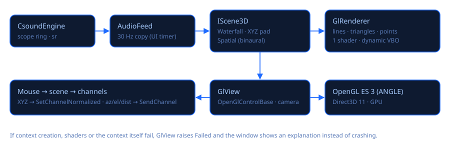

# Vistas 3D (OpenGL)

Se abren con **3D** en la barra (Ctrl+3). La ventana es independiente: llévala a un segundo
monitor o proyector y presiona **F11** para pantalla completa (F11 o Esc para volver).

## Escenas

| Escena | Qué muestra o hace | Controles |
|---|---|---|
| **Espectrograma en cascada** | El espectro de la salida como un terreno: la fila de adelante es ahora y las antiguas se alejan y se desvanecen. Ejes con números: **frecuencia en Hz** (50 … 20k, logarítmica), **nivel en dBFS** (−90 … 0) y **tiempo** (ahora, −1 s, −2 s…). Selector **Colores**: Ámbar, Viridis, Magma, Inferno, Arcoíris (Turbo), Hielo, Escala de grises (se recuerda). Selectores de **resolución**: bandas (32–256), filas por segundo (10–60) y segundos de historia (2–20); la barra inferior muestra el análisis (FFT de 2048 muestras ≈ 43 ms, Hz por bin, filas/s reales) y los fps de la GPU. | Arrastra para girar, rueda para acercar, doble clic o «Vista inicial» para volver. |
| **Pad XYZ** | Una esfera dentro de un cubo controla **tres canales a la vez**. Se eligen en los selectores X/Y/Z; cada eje recorre el rango de su slider, en forma exponencial si el canal es exponencial. Las proyecciones al piso y las paredes, más una estela que se desvanece, muestran el gesto. | Arrastrar con el botón izquierdo: X (horizontal) e Y (vertical). Shift+arrastrar o rueda: Z. Botón derecho para girar, Ctrl+rueda para acercar. Los bordes del cubo muestran el nombre de cada canal con su mínimo y máximo, y la esfera sus valores actuales. «Controla: …» indica de qué documento son los sliders (el que se ve en la ventana principal); al abrir el pad o cambiar de documento la esfera se ubica donde están los sliders, sin moverlos. |
| **Panorámica espacial (binaural)** | La cabeza de quien escucha (la nariz = el frente) y una fuente de sonido que ubicas alrededor. Envía **az** (0° al frente, en sentido horario), **el** (−40°…90°) y **dist** a los canales con esos nombres. | Arrastra sobre el piso; Shift+arrastrar o rueda: altura. El piso muestra los grados (0° frente, 90° derecha…) y las distancias de los anillos. |

**Abrir plantilla binaural** abre `Binaural3D.csd`: una fuente de pulsos espacializada con
`hrtfmove2`. Usa los datos HRTF que vienen con Csound (`samples\hrtf-*-left/right.dat`, elegidos
según `sr`). La distancia baja el volumen y oscurece el sonido. Escúchalo con audífonos.

## Tecnología

* **`OpenGlControlBase` de Avalonia**: el contexto lo maneja Avalonia. En Windows es
  **OpenGL ES 3.0 sobre ANGLE / Direct3D 11**, la ruta más robusta con cualquier GPU y driver.
  Verificado en el PC de desarrollo: *OpenGL ES 3.0 · ANGLE (NVIDIA GeForce RTX 3090 Ti,
  Direct3D11)*.
* **Silk.NET.OpenGLES 2.23** carga las funciones GL desde el contexto de Avalonia
  (`GL.GetApi(GetProcAddress)`).
* **GlRenderer**: un shader (posición + color), un buffer de vértices dinámico, líneas,
  triángulos y puntos, con transparencia y prueba de profundidad. El encabezado del shader cambia
  entre GLSL ES 3.00 y GLSL 3.30 para GL de escritorio.
* **GlView**: cámara orbital (matrices de System.Numerics), redibujo continuo
  (`RequestNextFrameRendering`) y paso del mouse a la escena.
* **LabelOverlay**: los números y nombres de los ejes se dibujan con texto de Avalonia sobre la imagen de la GPU, proyectados con la misma cámara (`GlView.ViewProjection`), así quedan pegados a la geometría.
* **Error corregido (2026-11-03)**: la imagen GL se dibuja en un visual hijo de composición, así que el control no tenía contenido propio y la prueba de impacto de Avalonia lo atravesaba: el mouse no llegaba (no se podía girar ni arrastrar). `GlView` implementa ahora `ICustomHitTest`.
* **AudioFeed**: un timer de la interfaz copia 30 veces por segundo el buffer de salida del
  motor. El código de GPU nunca toca el hilo de audio.
* **Robustez**: si fallan la creación del contexto, la compilación de shaders o el render, o si
  se pierde el contexto, se avisa `Failed`. La ventana explica el problema y las vistas 2D siguen
  funcionando. Al cerrar la ventana principal también se cierra la 3D.

## Ideas para después

Vulkan mediante `GpuInterop` de Avalonia si OpenGL no alcanzara; osciloscopio estéreo 3D (espiral
de fase L/R); superficie 3D de wavetables; visualizador para tocar en vivo guiado por canales y
bandas del espectro; grafo 3D del instrumento.

Código: `src/CsoundVisual/Visual3D/` (`GlView`, `GlRenderer`, `Scenes`) y
`Views/Visual3DWindow.cs`.
